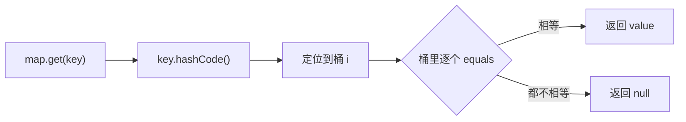

# equals 与 hashCode

> 频率：★★☆ · 参考：[JavaGuide](https://javaguide.cn/java/basis/java-basic-questions-02.html)

## 一句话答案

`==` 比较基本类型的值、引用类型的地址；`equals` 默认也是比地址，重写后比内容。重写 `equals` 必须同时重写 `hashCode`：两个对象 equals 相等，hashCode 必须相等，否则放进 HashMap / HashSet 会被当成两个不同的 key。

## 展开（1–2 分钟能讲完）

**两者的约定**（`Object` 的文档里写明的）：

- equals 相等 → hashCode 一定相等；
- hashCode 相等 → equals 不一定相等（哈希冲突）；
- hashCode 不等 → equals 一定不等。

**为什么只重写 equals 会出问题**：HashMap 查找时先用 hashCode 定位桶，再在桶里用 equals 比较。两个内容相同的对象如果 hashCode 不同，会落到不同的桶，`map.get(new User("a"))` 就找不到之前放进去的 `new User("a")`，HashSet 里也会出现「重复」元素。

**写 equals 的步骤**：

1. `this == o` 直接返回 true；
2. `o == null` 或类型不同返回 false（用 `getClass() != o.getClass()` 还是 `instanceof`：前者对子类更严格，后者允许子类和父类相等，但可能破坏对称性）；
3. 逐个比较关键字段，引用类型用 `Objects.equals`。

hashCode 用同样的字段算：`Objects.hash(name, age)`。record 会自动生成这两个方法。

## 图解

## 追问链

- **== 和 equals 的区别？** `==` 对基本类型比值，对引用比地址。`equals` 是方法，`Object` 里的实现就是 `==`，`String`、`Integer` 等重写成比内容。注意 `Integer a = 127, b = 127; a == b` 为 true，128 就是 false：-128~127 有缓存（`IntegerCache`），超出范围每次装箱都是新对象。包装类比较一律用 equals。
- **hashCode 冲突了怎么办？** 冲突是正常的（int 只有 2³² 个值），HashMap 用链表 + 红黑树解决：同一个桶里的元素用 equals 区分。好的 hashCode 应该让冲突尽量少、分布均匀。
- **为什么 String 的 hashCode 用 31？** `s[0]*31^(n-1) + … + s[n-1]`。31 是奇质数，乘法溢出时不会像偶数那样丢掉低位信息；而且 `31 * i == (i << 5) - i`，JIT 可以优化成移位和减法。实验上英文单词用 31 冲突很少。String 还会把算好的 hash 缓存在字段里，因为不可变。
- **可变对象当 HashMap 的 key 会怎样？** 放进去以后改了参与 hashCode 的字段，hash 变了，再也找不到这个 key，也删不掉，造成内存泄漏。所以 key 要用不可变对象。

## 我的项目里

TODO：项目里有没有自定义对象当 Map 的 key 或者放进 Set？equals/hashCode 是手写、Lombok 还是 record？
