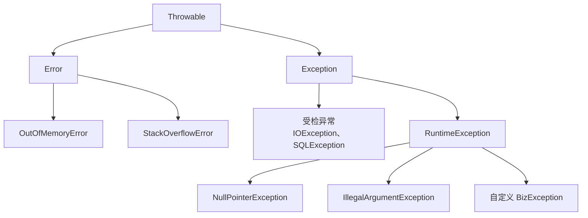

# 异常体系

> 频率：★☆☆ · 近两年出现在：阿里（异常体系、线程安全的集合） · 参考：[JavaGuide](https://javaguide.cn/java/basis/java-basic-questions-03.html)

## 一句话答案

`Throwable` 下分 `Error`（虚拟机级别的严重问题，如 OOM、StackOverflowError，程序不应该捕获）和 `Exception`。Exception 又分**受检异常**（编译器强制处理，如 IOException）和**非受检异常**（`RuntimeException` 及子类，如 NPE、数组越界，通常是代码 bug）。

## 展开（1–2 分钟能讲完）

**处理原则**：

- 能处理才捕获，处理不了就往上抛，不要 `catch` 了什么都不做（吞异常）。
- 捕获具体的异常，不要一律 `catch (Exception e)`。
- 包装再抛出时带上原异常：`throw new BizException("下单失败", e)`，否则丢了原始堆栈。
- 业务代码里一般定义一个 `BizException extends RuntimeException`，带错误码，在 Spring 里用 `@RestControllerAdvice` + `@ExceptionHandler` 统一转成响应。

**受检异常的争议**：强制调用方处理，看起来安全，但会让方法签名层层传染，而且 lambda 里不好用。Spring 把 JDBC 的 `SQLException` 都包装成非受检的 `DataAccessException`。

**异常的开销**：创建异常时要 `fillInStackTrace`，遍历整个调用栈，比较贵。所以不要用异常做正常的流程控制。高频场景可以复用异常对象，或者重写 `fillInStackTrace` 不收集堆栈。

## 图解

## 追问链

- **try-with-resources 原理？** 资源要实现 `AutoCloseable`。编译器把它展开成 try-finally，在 finally 里调用 `close()`。如果 try 块和 close 都抛异常，close 的异常会通过 `addSuppressed` 挂在主异常上，不会把主异常覆盖掉（手写 finally 很容易犯这个错）。多个资源按声明的**相反顺序**关闭。
- **finally 里 return 会怎样？** finally 的 return 会覆盖 try 里的 return，**还会吞掉 try 里抛出的异常**。所以 finally 里不要写 return。另外 try 里 `return x` 时，返回值已经先存起来了，finally 里修改 x（基本类型）不影响返回值；如果 x 是对象，修改它的字段会影响。
- **finally 一定会执行吗？** 不一定：`System.exit()`、JVM 崩溃、线程被杀、守护线程在 JVM 退出时，finally 都不会执行。
- **线程池里任务抛异常会怎样？** `execute` 提交的任务抛异常，会打印堆栈，执行它的工作线程会被移除，线程池再新建一个线程补上。`submit` 提交的任务，异常被包在 `Future` 里，不调用 `future.get()` 就**看不到**（静默丢失）。处理方法：任务内部 try-catch；`get()` 时处理 `ExecutionException`；`execute` 时可以设置 `UncaughtExceptionHandler`；或者重写 `afterExecute`。
- **NoClassDefFoundError 和 ClassNotFoundException 的区别？** 后者是受检异常，`Class.forName` 等动态加载找不到类；前者是 Error，编译时类在，运行时找不到（比如 jar 包冲突、静态初始化失败）。

## 我的项目里

TODO：项目里异常是怎么统一处理的？错误码怎么设计的？有没有遇到过异常被吞、排查很久的情况？
