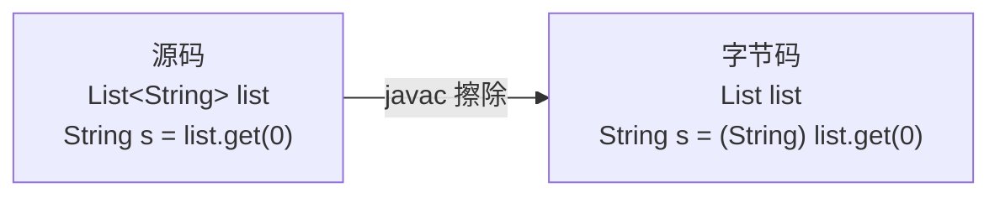

# 泛型与类型擦除

> 频率：★☆☆ · 参考：[JavaGuide](https://javaguide.cn/java/basis/generics-and-wildcards.html)

## 一句话答案

泛型让编译器在编译期检查类型，省去手动强转。Java 的泛型是**类型擦除**实现的：编译后泛型信息被擦掉，`List<String>` 和 `List<Integer>` 运行时都是 `List`，类型参数被替换成上界（默认 `Object`），编译器在取值处自动插入强转。

## 展开（1–2 分钟能讲完）

**为什么用擦除**：JDK 5 才加入泛型，擦除可以兼容之前没有泛型的代码和字节码（老的 `List` 和新的 `List<String>` 是同一个类）。

**擦除带来的限制**：

- 不能 `new T()`、不能 `new T[]`：运行时不知道 T 是什么。
- 不能 `instanceof List<String>`，只能 `instanceof List<?>`。
- 不能用基本类型做类型参数（`List<int>`），只能用包装类，有装箱开销。
- 静态字段不能用类的类型参数（所有实例共享同一个类）。
- `List<String>` 和 `List<Integer>` 的重载方法签名擦除后相同，编译报错。

**运行时能拿到的泛型信息**：擦除的是**对象**上的类型参数，但类、字段、方法签名上声明的泛型会保留在 class 文件的 `Signature` 属性里。所以 `class UserList extends ArrayList<User>` 可以通过 `getGenericSuperclass()` 拿到 `User`。Jackson 的 `TypeReference<List<User>>(){}`、Gson 的 `TypeToken` 都是用匿名子类来保留类型。

## 图解

## 追问链

- **? extends 和 ? super（PECS）？** Producer Extends, Consumer Super。`List<? extends Number>` 是生产者：可以**读**出 Number，但不能写（不知道具体是 `List<Integer>` 还是 `List<Double>`）。`List<? super Integer>` 是消费者：可以**写**入 Integer，读出来只能当 Object。例子是 `Collections.copy(List<? super T> dest, List<? extends T> src)`。
- **为什么不能创建泛型数组？** 数组是**协变**的且运行时检查元素类型（`Object[] a = new String[1]; a[0] = 1;` 会抛 `ArrayStoreException`），而泛型擦除后无法检查。如果允许 `new List<String>[10]`，就可以通过 `Object[]` 塞进一个 `List<Integer>`，取出来时才在莫名其妙的地方抛 ClassCastException。
- **擦除后怎么保证类型安全？** 一是编译期检查；二是编译器在取值的地方插入强转；三是**桥方法**：`class MyComparator implements Comparator<String>` 实现了 `compare(String, String)`，擦除后接口方法是 `compare(Object, Object)`，编译器生成一个桥方法 `compare(Object, Object)` 去调用 `compare(String, String)`，保证多态正常工作。
- **`List<Object>` 能接收 `List<String>` 吗？** 不能，泛型是**不变**的。要接收任意类型用 `List<?>`。

## 我的项目里

TODO：项目里有没有写过泛型类或泛型方法（比如统一的 `Result<T>` 响应体、通用的分页结果）？
