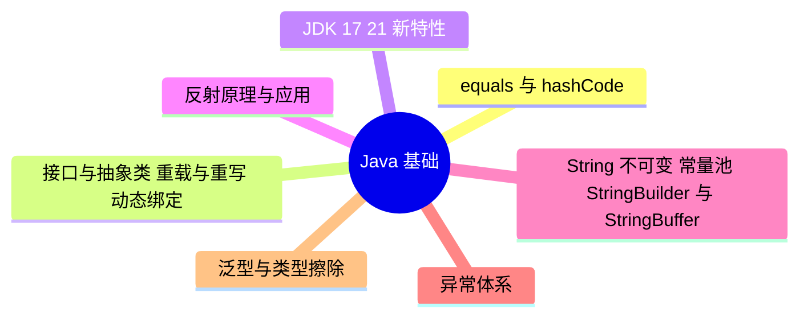

# Java 基础

> 进度：0 / 7 条已写完。本页由 `tools/gen_index.py` 生成，改条目后重新运行即可。

## 知识地图

## 条目（按频率排序）

频率按 2025–2026 年后端面经里出现的次数估计：★★★ 几乎每场都可能问，★★ 经常问，★ 偶尔问。

| 知识点 | 频率 | 状态 | 一句话答案 |
|---|---|---|---|
| [equals 与 hashCode](./equals-hashcode) | ★★☆ | · | 两个对象 equals 相等，hashCode 必须相等；重写 equals 不重写 hashCode，放进 HashMap/HashSet 时会被当成两个不同的 key。 |
| [接口与抽象类、重载与重写、动态绑定](./interface-abstract) | ★★☆ | · | 抽象类表示「是什么」，可以有状态和构造器，只能单继承；接口表示「能做什么」，可以多实现，Java 8 起可以有 default 方法。重写在运行时按实际类型动态绑定，重载在编译期按参数类型决定。 |
| [JDK 17 / 21 新特性](./jdk-new-features) | ★★☆ | · | 17 和 21 都是长期支持版本：record、sealed 类、switch 模式匹配、文本块；21 最重要的是虚拟线程和分代 ZGC。 |
| [反射原理与应用](./reflection) | ★★☆ | · | 通过 Class 对象在运行时拿到类的字段、方法、构造器并调用；Spring 的 IoC、动态代理、注解处理都靠它。代价是性能开销和破坏封装。 |
| [String 不可变、常量池、StringBuilder 与 StringBuffer](./string) | ★★☆ | · | String 底层数组是 final 且不对外暴露，所以不可变，可以安全地放进常量池共享；拼接多时用 StringBuilder（非线程安全、快），多线程共享时用 StringBuffer（方法加了 synchronized）。 |
| [异常体系](./exception) | ★☆☆ | · | Throwable 分为 Error（虚拟机级错误，不该捕获）和 Exception；Exception 又分受检异常（编译期必须处理）和运行时异常。 |
| [泛型与类型擦除](./generics) | ★☆☆ | · | Java 泛型在编译期检查类型，编译后擦除为原始类型（上界或 Object），所以运行时拿不到泛型参数，也不能 new T()。 |
