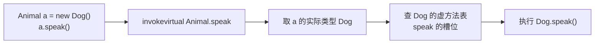

# 接口与抽象类、重载与重写、动态绑定

> 频率：★★☆ · 参考：[JavaGuide](https://javaguide.cn/java/basis/java-basic-questions-02.html)

## 一句话答案

接口表示「能做什么」（能力），一个类可以实现多个接口；抽象类表示「是什么」（模板），只能单继承，可以有构造方法和成员变量。重载是同一个类里方法名相同、参数不同，**编译期**决定调哪个；重写是子类覆盖父类方法，**运行期**根据对象的实际类型决定（动态绑定）。

## 展开（1–2 分钟能讲完）

**接口和抽象类的对比**：

| | 接口 | 抽象类 |
|---|---|---|
| 继承 | 一个类可实现多个 | 只能继承一个 |
| 成员变量 | 只能是 `public static final` 常量 | 任意 |
| 方法 | 抽象方法、`default` 方法（JDK 8）、`static` 方法、`private` 方法（JDK 9） | 任意 |
| 构造方法 | 没有 | 有（给子类调用） |
| 设计意图 | 定义规范、能力（`Comparable`、`Runnable`） | 复用代码、模板方法（`AbstractList`） |

常见做法是两者结合：接口定义规范，抽象类实现通用部分，具体类只实现差异（`List` → `AbstractList` → `ArrayList`）。

**重载和重写**：

| | 重载 Overload | 重写 Override |
|---|---|---|
| 位置 | 同一个类（或父子类） | 子类覆盖父类 |
| 参数 | 必须不同 | 必须相同 |
| 返回值 | 无要求 | 相同或是子类型（协变返回） |
| 访问修饰符 | 无要求 | 不能更严格 |
| 异常 | 无要求 | 不能抛出更宽的受检异常 |
| 绑定 | 编译期，按**声明类型**选 | 运行期，按**实际类型**选 |

## 图解

## 追问链

- **动态绑定怎么实现的（虚方法表）？** 每个类在方法区里有一张**虚方法表**（vtable），按顺序存放所有可被重写的方法的入口地址。子类的表先复制父类的，重写的方法替换成自己的地址，新方法追加在后面。所以同一个方法在父类和子类的表里**下标相同**。调用 `invokevirtual` 时，根据对象实际类型找到它的表，按下标取地址就行，不用逐个查找。接口方法用 `invokeinterface` 和接口方法表（itable），要多一步查找，略慢。JIT 还会做内联缓存：如果某个调用点一直是同一个类型，就直接内联。
- **final、static 方法能重写吗？** final 不能重写。static 方法属于类，子类写一个同名的静态方法叫**隐藏**，不是重写：用父类引用调用时执行的是父类的版本（编译期按声明类型绑定）。private 方法子类看不见，也谈不上重写。这三种方法以及构造方法都是静态绑定（`invokestatic` / `invokespecial`）。
- **什么时候用接口，什么时候用抽象类？** 不相关的类需要同一种能力（可比较、可序列化）用接口；一组相关的类有共同的代码和状态，用抽象类。JDK 8 有了 default 方法以后，接口也能带默认实现，所以优先用接口，需要共享状态（成员变量）或构造逻辑时再用抽象类。
- **两个接口有同名的 default 方法怎么办？** 实现类必须重写这个方法，可以用 `A.super.method()` 指定调用哪一个。

## 我的项目里

TODO：项目里有没有「接口 + 抽象类 + 多个实现」的结构（比如多种支付方式、多种消息渠道）？
