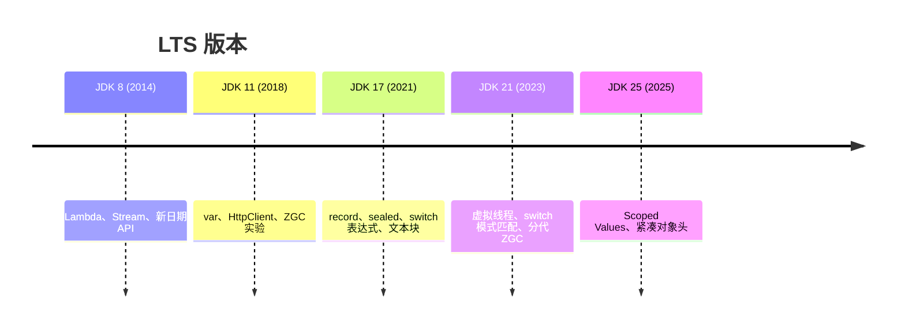

# JDK 17 / 21 新特性

> 频率：★★☆ · 近两年出现在：字节（虚拟线程、JDK 新特性） · 参考：[JavaGuide](https://javaguide.cn/java/new-features/java21.html)

## 一句话答案

JDK 17 和 21 都是 LTS。17 的重点：record、sealed 类、`switch` 表达式、文本块、`instanceof` 模式匹配、ZGC/Shenandoah 转正。21 的重点：**虚拟线程**正式发布、`switch` 模式匹配和 record 模式、有序集合 `SequencedCollection`、分代 ZGC。

## 展开（1–2 分钟能讲完）

**从 8 到 17 常用的变化**（按实际写代码用得多少排）：

| 特性 | 版本 | 例子 |
|---|---|---|
| `var` 局部变量类型推断 | 10 | `var map = new HashMap<String, List<User>>();` |
| `switch` 表达式 | 14 | `int n = switch (day) { case MON, TUE -> 1; default -> 0; };` |
| 文本块 | 15 | `"""` 包起来的多行字符串，写 SQL、JSON 很方便 |
| `instanceof` 模式匹配 | 16 | `if (o instanceof String s) { s.length(); }` |
| record | 16 | `record Point(int x, int y) {}` |
| sealed 类 | 17 | `sealed interface Shape permits Circle, Square {}` |
| 更好的 NPE 信息 | 14 | 直接告诉你 `a.b.c` 里哪个是 null |

**JDK 21**：

- **虚拟线程**（详见并发模块）：`Thread.ofVirtual().start(...)`、`Executors.newVirtualThreadPerTaskExecutor()`，阻塞 IO 时自动让出载体线程，适合大量 IO 密集的请求。
- **switch 模式匹配 + record 模式**：配合 sealed 接口，可以穷举所有子类型，编译器检查有没有漏。
  `return switch (shape) { case Circle(double r) -> Math.PI * r * r; case Square(double a) -> a * a; };`
- **SequencedCollection**：`List`、`Deque`、`LinkedHashSet` 等统一了 `getFirst()`、`getLast()`、`reversed()`。
- **分代 ZGC**：`-XX:+UseZGC -XX:+ZGenerational`（JDK 23 起默认分代）。

## 图解

## 追问链

- **虚拟线程**：见[虚拟线程](../03-concurrency/virtual-threads)。
- **record 和 Lombok @Data 的区别？** record 是语言特性：字段都是 `final`、不能继承别的类（隐式继承 `Record`）、自动生成构造方法、访问器（`x()` 而不是 `getX()`）、equals/hashCode/toString，**不可变**。`@Data` 是编译期注解处理器生成代码，有 setter、可变、可以继承。record 适合 DTO、值对象、方法返回多个值；JPA 实体需要无参构造和可变字段，不能用 record。另外老版本 Jackson / MyBatis 对 record 的支持要确认（Jackson 2.12+ 支持）。
- **Spring Boot 3 为什么要求 JDK 17？** Spring 6 / Boot 3 要用新语言特性和 API；更关键的是从 Java EE 迁到 **Jakarta EE 9+**（包名 `javax.*` → `jakarta.*`），一起把基线提高了；也为了支持 GraalVM 原生镜像（AOT）。升级时最大的工作量是改包名和升级依赖。
- **sealed 类有什么用？** 限制谁能继承，让类型层次封闭。配合 switch 模式匹配，编译器能检查是否覆盖了所有子类，新增子类时所有没处理的 switch 都会报错。

## 我的项目里

TODO：项目用的 JDK 版本是多少？用了哪些新特性（record、文本块、虚拟线程）？
