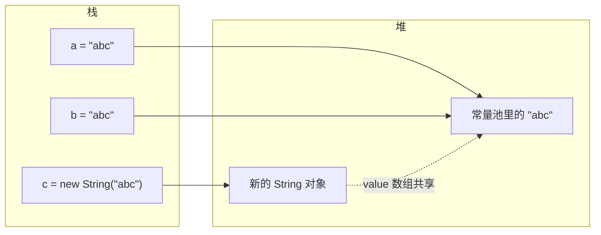

# String 不可变、常量池、StringBuilder 与 StringBuffer

> 频率：★★☆ · 参考：[JavaGuide](https://javaguide.cn/java/basis/java-basic-questions-02.html)

## 一句话答案

String 不可变：类是 `final`，内部的 `byte[] value`（JDK 9 起从 char[] 改成 byte[]）是 `private final` 且不对外暴露修改方法。不可变带来线程安全、可以缓存 hashCode、可以放进字符串常量池复用。频繁拼接用 `StringBuilder`（非线程安全，快）；多线程共享时用 `StringBuffer`（方法加了 synchronized），实际很少用。

## 展开（1–2 分钟能讲完）

**为什么设计成不可变**：

- **安全**：String 常用作类名、文件路径、URL、数据库连接参数，如果可变，校验之后被改掉就有安全问题。
- **常量池复用**：多个引用指向同一个 `"abc"`，前提是没人能改它。
- **hashCode 缓存**：作为 HashMap 的 key 不用每次重算。
- **线程安全**：不需要同步。

**字符串常量池**：JDK 7 起从永久代移到**堆**里。字面量 `"abc"` 在类加载解析（实际是第一次执行 `ldc` 指令）时放进池；`new String("abc")` 一定在堆上新建一个对象。

**JDK 9 紧凑字符串**：如果字符全是 Latin-1，每个字符只用 1 个字节，否则用 UTF-16 的 2 个字节，由 `coder` 字段区分。大部分字符串能省一半内存。

## 图解

`a == b` 为 true，`a == c` 为 false，`a == c.intern()` 为 true。

## 追问链

- **`new String("a")` 创建了几个对象？** 如果常量池里还没有 `"a"`，是 2 个：常量池里一个，堆上 new 一个；如果已经有了，就是 1 个。（两个对象底层可以共享同一个 byte 数组。）
- **intern() 的作用？** 如果常量池里已经有内容相同的字符串，返回池里那个的引用；没有就把**当前对象的引用**放进池（JDK 7 起，之前是复制一份到永久代），再返回它。可以用来对大量重复的字符串去重，但池是一个固定大小的哈希表（`-XX:StringTableSize`），放太多会变慢。
- **+ 拼接在编译期和运行期怎么处理？** 全是字面量或 `final` 常量时，编译期直接折叠成一个常量（`"a" + "b"` 就是 `"ab"`，所以 `"ab" == "a" + "b"` 为 true）。有变量参与时，JDK 8 编译成 `new StringBuilder().append(...).toString()`；JDK 9 起用 `invokedynamic` 调用 `StringConcatFactory`，运行时生成最优的拼接策略。**循环里**用 `+=` 每次都会新建 StringBuilder，所以循环里要手动用一个 StringBuilder。
- **String 的长度有限制吗？** 运行时最大约 `Integer.MAX_VALUE`；编译期字面量在常量池里用 2 个字节存长度，最长 65535 字节（实际 65534）。
- **StringBuilder 的扩容？** 默认容量 16，不够时扩成 `旧容量 * 2 + 2`，复制数组。能预估长度时在构造时指定容量。

## 我的项目里

TODO：项目里有没有大量字符串拼接的地方（比如拼 SQL、拼日志、拼 Prompt）？怎么写的？
