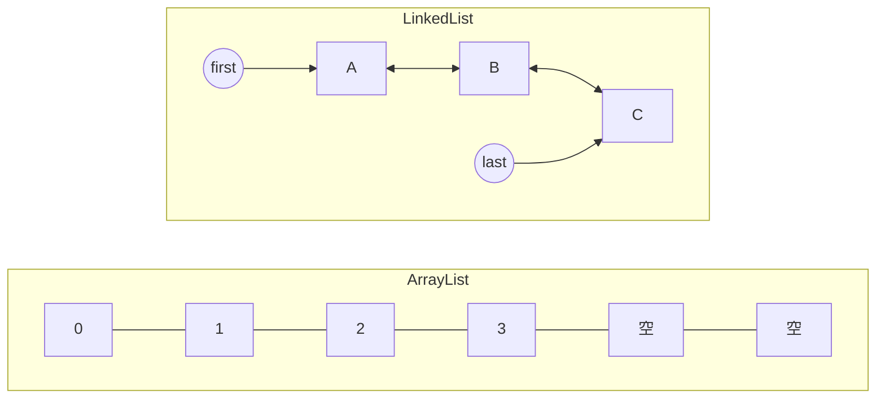

# ArrayList 与 LinkedList

> 频率：★★ · 近两年出现在：招银云创（ArrayList 与 LinkedList 选型）、优必选笔试（ArrayList 底层）、美团（容器体系）等 · 参考：[JavaGuide](https://javaguide.cn/java/collection/arraylist-source-code.html)

## 一句话答案

ArrayList 是动态数组，随机访问 O(1)，扩容为 1.5 倍；LinkedList 是双向链表，插入删除本身 O(1)，但要先花 O(n) 找到位置。实际开发几乎总用 ArrayList，因为内存连续、对缓存友好。

## 展开（1–2 分钟能讲完）

| | ArrayList | LinkedList |
|---|---|---|
| 底层 | `Object[]` 数组 | 双向链表 |
| 按下标访问 | O(1) | O(n)，从离得近的一头开始找 |
| 尾部添加 | 均摊 O(1) | O(1) |
| 中间插入删除 | O(n)，要移动后面的元素（`System.arraycopy` 很快） | 找位置 O(n) + 修改指针 O(1) |
| 内存 | 连续，可能有预留空间 | 每个元素多两个指针，分散在堆上 |
| 实现的接口 | `List`、`RandomAccess` | `List`、`Deque`（可以当队列和栈用） |

**为什么 LinkedList 在实践中很少更快？** 链表结点分散在内存里，遍历时 CPU 缓存几乎全部失效；而数组移动元素是一整块内存拷贝，非常快。所以即使是中间插入，ArrayList 往往也不慢。连 LinkedList 的作者都说自己从来不用它。

**ArrayList 的扩容**：

- 无参构造时是一个空数组，第一次 add 时扩到 10。
- 之后每次满了就扩到 `old + (old >> 1)`，也就是 1.5 倍，再用 `Arrays.copyOf` 把旧数组复制过去。
- 知道大概数量时，用 `new ArrayList<>(n)` 指定容量，避免多次扩容。

## 图解

## 追问链

- **fail-fast 是什么？** 集合有一个 `modCount` 记录结构修改次数。迭代器创建时记下它，每次 `next()` 检查，如果在迭代过程中集合被别的方式修改了，就抛 `ConcurrentModificationException`。它只是尽力检测，不能当作线程安全的保证。
- **怎么在遍历时安全删除？**
  - 用 `Iterator.remove()`。
  - 用 `list.removeIf(x -> ...)`。
  - 倒序按下标遍历删除。
  - 不要在 for-each 里直接调 `list.remove()`。
- **ArrayList 线程安全吗？** 不安全，并发 add 可能丢数据或数组越界。多线程用 `CopyOnWriteArrayList`（读多写少）或 `Collections.synchronizedList`。
- **`Arrays.asList` 返回的列表能 add 吗？** 不能，它是固定长度的，add 会抛 `UnsupportedOperationException`；而且它和原数组共享数据。`List.of` 返回的是完全不可变的列表。
- **队列和栈用什么？** 用 `ArrayDeque`，比 LinkedList 和 `Stack` 都快。

## 我的项目里

TODO：项目里有没有在循环中删除元素的地方？是怎么写的？
