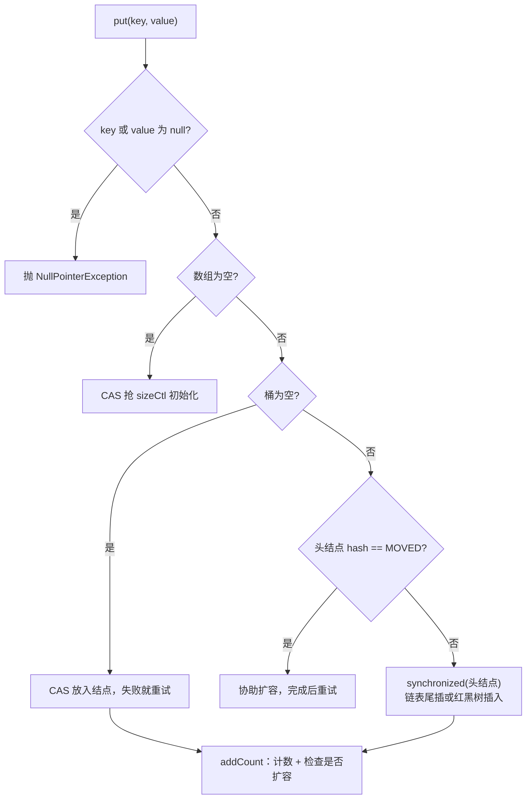

# ConcurrentHashMap：1.7 分段锁与 1.8 CAS + synchronized

> 频率：★★★ · 近两年出现在：腾讯、携程、去哪儿、小红书（扩容）、SHEIN、中兴、阿里（与 CAS ABA）、美团（与 HashMap 的差异）等 · 参考：[JavaGuide](https://javaguide.cn/java/collection/concurrent-hash-map-source-code.html)

## 一句话答案

1.7 用 Segment 分段锁；1.8 去掉了分段，空桶用 CAS 插入，非空桶只锁桶的头结点（`synchronized`），扩容时多个线程协助迁移，读操作不加锁。

## 展开（1–2 分钟能讲完）

**JDK 7**：整个 Map 分成若干个 Segment（默认 16 个），每个 Segment 继承 `ReentrantLock`，内部是一个小 HashMap。写操作只锁对应的 Segment，最多 16 个线程同时写。缺点是并发度在创建时就固定了。

**JDK 8**：结构和 HashMap 一样（数组 + 链表 + 红黑树），锁粒度降到**每个桶**：

| 操作 | 怎么保证线程安全 |
|---|---|
| 初始化数组 | CAS 修改 `sizeCtl`，抢到的线程负责初始化，其他线程 `yield` 等待 |
| 往空桶放结点 | CAS，不加锁 |
| 往非空桶放结点 | `synchronized` 锁住桶的头结点 |
| 桶正在迁移（头结点的 hash 是 MOVED = −1） | 当前线程先去帮忙扩容 |
| get | 不加锁，`Node` 的 `val` 和 `next` 都是 volatile，数组元素用 volatile 方式读 |
| 计数 | `baseCount` + `CounterCell` 数组，和 LongAdder 的思路一样，减少竞争 |

**为什么 JDK 8 用 synchronized 而不是 ReentrantLock？** 锁的粒度已经是一个桶，竞争很小；synchronized 有锁升级优化，低竞争时开销小；而且不用每个结点都带一个锁对象，省内存。

## 图解

**多线程协助扩容**：新数组是原来的 2 倍。每个线程通过 CAS 领取一段桶（至少 16 个），从后往前迁移；迁移完的桶放一个 `ForwardingNode` 占位（hash = MOVED），它指向新数组。

- 读线程碰到 `ForwardingNode`，就到新数组里查。
- 写线程碰到它，就先帮忙迁移。

## 追问链

- **size() 怎么统计？** 把 `baseCount` 和所有 `CounterCell` 的值加起来。没有竞争时直接 CAS 改 `baseCount`；有竞争时随机选一个 Cell 累加。结果是弱一致的，统计时可能有并发修改。大量元素时用 `mappingCount()`（返回 long）。
- **为什么 key 和 value 都不能为 null？** 有歧义：`get` 返回 null 时，分不清是「不存在」还是「值就是 null」。HashMap 可以再调一次 `containsKey` 区分，但并发环境下两次调用之间可能被修改，没法区分。
- **get 为什么不用加锁？** 结点的 `val`、`next` 是 volatile，数组元素通过 `Unsafe` 以 volatile 语义读取，保证读到最新写入的值；扩容中有 ForwardingNode 转发。
- **是强一致的吗？** 单个操作是线程安全的，但迭代器和 `size()` 是弱一致的，不会抛 `ConcurrentModificationException`，但可能看不到最新的修改。
- **复合操作怎么保证原子？** 用 `putIfAbsent`、`computeIfAbsent`、`merge`。例如计数：`map.merge(word, 1, Integer::sum)`。注意 `computeIfAbsent` 里的函数要短，执行期间会持有桶的锁。
- **和 Hashtable 比？** Hashtable 整张表一把锁，读也加锁；ConcurrentHashMap 锁到桶，读不加锁。

## 我的项目里

TODO：项目里用 ConcurrentHashMap 存了什么？有没有用 computeIfAbsent？
