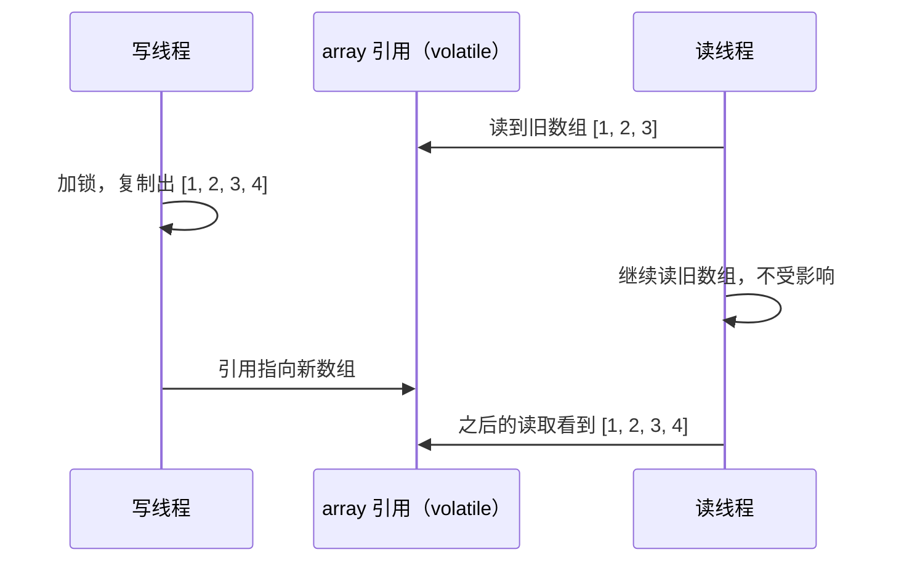

# CopyOnWriteArrayList 与写时复制

> 频率：★ · 近两年出现在：帆软（CopyOnWriteArrayList）、美团（Copy-On-Write 场景、COW 优化）、阿里（线程安全的集合）等 · 参考：[JavaGuide](https://javaguide.cn/java/collection/copyonwritearraylist-source-code.html)

## 一句话答案

写操作加锁并复制一份新数组，改完再替换引用；读操作不加锁，直接读当前数组。适合读多写少，代价是写入慢、占内存、读到的可能是旧数据。

## 展开（1–2 分钟能讲完）

```java
public boolean add(E e) {
    synchronized (lock) {                 // JDK 8 用的是 ReentrantLock
        Object[] es = getArray();
        int len = es.length;
        es = Arrays.copyOf(es, len + 1);  // 复制一份新数组
        es[len] = e;
        setArray(es);                     // volatile 写，替换引用
        return true;
    }
}

public E get(int index) {
    return elementAt(getArray(), index);  // 不加锁
}
```

- 数组引用是 `volatile` 的，写完替换引用后，其他线程马上能看到新数组。
- 读操作永远不会被写操作阻塞。
- 迭代器拿到的是创建时那个数组的**快照**，遍历时不会抛 `ConcurrentModificationException`，但也看不到之后的修改；迭代器不支持 `remove`。

**适用场景**：读远多于写，而且数据量不大。比如监听器列表、配置项、黑白名单。

**不适合**：写频繁或者元素很多。每次写都复制整个数组，又慢又会产生大量垃圾，引起频繁 GC。

## 图解



## 追问链

- **和 `Collections.synchronizedList` 比？** 后者读写都加同一把锁，写多读少时更合适；CopyOnWrite 读完全不加锁，读多写少时更快。
- **写时复制还用在哪里？**
  - Redis 生成 RDB 时 fork 子进程，父子进程共享内存页，谁要修改某页才复制，见[持久化](../07-redis/persistence)。
  - Linux 的 fork。
  - 很多配置中心的本地缓存：更新时构建新的不可变对象，整体替换引用。
- **为什么读到的可能是旧数据？** 读线程拿到引用后，写线程替换了引用，读线程手里的还是旧数组。这是弱一致性，业务要能接受。
- **有没有 CopyOnWriteSet？** 有 `CopyOnWriteArraySet`，内部就是一个 CopyOnWriteArrayList，add 时用 `addIfAbsent` 去重。

## 我的项目里

TODO：项目里有没有读多写少的共享数据？是怎么保证线程安全的？
