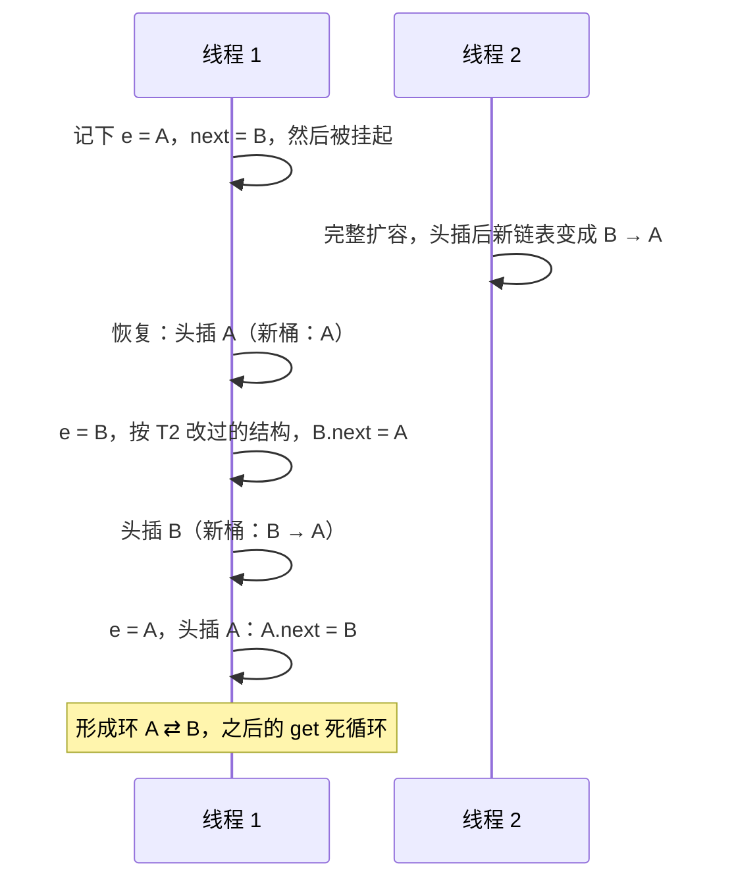

# HashMap 线程不安全：头插与尾插

> 频率：★★ · 近两年出现在：美团（HashMap 线程安全、头插与尾插，两条面经）、字节、腾讯（带锁 Map）、小红书（无保护的共享变量）等 · 参考：[JavaGuide](https://javaguide.cn/java/collection/java-collection-questions-02.html)

## 一句话答案

JDK 7 用头插法，并发扩容会把链表变成环导致死循环；JDK 8 改成尾插法，不会再死循环，但并发 put 仍会丢数据、size 不准，所以多线程要用 ConcurrentHashMap。

## 展开（1–2 分钟能讲完）

**JDK 7 的死循环**：扩容时把旧链表的结点逐个用头插法放进新数组，这会让同一个桶里的结点顺序反过来。两个线程同时扩容时，一个线程按旧顺序读、另一个线程已经把顺序反转了，两个结点就可能互相指向，形成环。之后 `get` 到这个桶就会无限循环，CPU 打满。

**JDK 8 仍然存在的问题：**

| 问题 | 过程 |
|---|---|
| 数据丢失 | 两个线程同时往同一个空桶 put，都判断桶为空，后写的覆盖先写的 |
| size 不准 | `++size` 不是原子操作 |
| 扩容期间读不到 | 一个线程正在搬数据，另一个线程可能在旧数组或新数组里都找不到 |

## 图解

JDK 7 并发扩容形成环（桶里原来是 A → B，扩容后仍在同一个桶）：

## 追问链

- **多线程下用什么？**
  - `ConcurrentHashMap`：首选，锁粒度到桶，见 [ConcurrentHashMap](./concurrenthashmap)。
  - `Hashtable`：每个方法都加 `synchronized`，整张表一把锁，基本淘汰了。
  - `Collections.synchronizedMap(map)`：包一层，所有方法用同一个锁对象，和 Hashtable 一样粗。
- **只有一个线程写、其他线程读，可以用 HashMap 吗？** 也不安全：读线程可能看到写了一半的结构（没有可见性保证）。要么用 ConcurrentHashMap，要么写完后整体替换成不可变 Map，再通过 volatile 引用发布。
- **线上遇到 CPU 100%，怎么确认是 HashMap 死循环？** 用 jstack 看占 CPU 的线程，栈停在 `HashMap.get` 或 `transfer` 上。排查步骤见[线上排查](../04-jvm/troubleshooting)。
- **ConcurrentHashMap 的复合操作就一定安全吗？** 不是。先 `get` 判断再 `put` 是两步，中间可能被插入。要用 `putIfAbsent`、`computeIfAbsent`、`merge` 这类原子方法。

## 我的项目里

TODO：项目里有没有在多线程环境下共享 Map？用的是什么？
