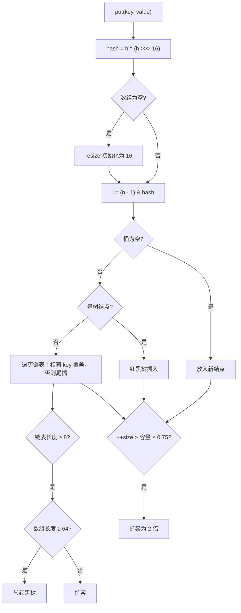

# HashMap 底层：put 流程、扩容、树化

> 频率：★★★ · 近两年出现在：字节（为什么容量是 2 的幂、红黑树）、腾讯（HashMap 红黑树）、美团、阿里、浩鲸（put 与扩容）、拼多多（手撕 HashMap）、用友（JDK 8 的升级）等，几乎每家都问 · 参考：[JavaGuide](https://javaguide.cn/java/collection/hashmap-source-code.html)

## 一句话答案

JDK 8 是数组 + 链表 + 红黑树。put 时用 `(h ^ h>>>16) & (n-1)` 定位桶，冲突时尾插进链表，链表长度达到 8 且数组长度至少 64 时转成红黑树；元素数超过容量 × 0.75 时扩容为 2 倍。

## 展开（1–2 分钟能讲完）

**几个关键参数**：默认容量 16（第一次 put 时才创建数组）、负载因子 0.75、树化阈值 8、退化阈值 6、最小树化容量 64。传入的初始容量会被向上取整到 2 的幂（`tableSizeFor`）。

**put 的流程：**

1. 计算哈希：`hash = h ^ (h >>> 16)`，把高 16 位混进低 16 位。key 为 null 时哈希是 0，放在 0 号桶。
2. 数组为空就先扩容（初始化）。
3. 定位桶：`i = (n - 1) & hash`。
4. 桶是空的：直接放新结点。
5. 桶不空：
   - 第一个结点的 key 相同 → 覆盖 value。
   - 是红黑树结点 → 按树的方式插入。
   - 是链表 → 遍历，找到相同 key 就覆盖；找不到就**尾插**。插入后链表长度达到 8 就调用 `treeifyBin`：数组长度小于 64 时只扩容，不树化。
6. `++size > threshold`（容量 × 0.75）就扩容。

## 图解

**扩容时元素怎么搬**：容量从 n 变成 2n，一个元素的新位置只取决于哈希值里新增的那一位，即 `hash & n` 是 0 还是 1：

- 是 0：留在原下标 i（低位链）。
- 是 1：搬到 i + n（高位链）。

所以每个桶拆成两条链整体搬走，**不需要重新计算哈希**，而且保持了原来的顺序。

## 追问链

- **为什么容量是 2 的幂？**
  - `(n - 1) & hash` 等价于 `hash % n`，但位运算更快。
  - n − 1 的二进制全是 1，哈希的每一位都参与运算，分布均匀。
  - 扩容时只需要看一位就能确定新位置。
- **为什么要异或高 16 位（扰动函数）？** 数组小的时候只用到哈希的低几位，高位完全不起作用。把高 16 位混进来，减少冲突。
- **为什么树化阈值是 8、退化是 6？** 按负载因子 0.75 计算，一个桶里的元素个数大致服从泊松分布，长度达到 8 的概率约千万分之六，正常情况几乎不会树化，树化主要是防御很差的哈希函数或哈希碰撞攻击。8 和 6 之间留出间隔，避免在临界值附近反复转换。
- **为什么数组小于 64 时先扩容不树化？** 数组小时冲突多是因为桶太少，扩容就能把链表拆短；红黑树结点占的内存约是普通结点的两倍。
- **为什么负载因子是 0.75？** 时间和空间的折中：太大冲突多、查找慢；太小浪费空间、频繁扩容。
- **key 用自定义对象要注意什么？** 必须同时重写 `equals` 和 `hashCode`，而且作为 key 的字段不能再修改，否则改完就找不到了，见 [equals 与 hashCode](../01-java-basic/equals-hashcode)。
- **JDK 7 和 8 的区别？** 7 是数组 + 链表、头插法，扩容时重新计算每个元素的位置；8 加了红黑树、改成尾插法、扩容时按高低位拆分。头插法在并发扩容时会形成环，见[线程不安全](./hashmap-thread-safety)。

## 我的项目里

TODO：项目里有没有预估容量来初始化 HashMap？有没有用对象做 key？
