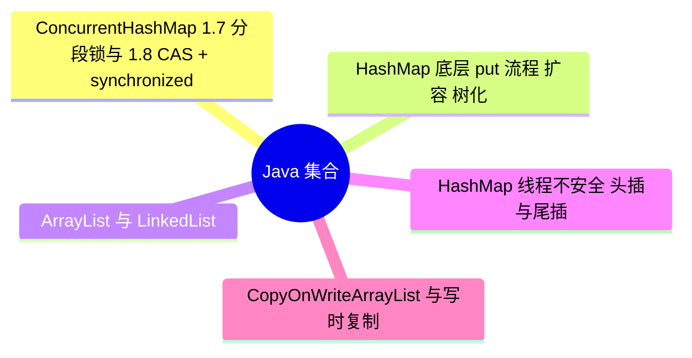

# Java 集合

> 进度：5 / 5 条已写完。本页由 `tools/gen_index.py` 生成，改条目后重新运行即可。

## 知识地图

## 条目（按频率排序）

频率按 2025–2026 年后端面经里出现的次数估计：★★★ 几乎每场都可能问，★★ 经常问，★ 偶尔问。

| 知识点 | 频率 | 状态 | 一句话答案 |
|---|---|---|---|
| [ConcurrentHashMap：1.7 分段锁与 1.8 CAS + synchronized](./concurrenthashmap) | ★★★ | ✅ | 1.7 用 Segment 分段锁；1.8 去掉了分段，空桶用 CAS 插入，非空桶只锁桶的头结点（synchronized），扩容时多个线程协助迁移，读操作不加锁。 |
| [HashMap 底层：put 流程、扩容、树化](./hashmap) | ★★★ | ✅ | JDK 8 是数组 + 链表 + 红黑树。put 时用 (h ^ h>>>16) & (n-1) 定位桶，冲突时尾插进链表，链表长度达到 8 且数组长度至少 64 时转成红黑树；元素数超过容量 × 0.75 时扩容为 2 倍。 |
| [ArrayList 与 LinkedList](./arraylist-linkedlist) | ★★☆ | ✅ | ArrayList 是动态数组，随机访问 O(1)，扩容为 1.5 倍；LinkedList 是双向链表，插入删除本身 O(1)，但要先花 O(n) 找到位置。实际开发几乎总用 ArrayList，因为内存连续、对缓存友好。 |
| [HashMap 线程不安全：头插与尾插](./hashmap-thread-safety) | ★★☆ | ✅ | JDK 7 用头插法，并发扩容会把链表变成环导致死循环；JDK 8 改成尾插法，不会再死循环，但并发 put 仍会丢数据、size 不准，所以多线程要用 ConcurrentHashMap。 |
| [CopyOnWriteArrayList 与写时复制](./copyonwrite) | ★☆☆ | ✅ | 写操作加锁并复制一份新数组，改完再替换引用；读操作不加锁，直接读当前数组。适合读多写少，代价是写入慢、占内存、读到的可能是旧数据。 |
