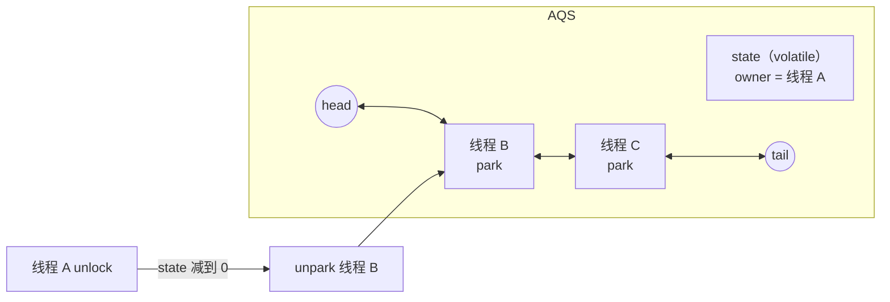

# AQS 与 ReentrantLock

> 频率：★★★ · 近两年出现在：字节（AQS、TAC 一面）、小红书（AQS 与锁、StampedLock）、阿里（AQS 与 ThreadLocal）、字节支付（AQS、ReentrantLock）、思格（JUC 工具类）等 · 参考：[JavaGuide](https://javaguide.cn/java/concurrent/aqs.html)

## 一句话答案

AQS 用一个 `volatile int state` 表示锁状态，再加一个 CLH 变体的双向等待队列；抢锁失败的线程入队并挂起。`ReentrantLock`、`Semaphore`、`CountDownLatch` 都基于它。ReentrantLock 支持公平和非公平、可中断、超时和多个 `Condition`。

## 展开（1–2 分钟能讲完）

**AQS（AbstractQueuedSynchronizer）是一个模板**：它负责排队、挂起、唤醒这些通用逻辑，子类只需要实现「怎么算抢到了」：

- 独占模式：实现 `tryAcquire` / `tryRelease`（ReentrantLock）。
- 共享模式：实现 `tryAcquireShared` / `tryReleaseShared`（Semaphore、CountDownLatch）。

**state 在不同工具里的含义：**

| 工具 | state 的含义 |
|---|---|
| ReentrantLock | 0 表示没锁；大于 0 表示被持有，数值是重入次数 |
| Semaphore | 剩余的许可数 |
| CountDownLatch | 还需要倒数的次数 |
| ReentrantReadWriteLock | 高 16 位是读锁计数，低 16 位是写锁计数 |

**加锁流程（独占）：**

1. `tryAcquire`：CAS 把 state 从 0 改成 1，成功就记下持有线程；如果持有者就是自己，state 加一（重入）。
2. 失败就 `addWaiter`：把当前线程包装成结点，CAS 加到队尾。
3. `acquireQueued`：如果前驱是头结点，就再试一次；否则把前驱标记为「需要唤醒后继」，然后 `LockSupport.park()` 挂起。
4. 释放锁：`tryRelease` 让 state 减到 0 后，唤醒头结点的下一个结点。

## 图解

**公平锁和非公平锁的区别只有一处**：非公平锁在 `lock()` 时先直接 CAS 抢一次，抢到就不排队；公平锁先检查 `hasQueuedPredecessors()`，前面有人排队就去排队。非公平锁吞吐量更高（刚释放锁时，新来的线程正好在 CPU 上，省去唤醒排队线程的时间），所以是默认的；代价是排队的线程可能等很久。

## 追问链

- **Condition 和 wait/notify 的区别？** 一个 ReentrantLock 可以创建多个 Condition，每个有自己的等待队列，可以精确唤醒某一类线程（比如生产者消费者里「不满」和「不空」两个条件）。`await()` 把线程从同步队列移到条件队列并释放锁；`signal()` 把它移回同步队列重新抢锁。
- **CountDownLatch 和 CyclicBarrier 的区别？**

  | | CountDownLatch | CyclicBarrier |
  |---|---|---|
  | 用法 | 一个或多个线程等其他 N 个任务完成 | N 个线程互相等，都到齐了再一起继续 |
  | 能否重用 | 不能，减到 0 就结束 | 能，一轮结束后自动重置 |
  | 实现 | AQS 共享模式 | ReentrantLock + Condition |

- **Semaphore 用在哪？** 限制同时访问某资源的线程数，比如限制对下游接口的并发调用数，也可以做单机限流。
- **读写锁有什么要注意的？** 读读不互斥，读写、写写互斥。写锁可以降级为读锁（持有写锁时获取读锁，再释放写锁），但读锁不能升级为写锁，否则会死锁。读多写少时读锁可能一直被持有，写线程「饥饿」。
- **StampedLock 是什么？** 增加了**乐观读**：读之前拿一个戳，读完用 `validate(stamp)` 检查期间有没有写入，没有就不用加锁，有的话再升级为悲观读锁。性能更好，但不可重入，也不支持 Condition。
- **为什么等待队列是双向的？** 取消等待（超时、被中断）时要把结点从队列中间移除，需要找到前驱；唤醒时如果后继被取消了，要从队尾往前找有效结点。

## 我的项目里

TODO：项目里有没有用 CountDownLatch 或 Semaphore？场景是什么？
