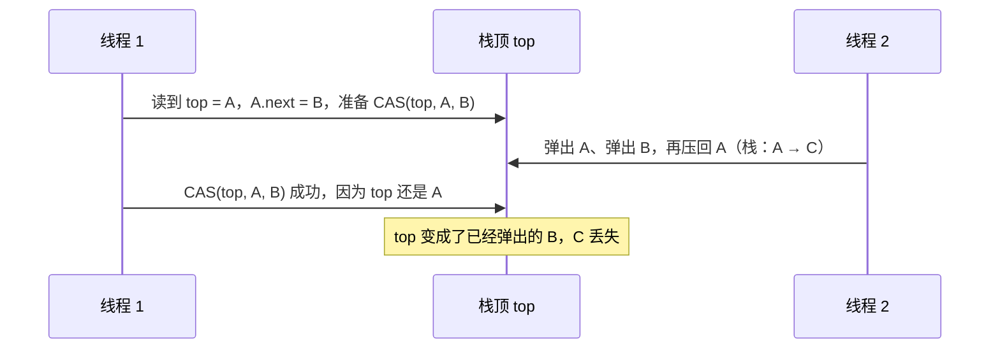

# CAS 与 ABA 问题

> 频率：★★ · 近两年出现在：携程（CAS 与 ABA）、京东（CAS 与 ABA）、字节（CAS 底层、CAS 多次）、阿里（CAS ABA）、小米（CAS 与幂等）、立讯等 · 参考：[JavaGuide](https://javaguide.cn/java/concurrent/cas.html)

## 一句话答案

CAS 是 CPU 提供的原子指令：比较内存里的值和期望值，相等才更新。它有三个问题：ABA（用版本号解决，`AtomicStampedReference`）、竞争激烈时自旋开销大、只能保证一个变量的原子性。

## 展开（1–2 分钟能讲完）

**CAS（Compare And Swap）**：三个参数——内存地址 V、期望值 A、新值 B。只有 V 处的值等于 A 时，才把它改成 B，整个过程由一条 CPU 指令完成（x86 上是 `lock cmpxchg`），不会被打断。

Java 里通过 `Unsafe` 或 `VarHandle` 调用。`AtomicInteger.incrementAndGet()` 就是循环 CAS：

```java
int prev, next;
do {
    prev = value;             // value 是 volatile 的
    next = prev + 1;
} while (!compareAndSet(prev, next));   // 失败说明被别人改了，重试
return next;
```

这就是**乐观锁**的思路：先假设没有冲突，直接改，冲突了再重试。与之相对的**悲观锁**（synchronized、ReentrantLock）先加锁再改。

**三个问题：**

| 问题 | 说明 | 解决 |
|---|---|---|
| ABA | 值从 A 改成 B 又改回 A，CAS 认为没变过 | 加版本号：`AtomicStampedReference`（比较值和版本号） |
| 自旋开销 | 竞争激烈时一直失败重试，空耗 CPU | 限制重试次数，或者改用 `LongAdder` 分散竞争 |
| 只能保证一个变量 | 多个变量要一起改 | 封装成一个对象用 `AtomicReference`，或者加锁 |

## 图解

**ABA 的危害（无锁栈的例子）**：



**LongAdder 为什么比 AtomicLong 快**：AtomicLong 所有线程都 CAS 同一个变量，竞争激烈时大量失败重试。LongAdder 有一个 `base` 和一个 `Cell[]` 数组：没竞争时改 `base`；有竞争时每个线程按哈希选一个 Cell 去加，读取时把 `base` 和所有 Cell 加起来。代价是 `sum()` 不是精确的瞬时值。适合高并发计数（统计 QPS），不适合需要精确比较的场景（发号器）。

## 追问链

- **乐观锁和悲观锁怎么选？** 冲突少、临界区短用乐观锁；冲突多或临界区长用悲观锁，避免大量重试。数据库里的乐观锁就是 `update ... where version = ?`，见 [MySQL 锁](../06-mysql/locks)。
- **CAS 在哪些地方用到了？** 原子类、[AQS](./aqs-reentrantlock) 修改 `state` 和队列、[ConcurrentHashMap](../02-collection/concurrenthashmap) 往空桶放结点、synchronized 的轻量级锁。
- **CAS 一定比加锁快吗？** 不一定。竞争很激烈时，大量线程反复失败重试，可能比直接阻塞更浪费 CPU。
- **ABA 在业务里会出问题吗？** 只看数值的场景（计数器）通常没影响；涉及引用、状态流转的场景（无锁数据结构、订单状态从 A 到 B 再回到 A）要用版本号。

## 我的项目里

TODO：项目里有没有用原子类计数或者数据库乐观锁？
