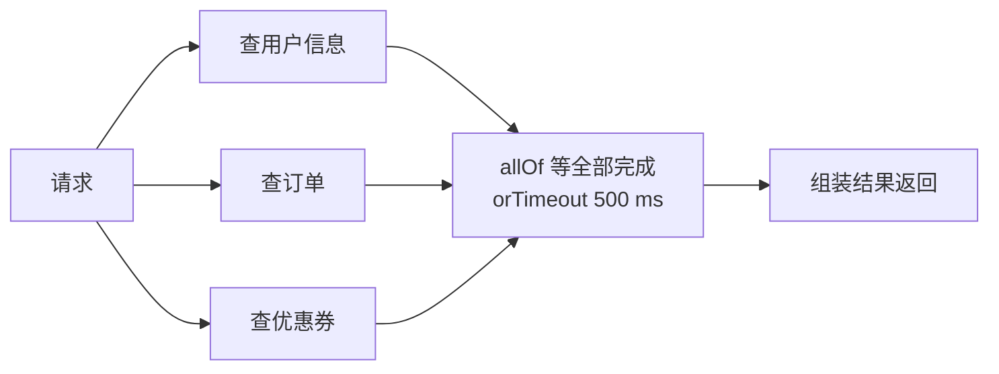

# CompletableFuture 与异步编排

> 频率：★★ · 近两年出现在：字节（CompletableFuture）、美团（CompletableFuture、Future）、用友（CompletableFuture）、腾讯云（同步改异步、Future 异常）等 · 参考：[JavaGuide](https://javaguide.cn/java/concurrent/completablefuture-intro.html)

## 一句话答案

支持链式组合异步任务（`thenApply`、`thenCompose`、`allOf`），默认用 `ForkJoinPool.commonPool`，生产环境要传自定义线程池；异常用 `exceptionally` 或 `handle` 处理。

## 展开（1–2 分钟能讲完）

**为什么需要它？** `Future` 只能 `get()` 阻塞等待结果，没法在完成时自动触发下一步，也没法组合多个任务。CompletableFuture 解决了这些。

**常用方法：**

| 类别 | 方法 | 作用 |
|---|---|---|
| 创建 | `supplyAsync(supplier, executor)`、`runAsync` | 异步执行，前者有返回值 |
| 转换 | `thenApply` | 拿到结果后做转换（同步函数） |
| 消费 | `thenAccept`、`thenRun` | 拿到结果后执行，没有返回值 |
| 串联 | `thenCompose` | 下一步本身也是异步的（相当于 flatMap） |
| 合并两个 | `thenCombine` | 两个都完成后合并结果 |
| 合并多个 | `allOf`（全部完成）、`anyOf`（任意一个完成） | |
| 异常 | `exceptionally`（只处理异常）、`handle`（结果和异常都能拿到）、`whenComplete`（只观察，不改结果） | |
| 超时（JDK 9） | `orTimeout`、`completeOnTimeout(默认值, ...)` | |

带 `Async` 后缀的方法（如 `thenApplyAsync`）会把这一步交给线程池执行；不带的，由完成上一步的线程直接执行。

## 图解

**并行调用三个下游接口，整体 500 毫秒超时：**



```java
ExecutorService pool = ...;  // 自定义线程池
var user   = CompletableFuture.supplyAsync(() -> userClient.get(uid), pool);
var orders = CompletableFuture.supplyAsync(() -> orderClient.list(uid), pool);
var coupon = CompletableFuture.supplyAsync(() -> couponClient.get(uid), pool)
        .exceptionally(e -> Coupon.EMPTY);          // 非核心数据失败就降级

CompletableFuture.allOf(user, orders, coupon)
        .orTimeout(500, TimeUnit.MILLISECONDS)
        .join();
return new Page(user.join(), orders.join(), coupon.join());
```

总耗时从三个接口相加，变成最慢的那个。

## 追问链

- **为什么不能用默认线程池？** `commonPool` 是整个 JVM 共享的，大小是 CPU 核数减一。如果在里面执行阻塞的 IO 调用，几个慢请求就能把它占满，影响所有用到它的地方（包括并行流）。IO 任务一定要传自定义线程池。
- **`thenApply` 和 `thenCompose` 的区别？** 函数返回普通值用 `thenApply`；函数本身返回一个 CompletableFuture 时用 `thenCompose`，否则会得到嵌套的 `CompletableFuture<CompletableFuture<T>>`。
- **异常是怎么传播的？** 某一步抛异常后，后面的 `thenApply` 等都不执行，直到遇到 `exceptionally` 或 `handle`。`join()` 抛 `CompletionException`，`get()` 抛 `ExecutionException`，真正的异常在 `getCause()` 里。
- **和 Future 比还有什么区别？** Future 不能手动完成，CompletableFuture 可以 `complete(value)`，常用来把回调式的接口包装成 Future。
- **同步改异步要注意什么？** ThreadLocal 里的上下文（用户信息、链路追踪 id）不会自动传到异步线程，要手动传或者包装线程池；异步后要保证异常有日志；事务不会跨线程。

## 我的项目里

TODO：项目里有没有并行调用多个接口的地方？用的是什么？
