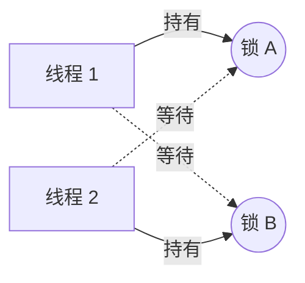

# 死锁：条件、排查、避免

> 频率：★★ · 近两年出现在：字节（死锁排查）、小红书（死锁与锁竞争）、顺丰（死锁）、超聚变（线程状态）、拼多多（线程状态）、SHEIN（数据库死锁）等 · 参考：[JavaGuide](https://javaguide.cn/java/concurrent/java-concurrent-questions-01.html)

## 一句话答案

四个必要条件：互斥、占有且等待、不可剥夺、循环等待。排查用 jstack 看线程栈里的 `Found one Java-level deadlock`；避免的办法是按固定顺序加锁、用 `tryLock` 设置超时。

## 展开（1–2 分钟能讲完）

**一个死锁的例子（转账）：**

```java
void transfer(Account from, Account to, int amount) {
    synchronized (from) {
        synchronized (to) {
            from.debit(amount);
            to.credit(amount);
        }
    }
}
// 线程 1：transfer(A, B)，锁住 A 等 B
// 线程 2：transfer(B, A)，锁住 B 等 A
```

**四个必要条件**，破坏任意一个就不会死锁：

| 条件 | 含义 | 怎么破坏 |
|---|---|---|
| 互斥 | 资源一次只能被一个线程用 | 一般破坏不了 |
| 占有且等待 | 拿着一个资源再去等另一个 | 一次性申请所有资源 |
| 不可剥夺 | 拿到的资源不能被抢走 | 用 `tryLock(超时)`，拿不到就释放已有的锁并重试 |
| 循环等待 | 形成等待环 | **所有线程按同一顺序加锁**（比如按账户 id 从小到大） |

转账的修复：

```java
Account first = from.id < to.id ? from : to;
Account second = from.id < to.id ? to : from;
synchronized (first) { synchronized (second) { ... } }
```

## 图解



**排查步骤：**

1. `jps` 找到进程 id。
2. `jstack <pid>`，输出末尾会有 `Found one Java-level deadlock`，列出每个线程持有和等待的锁，以及代码位置。
3. 也可以用 JConsole、VisualVM、Arthas 的 `thread -b`，或者在代码里用 `ThreadMXBean.findDeadlockedThreads()` 定时检测并报警。

## 追问链

- **线程有哪几种状态？** `NEW`、`RUNNABLE`（包括正在运行和等待 CPU）、`BLOCKED`（等 synchronized 的锁）、`WAITING`（`wait()`、`join()`、`LockSupport.park()`，无限期等待）、`TIMED_WAITING`（带超时的等待，如 `sleep`）、`TERMINATED`。synchronized 死锁时线程是 `BLOCKED`；ReentrantLock 死锁时是 `WAITING`，因为它底层用的是 `park`。
- **`sleep` 和 `wait` 的区别？** `sleep` 是 Thread 的静态方法，不释放锁，时间到了自动恢复；`wait` 是 Object 的方法，必须在 synchronized 里调用，会释放锁，要被 `notify` 唤醒（或者超时）。
- **数据库死锁和 Java 死锁的区别？** 数据库有死锁检测，会自动回滚其中一个事务；JVM 不会自动处理 synchronized 的死锁，相关线程会一直卡住。数据库死锁见 [MySQL 锁](../06-mysql/locks)。
- **活锁和饥饿是什么？** 活锁：线程都没阻塞，但互相谦让，一直重试也做不成（比如都用 `tryLock` 失败后立即重试）。加随机退避可以解决。饥饿：某个线程一直抢不到资源，比如非公平锁下的排队线程、读写锁下的写线程。
- **写一个死锁？** 面试官可能直接让你写：两个线程用相反的顺序 synchronized 两个对象，中间 `sleep` 一下，保证都拿到了第一把锁。

## 我的项目里

TODO：项目里有没有需要同时锁多个资源的地方？加锁顺序是怎么保证的？
