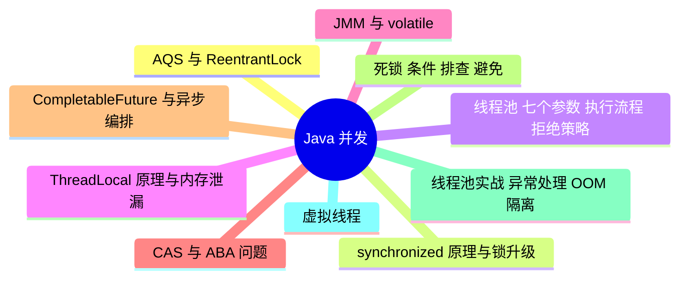

# Java 并发

> 进度：0 / 10 条已写完。本页由 `tools/gen_index.py` 生成，改条目后重新运行即可。

## 知识地图

## 条目（按频率排序）

频率按 2025–2026 年后端面经里出现的次数估计：★★★ 几乎每场都可能问，★★ 经常问，★ 偶尔问。

| 知识点 | 频率 | 状态 | 一句话答案 |
|---|---|---|---|
| [AQS 与 ReentrantLock](./aqs-reentrantlock) | ★★★ | · | AQS 用一个 volatile int state 表示锁状态，加一个 CLH 变体的双向等待队列；抢锁失败的线程入队并挂起。ReentrantLock、Semaphore、CountDownLatch 都基于它。ReentrantLock 支持公平/非公平、可中断、超时和多个 Condition。 |
| [synchronized 原理与锁升级](./synchronized) | ★★★ | · | 编译后是 monitorenter/monitorexit 指令（方法上是 ACC_SYNCHRONIZED 标志），依赖对象头的 Mark Word。锁会从无锁 → 偏向锁 → 轻量级锁（CAS 自旋）→ 重量级锁（操作系统互斥量）逐步升级。JDK 15 起默认关闭偏向锁。 |
| [线程池：七个参数、执行流程、拒绝策略](./thread-pool) | ★★★ | · | 提交任务时：核心线程没满就新建线程 → 满了就放进队列 → 队列满了且没到最大线程数就新建线程 → 都满了执行拒绝策略。七个参数是核心线程数、最大线程数、空闲存活时间、时间单位、阻塞队列、线程工厂、拒绝策略。 |
| [ThreadLocal 原理与内存泄漏](./threadlocal) | ★★★ | · | 每个线程有自己的 ThreadLocalMap，key 是 ThreadLocal 的弱引用，value 是强引用。线程池里线程不会结束，用完不 remove 的话 value 一直留着，造成内存泄漏和数据串用。 |
| [JMM 与 volatile](./volatile-jmm) | ★★★ | · | JMM 规定了可见性、有序性、原子性三个问题的规则。volatile 保证可见性（写后立即刷回主存，读时从主存读）和有序性（内存屏障禁止重排序），但不保证原子性，i++ 仍然不安全。 |
| [CAS 与 ABA 问题](./cas-aba) | ★★☆ | · | CAS 是 CPU 提供的原子指令：比较内存值和期望值，相等才更新。问题有三个：ABA（用版本号解决，AtomicStampedReference）、自旋开销大、只能保证一个变量的原子性。 |
| [CompletableFuture 与异步编排](./completablefuture) | ★★☆ | · | 支持链式组合异步任务（thenApply、thenCompose、allOf），默认用 ForkJoinPool.commonPool，生产环境要传自定义线程池，异常用 exceptionally 或 handle 处理。 |
| [死锁：条件、排查、避免](./deadlock) | ★★☆ | · | 四个必要条件：互斥、占有且等待、不可剥夺、循环等待。排查用 jstack 看线程栈里的 "Found one Java-level deadlock"；避免的办法是按固定顺序加锁、用 tryLock 超时。 |
| [线程池实战：异常处理、OOM、隔离](./thread-pool-practice) | ★★☆ | · | execute 提交的任务抛异常会打印并让线程退出重建；submit 会把异常包进 Future，不调用 get() 就看不到。不同业务要用不同线程池隔离，防止一个慢业务拖垮全部。 |
| [虚拟线程（JDK 21）](./virtual-threads) | ★★☆ | · | 虚拟线程由 JVM 调度，挂载在少量平台线程（载体线程）上，阻塞时自动卸载，适合大量 IO 密集任务；不适合 CPU 密集任务。synchronized 块里阻塞会把载体线程「钉住」（pinning，JDK 24 起已修复）。 |
