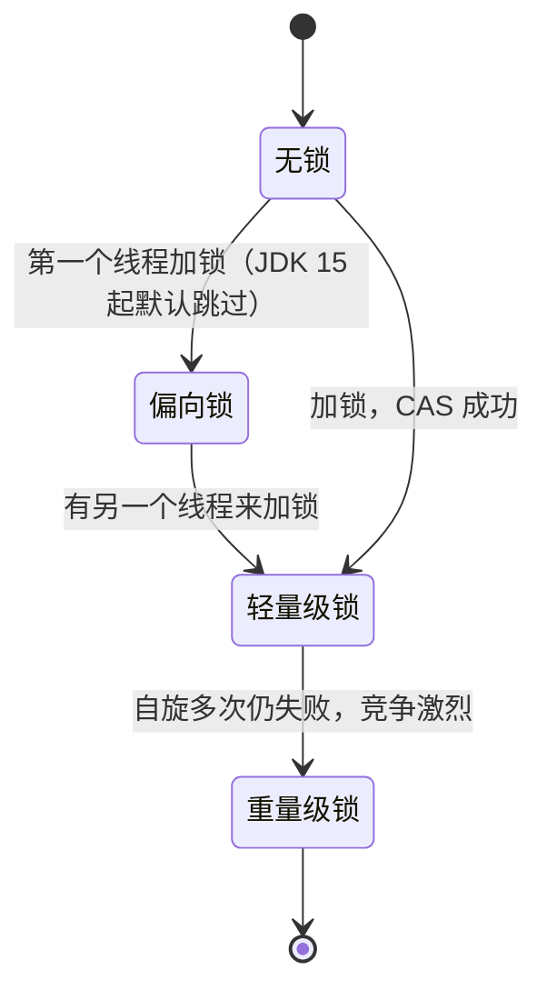

# synchronized 原理与锁升级

> 频率：★★★ · 近两年出现在：字节、腾讯（与 volatile 对比）、美团（锁对象、锁标记、锁升级）、小红书（锁升级与 AQS）、超聚变、立讯（锁升级）、美图（与自旋锁的区别）等 · 参考：[JavaGuide](https://javaguide.cn/java/concurrent/java-concurrent-questions-02.html)

## 一句话答案

编译后是 `monitorenter` / `monitorexit` 指令（加在方法上时是 `ACC_SYNCHRONIZED` 标志），依赖对象头的 Mark Word 和 monitor。锁会从无锁 → 偏向锁 → 轻量级锁（CAS 自旋）→ 重量级锁（操作系统互斥量）逐步升级。JDK 15 起默认关闭偏向锁。

## 展开（1–2 分钟能讲完）

**锁的是什么：**

| 写法 | 锁对象 |
|---|---|
| 修饰实例方法 | 当前实例 `this` |
| 修饰静态方法 | 当前类的 `Class` 对象 |
| `synchronized (obj) {}` | 括号里的对象 |

**底层实现**：每个 Java 对象的对象头里有一个 Mark Word，记录锁状态。重量级锁时，Mark Word 指向一个 `ObjectMonitor`，里面有：

- `_owner`：持有锁的线程。
- `_recursions`：重入次数（所以 synchronized 是可重入的）。
- `_EntryList`：等待获取锁的线程。
- `_WaitSet`：调用了 `wait()` 的线程。

**锁升级**：重量级锁需要操作系统的互斥量，线程阻塞和唤醒要切换到内核态，代价很大。所以 JVM 先用更轻的锁：

| 状态 | 适用情况 | 做法 |
|---|---|---|
| 偏向锁 | 只有一个线程反复加锁 | 把线程 id 记在 Mark Word 里，之后这个线程进出不需要 CAS。**JDK 15 起默认关闭**，因为现代应用里收益很小，撤销偏向锁的代价反而大 |
| 轻量级锁 | 多个线程交替加锁，很少同时竞争 | 在栈帧里建一个 Lock Record，用 CAS 把 Mark Word 换成指向它的指针；失败就自旋几次（自适应自旋） |
| 重量级锁 | 真正同时竞争 | 膨胀为 ObjectMonitor，抢不到的线程阻塞 |

锁一般只升级不降级。

## 图解

## 追问链

- **和 ReentrantLock 的区别？**

  | | synchronized | ReentrantLock |
  |---|---|---|
  | 实现 | JVM 关键字 | Java 代码，基于 [AQS](./aqs-reentrantlock) |
  | 释放 | 自动释放（出代码块或抛异常） | 必须在 `finally` 里 `unlock()` |
  | 公平锁 | 只有非公平 | 可以选公平或非公平 |
  | 可中断、超时 | 不支持 | `lockInterruptibly()`、`tryLock(timeout)` |
  | 等待条件 | 一个（`wait/notify`） | 多个 `Condition` |

  简单场景用 synchronized；需要超时、可中断、多个条件或公平锁时用 ReentrantLock。

- **synchronized 和自旋锁的区别？** 自旋锁抢不到时不阻塞，在 CPU 上空转重试，适合锁持有时间很短的情况；synchronized 的轻量级锁阶段会自旋，到了重量级锁阶段就会阻塞线程。
- **JVM 还有哪些锁优化？**
  - 锁消除：逃逸分析发现对象不会被别的线程访问，就把锁去掉。
  - 锁粗化：循环里反复对同一个对象加解锁，合并成一次。
- **`wait()` 为什么必须在 synchronized 里调用？** `wait` 要释放 monitor，并进入 `_WaitSet`，前提是当前线程持有这个 monitor，否则抛 `IllegalMonitorStateException`。`wait` 会释放锁，`sleep` 不会。
- **可重入是怎么实现的？** monitor 记录了持有者和重入次数，同一个线程再次进入时计数加一，退出时减一，减到 0 才真正释放。
- **在虚拟线程里用 synchronized 有什么问题？** JDK 21 中会把载体线程「钉住」，见[虚拟线程](./virtual-threads)。

## 我的项目里

TODO：项目里哪里用了 synchronized 或 ReentrantLock？为什么选这个？
