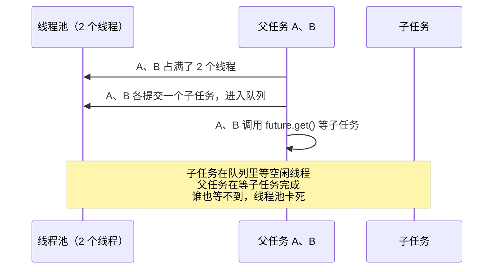

# 线程池实战：异常处理、OOM、隔离

> 频率：★★ · 近两年出现在：快手（submit 与 execute 的异常差异、线程池 OOM）、腾讯云（Future 异常）、字节（线程池拆分、阅读线程池代码）、中兴（线程池保护）、京东和小红书（手写线程池）等 · 参考：[JavaGuide](https://javaguide.cn/java/concurrent/java-thread-pool-best-practices.html)

## 一句话答案

`execute` 提交的任务抛异常时，会打印堆栈并让这个工作线程退出，线程池再补一个新线程；`submit` 会把异常包进 `Future`，不调用 `get()` 就看不到。不同业务要用不同的线程池隔离，防止一个慢业务拖垮全部。

## 展开（1–2 分钟能讲完）

### 异常处理

| | `execute(Runnable)` | `submit(Callable/Runnable)` |
|---|---|---|
| 返回值 | 无 | `Future` |
| 任务抛异常 | 异常抛出到工作线程，打印堆栈；这个线程结束，线程池新建一个线程替代 | 被 `FutureTask` 捕获存起来，**不打印**；调用 `future.get()` 时抛 `ExecutionException` |

`submit` 的异常最容易被「吞掉」：提交完从来不调 `get()`，出了错一点日志都没有。

**处理办法：**

1. 任务内部自己 `try-catch` 并记录日志（最直接）。
2. 继承 `ThreadPoolExecutor`，重写 `afterExecute(Runnable r, Throwable t)` 统一处理。对 `submit` 的任务，`t` 是 null，要从 `Future` 里取异常。
3. 在线程工厂里设置 `UncaughtExceptionHandler`，只对 `execute` 有效。

### 线程池导致 OOM 的几种情况

- 无界队列，任务提交得比处理得快，队列越来越长。
- 最大线程数太大（`newCachedThreadPool`），线程本身占内存（每个线程栈默认 1 MB）。
- 在方法里每次都 `new` 一个线程池却不关闭，线程池和线程都不会被回收。
- 任务里用了 ThreadLocal 却不 `remove`，见 [ThreadLocal](./threadlocal)。

### 隔离

所有业务共用一个线程池时，一个下游接口变慢，线程全部卡在它上面，其他业务也提交不进去。所以按业务或下游拆分线程池（舱壁模式），每个池的大小和队列单独设置。

## 图解

**同一个线程池里父任务等子任务，会死锁：**

解决：父子任务用不同的线程池。

## 追问链

- **怎么优雅关闭线程池？** 先 `shutdown()`（不再接受新任务，执行完已提交的），再 `awaitTermination(超时时间)` 等待；超时还没结束就 `shutdownNow()`（中断所有线程，返回队列里没执行的任务）。Spring 的 `ThreadPoolTaskExecutor` 可以设置 `setWaitForTasksToCompleteOnShutdown(true)`。
- **`shutdownNow` 一定能停下正在执行的任务吗？** 不一定。它只是调用 `interrupt()`，任务里要响应中断（检查中断标志，或者在 `sleep`、`wait`、阻塞队列操作时会抛 `InterruptedException`），不响应就停不下来。
- **手写一个简单的线程池？** 一个阻塞队列 + 一组工作线程循环 `take()` 任务执行 + 提交时队列满了执行拒绝策略。代码见[算法库：手写线程池](https://bingqin2.github.io/algo-notes/13-design/thread-pool)。
- **线程池里的任务需要用户上下文怎么办？** ThreadLocal 不会自动传到池里的线程，用阿里的 `TransmittableThreadLocal`，或者在提交时包装任务，手动传递。
- **定时任务用什么？** `ScheduledThreadPoolExecutor`。注意任务抛异常后，这个周期任务后续就不会再执行了，所以任务里一定要 catch。分布式环境用 XXL-JOB 之类的调度框架。

## 我的项目里

TODO：项目里线程池里的任务出过异常吗？日志里能看到吗？
