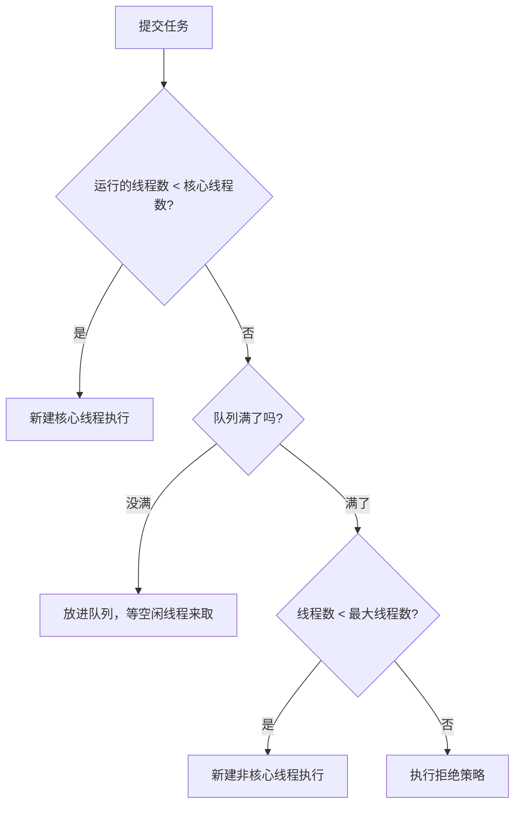

# 线程池：七个参数、执行流程、拒绝策略

> 频率：★★★ · 近两年出现在：几乎每家公司都问。字节、腾讯、美团（核心参数与创建流程）、阿里、小红书（执行流程、手写线程池）、京东（手撕线程池）、超聚变（参数推演）、快手（线程池参数与 OOM）等 · 参考：[JavaGuide](https://javaguide.cn/java/concurrent/java-thread-pool-summary.html)

## 一句话答案

提交任务时：核心线程没满就新建线程 → 核心线程满了就放进队列 → 队列满了且没到最大线程数就再新建线程 → 都满了执行拒绝策略。七个参数是核心线程数、最大线程数、空闲存活时间、时间单位、阻塞队列、线程工厂、拒绝策略。

## 展开（1–2 分钟能讲完）

**七个参数：**

| 参数 | 作用 |
|---|---|
| `corePoolSize` | 核心线程数，默认一直存活 |
| `maximumPoolSize` | 最大线程数 |
| `keepAliveTime` + `unit` | 非核心线程空闲多久后回收（`allowCoreThreadTimeOut(true)` 时核心线程也会回收） |
| `workQueue` | 任务队列：`ArrayBlockingQueue`（有界）、`LinkedBlockingQueue`（不指定容量就是无界）、`SynchronousQueue`（不存任务，直接交给线程）、`PriorityBlockingQueue`、`DelayedWorkQueue` |
| `threadFactory` | 创建线程，主要用来**给线程起有意义的名字**，方便排查 |
| `handler` | 拒绝策略 |

**四种拒绝策略：**

| 策略 | 行为 |
|---|---|
| `AbortPolicy`（默认） | 抛 `RejectedExecutionException` |
| `CallerRunsPolicy` | 由提交任务的线程自己执行，起到减慢提交速度的作用，任务不丢 |
| `DiscardPolicy` | 直接丢弃，不报错 |
| `DiscardOldestPolicy` | 丢掉队列里最老的任务，再尝试提交 |

也可以自定义：把任务存到数据库或 MQ，稍后补偿执行。

## 图解

**注意顺序**：是先放队列，队列满了才扩到最大线程数。所以如果队列是无界的，最大线程数这个参数永远不起作用。

**线程池的状态**：`ctl` 这一个 int 的高 3 位存状态，低 29 位存线程数。状态有五种：RUNNING → SHUTDOWN（不接新任务，执行完队列里的）/ STOP（不接新任务，中断正在执行的）→ TIDYING → TERMINATED。

## 追问链

- **为什么不推荐用 Executors 创建？**
  - `newFixedThreadPool`、`newSingleThreadExecutor` 用无界的 `LinkedBlockingQueue`，任务堆积会 OOM。
  - `newCachedThreadPool` 最大线程数是 `Integer.MAX_VALUE`，可能创建大量线程导致 OOM。
  - `newScheduledThreadPool` 的队列也是无界的。
  - 阿里 Java 开发手册要求手动 `new ThreadPoolExecutor`，把参数写明白。
- **核心线程数怎么设？**
  - CPU 密集型：CPU 核数 + 1。
  - IO 密集型：核数 × (1 + 平均等待时间 / 平均计算时间)，常见起点是 2 × 核数。
  - 公式只是起点，最终**靠压测**，并且让参数可以动态调整。
- **线程池的参数能动态调整吗？** `setCorePoolSize`、`setMaximumPoolSize` 可以在运行时调整。但 `LinkedBlockingQueue` 的容量是 final 的，要动态调队列长度得自定义队列（美团技术团队的动态线程池就是这么做的），参数放在配置中心里。
- **怎么监控？** `getActiveCount()`、`getQueue().size()`、`getCompletedTaskCount()`、`getLargestPoolSize()`，定期上报，队列积压或拒绝次数超过阈值就报警。
- **线程池里的线程是怎么复用的？** 每个 Worker 线程在 `runWorker` 里循环调用 `getTask()` 从队列取任务执行；核心线程取不到任务就阻塞在 `take()`，非核心线程用 `poll(keepAliveTime)`，超时取不到就退出。
- **任务抛了异常会怎样？** 见[线程池实战](./thread-pool-practice)。

## 我的项目里

TODO：项目里有几个线程池？每个的参数是多少，为什么这么设？
