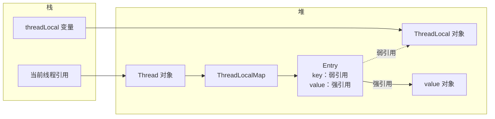

# ThreadLocal 原理与内存泄漏

> 频率：★★★ · 近两年出现在：字节（ThreadLocal 实现与隔离、社招）、京东、阿里（AQS 与 ThreadLocal）、美团（ThreadLocal 两条）、字节社招（虚拟线程与 ThreadLocal）等 · 参考：[JavaGuide](https://javaguide.cn/java/concurrent/threadlocal.html)

## 一句话答案

每个线程有自己的 `ThreadLocalMap`，key 是 ThreadLocal 的弱引用，value 是强引用。线程池里的线程不会结束，用完不 `remove` 的话 value 一直留着，造成内存泄漏和数据串用。

## 展开（1–2 分钟能讲完）

**作用**：让每个线程有一份自己的变量副本，线程之间互不干扰。典型场景：

- 存当前请求的用户信息，拦截器里放进去，业务代码里随时取，不用层层传参。
- 每个线程一个 `SimpleDateFormat`（它不是线程安全的）。
- 数据库连接、事务上下文（Spring 的事务管理就用了 ThreadLocal）。

**数据存在哪？** 不在 ThreadLocal 对象里，而在**线程**里：`Thread` 有一个字段 `threadLocals`，类型是 `ThreadLocalMap`。`threadLocal.set(v)` 实际上是 `Thread.currentThread().threadLocals.set(this, v)`。

`ThreadLocalMap` 是一个自己实现的哈希表：用数组存 `Entry`，冲突时用**线性探测**（往后找空位），不是链表。

## 图解



**泄漏是怎么发生的**：

1. 外部不再引用 ThreadLocal 对象（`R1` 断开），由于 Entry 的 key 是弱引用，GC 后 key 变成 null。
2. 但 value 还被 `Thread → ThreadLocalMap → Entry` 这条强引用链抓着。
3. 线程池里的线程一直活着，这条链就一直在，value 无法回收。

更常见的问题其实是**数据串用**：上一个请求在这个线程上设置的用户信息没清掉，下一个请求复用这个线程时读到了别人的数据。

**正确用法**：

```java
try {
    USER.set(user);
    // 业务逻辑
} finally {
    USER.remove();   // 一定要在 finally 里清理
}
```

## 追问链

- **为什么 key 要用弱引用？** 如果 key 是强引用，外部不再使用 ThreadLocal 了，它也会因为被 Entry 引用而无法回收，泄漏更严重。用弱引用至少 key 能被回收，而且 `set`、`get`、`remove` 时会顺便清理 key 为 null 的 Entry（`expungeStaleEntry`）。但这种清理是顺带的，不能依赖它。
- **value 为什么不也用弱引用？** 那样 value 可能在还要用的时候就被 GC 回收了。
- **子线程能拿到父线程的 ThreadLocal 吗？** 普通的不行。`InheritableThreadLocal` 会在创建子线程时把值复制过去；但线程池的线程是提前创建好、反复复用的，复制只发生一次，之后拿到的是旧值。阿里的 `TransmittableThreadLocal` 在提交任务时捕获值、执行时还原，解决了线程池的传递问题。
- **ThreadLocal 在虚拟线程下有什么问题？** 虚拟线程可能有上百万个，每个都存一份副本，内存开销很大。JDK 25 正式推出的 `ScopedValue` 是替代方案：值不可变、作用域结束自动失效。见[虚拟线程](./virtual-threads)。
- **为什么哈希冲突用线性探测？** ThreadLocal 一般很少，数据量小，线性探测实现简单、对缓存友好。哈希值每次递增一个魔数 `0x61c88647`（和黄金分割有关），让 key 在 2 的幂长度的数组里分布得很均匀。

## 我的项目里

TODO：项目里有没有用 ThreadLocal 存用户上下文？在哪里 remove？
