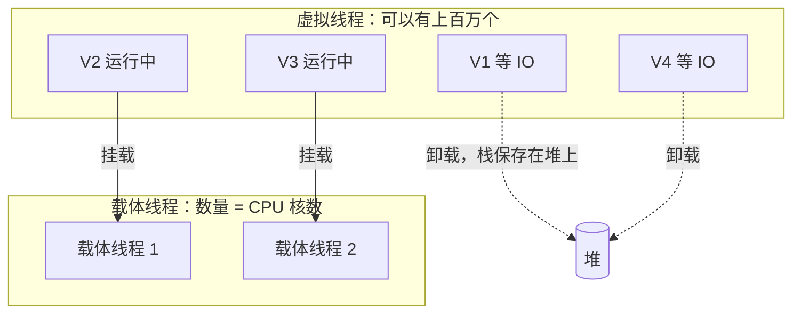

# 虚拟线程（JDK 21）

> 频率：★★ · 近两年出现在：字节（虚拟线程多次、社招）、腾讯音乐（JDK 21 GC 与虚拟线程）、腾讯云、老虎国际（虚拟线程边界）、字节飞书 · 参考：[JavaGuide](https://javaguide.cn/java/concurrent/virtual-thread.html)

## 一句话答案

虚拟线程由 JVM 调度，挂载在少量平台线程（载体线程）上运行，遇到阻塞时自动卸载，适合大量 IO 密集任务，不适合 CPU 密集任务。JDK 21 中在 `synchronized` 块里阻塞会把载体线程「钉住」（pinning），JDK 24 起已修复。

## 展开（1–2 分钟能讲完）

**要解决的问题**：传统的「一个请求一个线程」模型里，Java 线程和操作系统线程一一对应，每个线程栈默认约 1 MB，切换要进内核。一台机器开几千个线程就到头了，而大部分线程其实都在等 IO。以前只能用回调或响应式编程（WebFlux）来提高并发，代码很难写、很难调试。

**虚拟线程的做法**：

- 很轻：栈按需增长，存在堆上，创建一百万个也没问题。
- 由 JVM 调度：默认用一个 `ForkJoinPool` 作为调度器，载体线程数等于 CPU 核数。
- 遇到阻塞（IO、`sleep`、`BlockingQueue.take`、`ReentrantLock`）时，JVM 把虚拟线程的栈保存起来，从载体线程上**卸载**，载体线程去运行别的虚拟线程；IO 完成后再挂载回某个载体线程继续执行。
- 代码还是普通的同步阻塞写法。

**怎么用：**

```java
try (var executor = Executors.newVirtualThreadPerTaskExecutor()) {
    for (int i = 0; i < 10_000; i++) {
        executor.submit(() -> callRemoteApi());  // 每个任务一个虚拟线程
    }
}
// Spring Boot 3.2+：spring.threads.virtual.enabled=true
```

## 图解



**pinning（钉住）**：在 JDK 21 里，虚拟线程在 `synchronized` 块内或调用本地方法时阻塞，无法卸载，载体线程也跟着被占住。如果大量虚拟线程这样阻塞，载体线程会被耗尽。JDK 24（JEP 491）解决了 `synchronized` 的问题；在 21 上，热点路径要把 `synchronized` 换成 `ReentrantLock`。可以用 `-Djdk.tracePinnedThreads=full` 检测。

## 追问链

- **和平台线程的区别？** 平台线程和系统线程一一对应，重、数量有限，适合 CPU 密集任务；虚拟线程是 M:N 映射，轻、数量多，只在 IO 密集时有优势。CPU 密集的任务用虚拟线程不会更快，因为载体线程数就是核数。
- **为什么不要池化虚拟线程？** 它创建成本极低，池化没有意义，应该每个任务新建一个。要限制并发（比如下游只能承受 100 个并发），用 `Semaphore`，而不是用一个大小为 100 的池。
- **ThreadLocal 有什么问题？** 能用，但每个虚拟线程一份副本，百万个虚拟线程会占大量内存。见 [ThreadLocal](./threadlocal) 和替代方案 `ScopedValue`。
- **和 Go 的协程比？** 都是 M:N 调度、都很轻。区别是 Go 运行时会抢占长时间运行的协程；Java 虚拟线程只在阻塞时让出，长时间计算的任务会一直占着载体线程。Go 从语言层面就是这个模型，Java 是在原有线程 API 上兼容地加进来的。见 [GMP](../12-go/gmp)。
- **有了虚拟线程还需要 WebFlux 吗？** 大多数 IO 密集的业务服务用虚拟线程就够了，代码更简单；响应式编程在流式处理、背压等场景仍然有用。
- **AI 应用为什么适合虚拟线程？** 调用大模型接口一次要几秒到几十秒，大部分时间在等响应，正好是 IO 密集。

## 我的项目里

TODO：项目用的 JDK 版本是多少？有没有可以用虚拟线程改造的地方？
