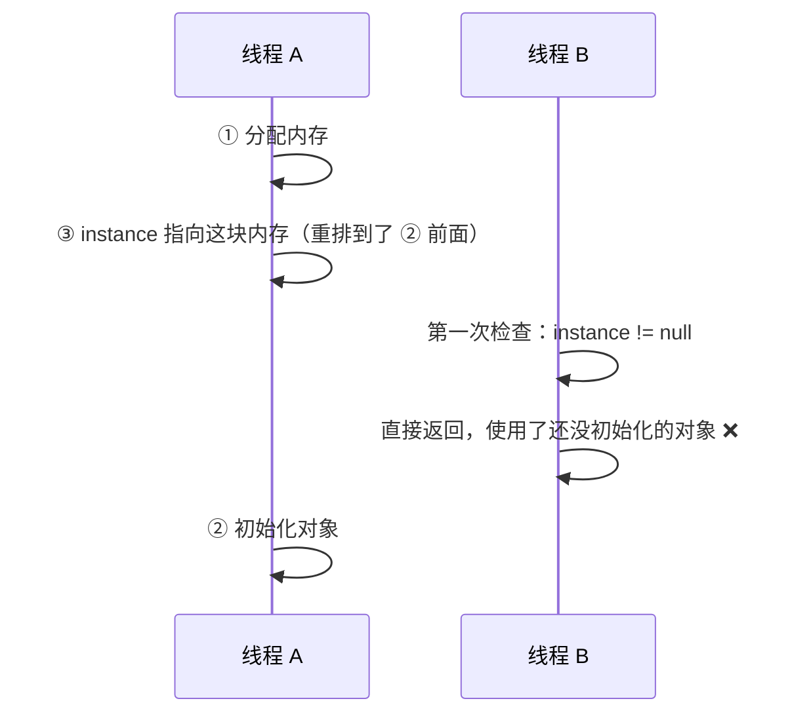

# JMM 与 volatile

> 频率：★★★ · 近两年出现在：腾讯（JMM 三大特性、volatile 与 synchronized）、字节（JMM、懒汉单例漏洞）、美团（volatile）、小红书（CAS 与 volatile）、招银云创（DCL 单例）等 · 参考：[JavaGuide](https://javaguide.cn/java/concurrent/jmm.html)

## 一句话答案

JMM 规定了可见性、有序性、原子性三个问题的规则。volatile 保证可见性（写后立即刷回主内存，读时从主内存读）和有序性（通过内存屏障禁止重排序），但不保证原子性，`i++` 仍然不安全。

## 展开（1–2 分钟能讲完）

**为什么需要 JMM？** CPU 有多级缓存，编译器和 CPU 会重排指令。一个线程改了变量，另一个线程可能读不到（可见性），也可能看到的执行顺序和代码顺序不同（有序性）。JMM 是 Java 对这些行为的统一规定：每个线程有自己的工作内存（对应缓存和寄存器的抽象），共享变量在主内存里。

**三大特性和保证手段：**

| 特性 | 问题 | 怎么保证 |
|---|---|---|
| 原子性 | 一个操作被中途打断，比如 `i++` 是读、加、写三步 | `synchronized`、锁、原子类 |
| 可见性 | 一个线程改了，别的线程看不到 | `volatile`、`synchronized`、`final`、锁 |
| 有序性 | 指令重排 | `volatile`、`synchronized` |

**happens-before 规则**（如果 A happens-before B，A 的结果对 B 可见）：

- 程序顺序：同一线程里，前面的操作先于后面的。
- 锁：解锁先于之后对同一把锁的加锁。
- volatile：对 volatile 变量的写先于之后对它的读。
- 线程启动：`start()` 先于这个线程里的所有操作。
- 线程终止：线程里的所有操作先于别的线程 `join()` 返回。
- 传递性。

**volatile 的实现**：写 volatile 变量时，JVM 插入内存屏障（x86 上是带 `lock` 前缀的指令），把缓存写回内存并让其他 CPU 的缓存失效；同时禁止屏障前后的指令重排。

## 图解

**DCL 单例为什么要加 volatile：**

```java
private static volatile Singleton instance;

public static Singleton getInstance() {
    if (instance == null) {                 // 第一次检查，不加锁
        synchronized (Singleton.class) {
            if (instance == null) {         // 第二次检查
                instance = new Singleton();
            }
        }
    }
    return instance;
}
```

`new Singleton()` 分三步：① 分配内存 ② 初始化对象 ③ 把引用赋给 `instance`。没有 volatile 时，② 和 ③ 可能重排：



加了 volatile 就禁止了这种重排。

## 追问链

- **volatile 和 synchronized 的区别？** volatile 只能修饰变量，保证可见性和有序性，不保证原子性，不会阻塞；synchronized 修饰方法或代码块，三个特性都保证，可能阻塞。
- **volatile 适合什么场景？** 一个线程写、多个线程读的状态标志（如 `volatile boolean running`）；DCL 单例；配合 CAS 实现无锁结构（原子类里的 `value` 就是 volatile 的）。
- **为什么 volatile 不能保证 `count++` 安全？** 两个线程都读到 5，各自加一写回 6，少加了一次。可见性只能保证读到最新值，不能保证「读-改-写」不被打断。用 `AtomicInteger` 或加锁。
- **还有哪些单例写法？** 静态内部类（利用类加载的线程安全，延迟加载）；枚举（最简单，还能防反射和反序列化破坏）。字节问过「懒汉单例的漏洞」，就是上面的重排问题。
- **CPU 的缓存一致性协议（MESI）和 volatile 是什么关系？** MESI 保证各个 CPU 缓存之间最终一致，但 CPU 还有写缓冲区和失效队列，会造成短暂不可见。内存屏障就是用来清空这些缓冲、强制同步的。

## 我的项目里

TODO：项目里有没有用 volatile 做状态标志？有没有写过单例？
