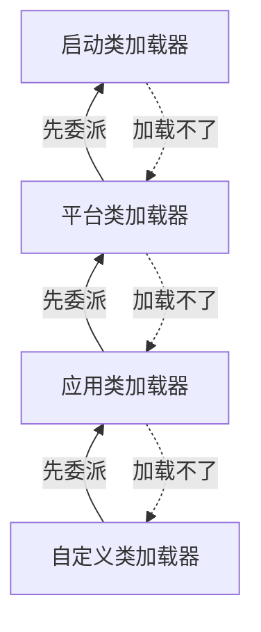

# 类加载与双亲委派

> 频率：★★☆ · 近两年出现在：阿里（JVM、类加载） · 参考：[JavaGuide](https://javaguide.cn/java/jvm/classloader.html)

## 一句话答案

类的生命周期是 加载 → 验证 → 准备 → 解析 → 初始化 → 使用 → 卸载（中间三步合称连接）。**双亲委派**：类加载器收到请求时，先交给父加载器加载，父加载器加载不了才自己加载。这样 `java.lang.String` 这种核心类永远由启动类加载器加载，用户写一个同名类也替换不了，同时保证同一个类不会被加载多次。

## 展开（1–2 分钟能讲完）

**五个阶段做什么**：

| 阶段 | 做什么 |
|---|---|
| 加载 | 按全限定名找到字节流（jar、网络、动态生成都行），在方法区生成类的元数据，在堆里生成 `Class` 对象 |
| 验证 | 文件格式、元数据、字节码、符号引用验证，防止恶意或损坏的 class |
| 准备 | 给**静态变量**分配内存并设**零值**（`static int a = 5` 此时 a 是 0；`static final` 常量此时直接是 5） |
| 解析 | 把常量池里的符号引用换成直接引用（可以延迟到第一次用时） |
| 初始化 | 执行 `<clinit>()`：按代码顺序执行静态变量赋值和静态代码块。JVM 保证多线程下只执行一次（加锁） |

**类加载器**：

- 启动类加载器（Bootstrap，C++ 实现）：加载 `java.base` 等核心模块（JDK 8 是 `rt.jar`）。
- 平台类加载器（JDK 9 起，之前叫扩展类加载器）：加载部分 JDK 模块。
- 应用类加载器（AppClassLoader）：加载 classpath 上的类。
- 自定义类加载器：继承 `ClassLoader`，重写 `findClass`。

注意「父子」是**组合**关系（`parent` 字段），不是继承。**同一个类**由「类加载器 + 全限定名」共同确定，不同加载器加载的同名类是两个不同的类，互相强转会抛 ClassCastException。

## 图解

`loadClass` 的逻辑：已经加载过就返回 → 交给 parent 加载 → parent 返回 null 再调用自己的 `findClass`。

## 追问链

- **怎么打破双亲委派？** 重写 `loadClass`（而不只是 `findClass`）。典型例子：
  - **Tomcat**：每个 Web 应用一个 `WebappClassLoader`，**先自己加载** `/WEB-INF` 下的类，找不到再委派父加载器。这样两个应用可以用不同版本的同一个库，互相隔离。（核心类仍然先交给上层，防止被覆盖。）
  - **SPI（JDBC）**：`DriverManager` 在 `java.sql` 里由启动类加载器加载，但驱动实现在 classpath 上，启动类加载器看不到。于是用**线程上下文类加载器**（`Thread.currentThread().getContextClassLoader()`，默认是应用类加载器）去加载实现类，相当于父加载器请子加载器干活。
  - **热部署 / OSGi**：每次重新加载用一个新的类加载器。
- **类什么时候初始化？** 主动使用时：`new`、读写静态字段（编译期常量除外）、调用静态方法、反射（`Class.forName`）、初始化子类时先初始化父类、包含 `main` 的类。被动使用不会初始化：通过子类引用父类的静态字段（只初始化父类）、定义数组 `new User[10]`、引用编译期常量。
- **静态代码块的执行时机？** 在初始化阶段，和静态变量赋值按**代码顺序**执行，只执行一次。完整顺序：父类静态 → 子类静态 → 父类实例初始化块和构造方法 → 子类实例初始化块和构造方法。
- **类什么时候卸载？** 类的所有实例都被回收、它的 Class 对象没有被引用、**加载它的类加载器也被回收**。所以系统类加载器加载的类基本不会卸载，自定义类加载器加载的才可能卸载。

## 我的项目里

TODO：有没有遇到过 jar 包冲突（NoSuchMethodError、ClassNotFoundException）？怎么排查的（`mvn dependency:tree`、`-verbose:class`）？
