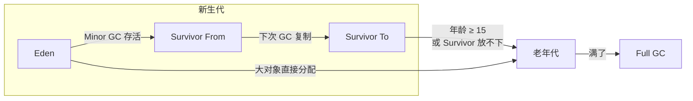

# 垃圾回收：算法与收集器（G1、ZGC）

> 频率：★★★ · 近两年出现在：字节（JVM 内存、GC、G1）、阿里（ZGC 染色指针、多重映射、GC 调优）、腾讯（JDK 21 虚拟线程与 GC）、美团（G1 与 CMS、JVM GC 排查） · 参考：[JavaGuide](https://javaguide.cn/java/jvm/jvm-garbage-collection.html)

## 一句话答案

用**可达性分析**找垃圾：从 GC Roots 出发走引用链，走不到的对象就是垃圾。回收算法有标记-清除（有碎片）、标记-复制（没碎片但浪费一半空间）、标记-整理（没碎片但要移动对象）。分代收集：新生代对象朝生夕死，用复制；老年代存活率高，用标记-清除或标记-整理。**G1** 把堆分成很多 Region，按停顿时间目标优先回收垃圾最多的 Region；**ZGC** 用染色指针和读屏障，并发整理，停顿时间不到 1 毫秒，和堆大小无关。

## 展开（1–2 分钟能讲完）

**分代和对象流转**：

- 新生代分成 Eden 和两个 Survivor（默认 8:1:1）。新对象分配在 Eden；Eden 满了触发 **Minor GC**，存活对象复制到一个 Survivor，年龄 +1；两个 Survivor 轮流用。
- 年龄到阈值（默认 15）进入老年代。
- 老年代满了触发 **Major / Full GC**，停顿长得多。

**主要收集器**：

| 收集器 | 特点 |
|---|---|
| Serial / Parallel | 单线程 / 多线程，全程 STW。Parallel 是 JDK 8 默认，追求吞吐量 |
| CMS | 老年代并发标记-清除，停顿短；有碎片、浮动垃圾，JDK 14 删除 |
| **G1** | JDK 9 起默认。堆分成等大的 Region（1–32 MB），每个 Region 动态当 Eden/Survivor/Old/Humongous（大对象）。用 `-XX:MaxGCPauseMillis`（默认 200 ms）设停顿目标，每次挑回收收益最高的一批 Region（Garbage First）。整体是标记-整理，Region 之间是复制，没有碎片 |
| **ZGC** | 停顿 < 1 ms，支持 TB 级堆。**染色指针**：把标记状态存在 64 位指针的几个高位里；**读屏障**：读引用时检查指针颜色，如果对象已经被移动，就顺手修正引用。所以对象的移动可以和应用线程并发进行。JDK 21 起有分代 ZGC |

## 图解

**G1 一次 Mixed GC 的过程**：初始标记（STW，很短，顺带在 Young GC 里做）→ 并发标记 → 最终标记（STW，处理 SATB 记录）→ 筛选回收（STW，按停顿目标选 Region，复制存活对象）。

## 追问链

- **哪些对象可以作为 GC Roots？** 虚拟机栈（栈帧局部变量表）里引用的对象；本地方法栈里 JNI 引用的对象；方法区里类的静态变量引用的对象；常量池里引用的对象；被 `synchronized` 持有的对象；JVM 内部的引用（基本类型的 Class 对象、常驻异常、系统类加载器）。
- **对象什么时候进入老年代？** 年龄达到 `-XX:MaxTenuringThreshold`（默认 15，因为对象头里年龄只有 4 位）；**动态年龄判断**：Survivor 里某个年龄及以下的对象总大小超过 Survivor 的一半，大于等于这个年龄的直接晋升；**大对象**直接进老年代（G1 里是 Humongous Region）；Minor GC 后 Survivor 放不下，多出来的直接进老年代（分配担保）。
- **G1 和 CMS 的区别？** CMS 只管老年代，标记-清除有碎片，碎片多了退化成 Serial Old 做一次很长的 Full GC；G1 管整个堆，Region 间复制没有碎片，可以设定停顿目标，停顿可预测。CMS 用增量更新处理并发标记期间的引用变化，G1 用 SATB（开始时快照）。G1 的额外开销是每个 Region 的记忆集（RSet），占内存。
- **怎么降低 STW？** 换收集器（G1 → ZGC）；调大新生代减少对象过早晋升；避免大对象和频繁创建短命大数组；减少 Full GC 的诱因（元空间不足、`System.gc()`、老年代碎片）；G1 适当调低 `MaxGCPauseMillis`（太低会导致每次回收太少、反而更频繁）。
- **三色标记和漏标？** 并发标记时用白（未访问）、灰（访问了但引用没扫完）、黑（全部扫完）。如果并发期间「黑对象新引用了白对象」且「灰对象到这个白对象的引用被删了」，白对象会被漏标、错误回收。CMS 用增量更新（记下黑对象新增的引用，重新扫描），G1 用 SATB（记下被删除的引用，当作存活）。
- **强、软、弱、虚引用？** 强引用不回收；软引用内存不足时回收（做缓存）；弱引用下次 GC 就回收（`WeakHashMap`、ThreadLocalMap 的 key）；虚引用只用来在对象被回收时收到通知（管理堆外内存，`Cleaner`）。

## 我的项目里

TODO：项目用的是什么收集器？堆设了多大？有没有看过 GC 日志、知道一次 Young GC 大概多久？
