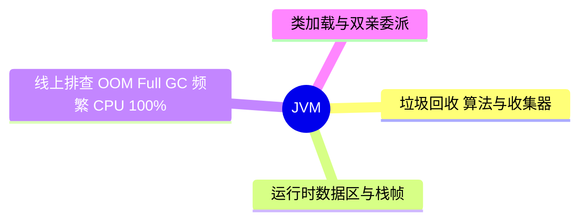

# JVM

> 进度：4 / 4 条已写完。本页由 `tools/gen_index.py` 生成，改条目后重新运行即可。

## 知识地图

## 条目（按频率排序）

频率按 2025–2026 年后端面经里出现的次数估计：★★★ 几乎每场都可能问，★★ 经常问，★ 偶尔问。

| 知识点 | 频率 | 状态 | 一句话答案 |
|---|---|---|---|
| [垃圾回收：算法与收集器（G1、ZGC）](./gc-algorithms) | ★★★ | ✅ | 可达性分析找垃圾；算法有标记-清除、标记-复制、标记-整理；新生代用复制，老年代用标记-整理。G1 把堆分成 Region、按停顿时间目标挑回收价值高的 Region；ZGC 用染色指针和读屏障，停顿时间不到 1 毫秒。 |
| [运行时数据区与栈帧](./memory-areas) | ★★★ | ✅ | 线程私有：程序计数器、虚拟机栈（栈帧里有局部变量表、操作数栈、动态链接、返回地址）、本地方法栈；线程共享：堆、方法区（JDK 8 起用元空间实现，放在本地内存）。 |
| [线上排查：OOM、Full GC 频繁、CPU 100%](./troubleshooting) | ★★★ | ✅ | OOM：加 -XX:+HeapDumpOnOutOfMemoryError 导出 dump，用 MAT 看大对象和引用链。CPU 100%：top 找进程 → top -H 找线程 → 线程 id 转十六进制 → jstack 找对应栈。Full GC 频繁：jstat 看 GC 情况，检查大对象、内存泄漏、元空间。 |
| [类加载与双亲委派](./class-loading) | ★★☆ | ✅ | 加载 → 验证 → 准备 → 解析 → 初始化。加载类时先委托父加载器，父加载器加载不了才自己加载，保证核心类不被篡改。 |
