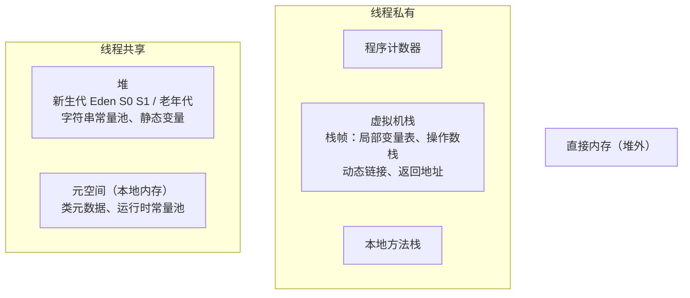

# 运行时数据区与栈帧

> 频率：★★★ · 近两年出现在：字节（JVM 内存、GC、G1）、阿里（JVM、类加载） · 参考：[JavaGuide](https://javaguide.cn/java/jvm/memory-area.html)

## 一句话答案

线程私有：**程序计数器**（当前执行到哪条字节码）、**虚拟机栈**（每次方法调用压一个栈帧，栈帧里有局部变量表、操作数栈、动态链接、返回地址）、**本地方法栈**。线程共享：**堆**（对象实例，GC 的主要区域）和**方法区**（类的元数据、运行时常量池、静态变量；JDK 8 起用元空间实现，放在本地内存）。另外还有不归 JVM 规范管的**直接内存**。

## 展开（1–2 分钟能讲完）

| 区域 | 线程 | 存什么 | 会不会 OOM |
|---|---|---|---|
| 程序计数器 | 私有 | 下一条字节码的地址（执行 native 方法时为空） | 唯一不会 OOM 的区域 |
| 虚拟机栈 | 私有 | 栈帧 | 太深 StackOverflowError；扩展失败 OOM |
| 本地方法栈 | 私有 | native 方法的栈帧（HotSpot 和虚拟机栈合一） | 同上 |
| 堆 | 共享 | 对象、数组；字符串常量池和静态变量（JDK 7 起） | `Java heap space` |
| 方法区（元空间） | 共享 | 类的结构、方法字节码、运行时常量池 | `Metaspace` |
| 直接内存 | 共享 | NIO 的 `DirectByteBuffer`、Netty | `Direct buffer memory` |

**栈帧的组成**：

- 局部变量表：方法参数和局部变量，以槽（slot）为单位，实例方法的第 0 个槽是 `this`。
- 操作数栈：字节码指令的计算区，比如 `iadd` 从栈顶弹两个数、压回结果。
- 动态链接：指向运行时常量池里这个方法的引用，用于把符号引用转成直接引用。
- 返回地址：方法正常返回或异常退出后回到哪里。

**为什么 JDK 8 用元空间替代永久代**：永久代大小固定（`-XX:MaxPermSize`），类多了（大量动态代理、JSP）容易 OOM，而且很难调；元空间用本地内存，默认只受物理内存限制，也让 HotSpot 和 JRockit 合并更方便。

## 图解

## 追问链

- **哪些区域会 OOM？** 除了程序计数器都会：堆（对象太多或内存泄漏）、元空间（动态生成大量类，如 CGLIB 代理、Groovy 脚本）、栈（线程太多，每个线程的栈分配失败）、直接内存（Netty 堆外内存泄漏）。还有 `unable to create new native thread`：线程数超过系统限制。
- **StackOverflowError 和 OOM 的区别？** 前者是单个线程的栈深度超过限制，常见于无限递归或递归太深，`-Xss` 设单个栈的大小（默认 1 MB）；后者是申请内存失败。`-Xss` 设得越大，每个线程占的内存越多，能创建的线程数越少。
- **对象一定分配在堆上吗？** 不一定。JIT 的**逃逸分析**发现对象不会逃出方法（不被返回、不被赋给字段、不传给别的线程），就可以做**标量替换**：不创建对象，把它的字段拆成局部变量放在栈上或寄存器里。另外还有**锁消除**（对象不逃逸，上面的 synchronized 可以去掉）。HotSpot 没有真正的「栈上分配」，是靠标量替换实现的效果。
- **对象创建的过程？** 类加载检查 → 分配内存（规整的堆用**指针碰撞**，有碎片的用**空闲列表**；并发分配用 CAS 或 **TLAB** 每个线程预先分一小块）→ 内存清零 → 设置对象头（类型指针、哈希码、GC 年龄、锁状态）→ 执行构造方法 `<init>`。
- **对象的内存布局？** 对象头（Mark Word 8 字节 + 类型指针，开启压缩指针时 4 字节；数组还有长度）+ 实例数据 + 对齐填充到 8 字节的倍数。所以 `new Object()` 占 16 字节。

## 我的项目里

TODO：项目的 `-Xmx`、`-Xss`、`-XX:MaxMetaspaceSize` 设的多少？有没有用到堆外内存（Netty）？
