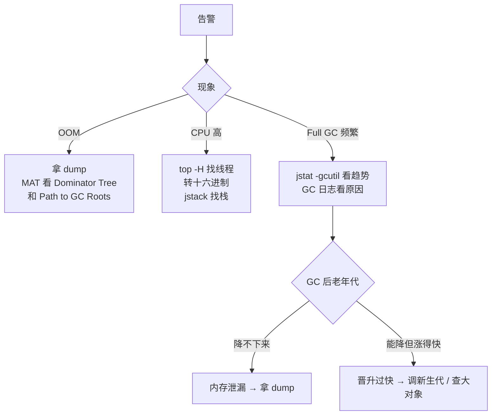

# 线上排查：OOM、Full GC 频繁、CPU 100%

> 频率：★★★ · 近两年出现在：腾讯（线上 OOM / Full GC 排查）、美团（G1 与 CMS、JVM GC 排查） · 参考：[JavaGuide](https://javaguide.cn/java/jvm/jdk-monitoring-and-troubleshooting-tools.html)

## 一句话答案

**OOM**：提前加 `-XX:+HeapDumpOnOutOfMemoryError` 自动导出堆快照，用 MAT 看占用最大的对象和它到 GC Roots 的引用链。**CPU 100%**：`top` 找进程 → `top -H -p` 找线程 → 线程 id 转十六进制 → `jstack` 里搜 `nid=0x...` 找到对应的栈。**Full GC 频繁**：`jstat -gcutil` 看各区占用和 GC 次数，再看是老年代真的满了（内存泄漏、大对象）、元空间满了，还是代码里调了 `System.gc()`。

## 展开（1–2 分钟能讲完）

**排查的通用步骤**：先止血（重启、扩容、摘流量，但要先保留现场：dump、jstack），再定位，最后修复和复盘。

**OOM 排查**：

1. 看报错类型：`Java heap space`（堆）、`Metaspace`（类太多）、`Direct buffer memory`（堆外）、`GC overhead limit exceeded`（98% 时间在 GC 但只回收了不到 2%）、`unable to create new native thread`。
2. 堆 OOM：用 MAT 打开 dump，看 **Dominator Tree** 和 **Leak Suspects**，找到占内存最多的对象，再看它的 **Path to GC Roots**，定位是谁持有它。
3. 常见原因：一次查出太多数据（没分页）；静态 Map 当缓存只加不删；ThreadLocal 没 remove；大量未关闭的连接；无界队列堆积。

**CPU 100% 排查**：

```bash
top                         # 找到 CPU 高的 Java 进程 pid
top -H -p <pid>             # 找到 CPU 高的线程 tid
printf '%x\n' <tid>         # 转成十六进制
jstack <pid> | grep -A 20 'nid=0x<十六进制>'
```

常见原因：死循环（比如并发下的 HashMap）、正则回溯、频繁 GC（看到的是 GC 线程）、大量序列化计算。

**Full GC 频繁排查**：

```bash
jstat -gcutil <pid> 1000    # 每秒打印 S0 S1 E O M 使用率和 YGC/FGC 次数
jmap -histo:live <pid> | head -20   # 对象数量和大小排行（会触发 Full GC，线上慎用）
```

老年代在每次 Full GC 后都降不下来 → 内存泄漏；每次能降很多但很快又满 → 对象晋升太快（新生代太小、大对象），调大新生代或优化代码。

## 图解



## 追问链

- **常用 JVM 参数？** `-Xms -Xmx`（堆的初始和最大值，一般设成一样，避免扩容抖动）；`-Xmn`（新生代）；`-Xss`；`-XX:MaxMetaspaceSize`；`-XX:+UseG1GC -XX:MaxGCPauseMillis=200`；`-XX:+HeapDumpOnOutOfMemoryError -XX:HeapDumpPath=...`；GC 日志 `-Xlog:gc*:file=gc.log`（JDK 9+）。容器里用 `-XX:MaxRAMPercentage=75` 按容器内存比例设堆。
- **四核 8G 机器怎么设堆大小？** 不能把 8G 全给堆：还有元空间、线程栈、直接内存、代码缓存、操作系统本身。一般堆给物理内存的一半到 3/4，比如 `-Xms4g -Xmx4g`（或者容器里 `MaxRAMPercentage=60~75`）。G1 下一般不手动设新生代大小，让它自己按停顿目标调。最终要按压测和 GC 日志调整。
- **Arthas 能做什么？** 不重启就能在线诊断：`dashboard`（总览线程、内存、GC）、`thread -n 3`（CPU 最高的 3 个线程，直接替代上面那套 top + jstack）、`thread -b`（找死锁）、`trace`（方法内部每一步耗时，查接口慢）、`watch`（看方法的入参、返回值、异常）、`jad`（反编译线上的类，确认代码版本）、`heapdump`、`profiler`（生成火焰图）。
- **内存泄漏和内存溢出的区别？** 泄漏是不用的对象还被引用着、回收不掉；泄漏积累多了会导致溢出。溢出也可能只是数据量确实太大。
- **线上 dump 有什么风险？** `jmap -dump` 会 STW，堆越大停得越久；dump 文件和堆一样大，可能写满磁盘。所以先摘流量再 dump。

## 我的项目里

TODO：写一个自己的排查案例：现象 → 用了什么工具 → 定位到什么原因 → 怎么修 → 怎么防止再发生。
