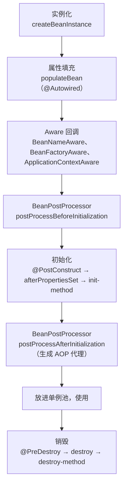

# Bean 生命周期与作用域

> 频率：★★☆ · 近两年出现在：阿里（Spring 自动配置、Bean 生命周期）、美团（ThreadLocal、Bean 作用域） · 参考：[JavaGuide](https://javaguide.cn/system-design/framework/spring/spring-knowledge-and-questions-summary.html)

## 一句话答案

实例化（反射调构造方法）→ 属性填充（依赖注入）→ 各种 `Aware` 回调 → `BeanPostProcessor` 前置处理 → 初始化（`@PostConstruct` → `InitializingBean.afterPropertiesSet` → `init-method`）→ `BeanPostProcessor` 后置处理（**AOP 代理在这一步生成**）→ 使用 → 销毁（`@PreDestroy` → `DisposableBean.destroy` → `destroy-method`）。作用域默认是 singleton。

## 展开（1–2 分钟能讲完）

**记忆方法：四个大阶段 + 两类扩展点**。

- 四个阶段：实例化、属性赋值、初始化、销毁。源码对应 `AbstractAutowireCapableBeanFactory.doCreateBean` 里的 `createBeanInstance` → `populateBean` → `initializeBean`。
- 扩展点一：`BeanPostProcessor`，对**每个** Bean 的初始化前后做处理。`@Autowired` 注入靠 `AutowiredAnnotationBeanPostProcessor`，AOP 代理靠 `AnnotationAwareAspectJAutoProxyCreator`。
- 扩展点二：`BeanFactoryPostProcessor`，在**所有 Bean 实例化之前**修改 Bean 的定义（BeanDefinition），比如解析 `${}` 占位符。

**作用域**：

| 作用域 | 含义 |
|---|---|
| singleton（默认） | 容器里只有一个实例 |
| prototype | 每次 `getBean` 或注入都新建一个；Spring 不管它的销毁 |
| request / session / application | Web 环境下每个请求 / 会话 / ServletContext 一个 |

## 图解

## 追问链

- **Bean 是线程安全的吗？** Spring 不保证。singleton Bean 被所有线程共享，**无状态**的（只有注入的其他 Bean、没有可变成员变量，比如大部分 Service、Controller）就是安全的；有可变成员变量就不安全。解决：不要在 Bean 里放可变状态，用局部变量；必须要时用 `ThreadLocal`、并发容器，或者改成 prototype / request 作用域。
- **singleton 和 prototype？** singleton 在容器启动时创建（除非 `@Lazy`），生命周期全程由 Spring 管理；prototype 每次获取都新建，Spring 创建完就不管了，不会调用销毁方法。**坑**：singleton 里注入 prototype，只在注入时创建一次，之后一直是同一个；要每次拿新的，用 `ObjectProvider<T>.getObject()`、`@Lookup` 方法或者作用域代理。
- **BeanFactory 和 FactoryBean？** `BeanFactory` 是 IoC 容器的顶层接口（`ApplicationContext` 是它的增强版，多了事件、国际化、资源加载，并且启动时就预先创建单例）。`FactoryBean` 是一个特殊的 Bean，用来**生产**其他 Bean：`getBean("xxx")` 拿到的是它 `getObject()` 返回的对象，`getBean("&xxx")` 才拿到 FactoryBean 本身。MyBatis 的 `MapperFactoryBean` 就是用它给每个 Mapper 接口生成代理。
- **@PostConstruct 里能用注入的 Bean 吗？** 能，它在属性填充之后执行。但在构造方法里不能用字段注入的 Bean（还没注入），所以推荐构造器注入。

## 我的项目里

TODO：项目里有没有在 Bean 初始化时做事情（预热缓存、加载配置、启动后台线程）？用的是哪个扩展点？
