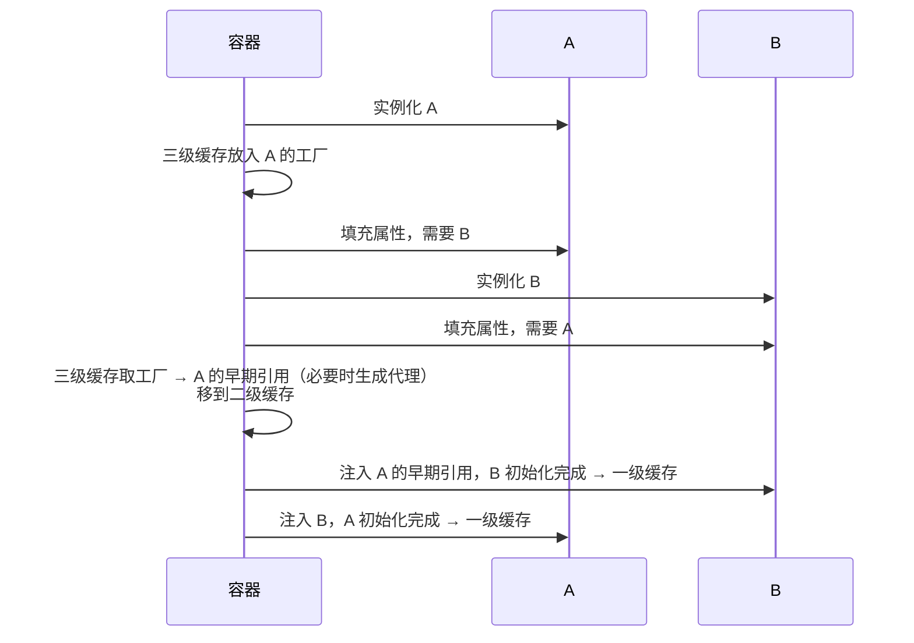

# 循环依赖与三级缓存

> 频率：★★★ · 近两年出现在：美团（Spring 循环依赖、设计模式） · 参考：[JavaGuide](https://javaguide.cn/system-design/framework/spring/spring-knowledge-and-questions-summary.html)

## 一句话答案

A 依赖 B、B 又依赖 A。Spring 用**三级缓存**解决**单例 + 字段/setter 注入**的循环依赖：A 实例化后（还没填属性）先把一个能生成 A 早期引用的工厂放进三级缓存；填充属性时去创建 B，B 需要 A，就从三级缓存拿到 A 的早期引用（如果 A 需要 AOP，这时就提前生成代理），B 完成后 A 再继续。构造器注入的循环依赖、prototype 的循环依赖解决不了。

## 展开（1–2 分钟能讲完）

**三级缓存**（都在 `DefaultSingletonBeanRegistry` 里）：

| 缓存 | 存什么 |
|---|---|
| 一级 `singletonObjects` | 完全初始化好的 Bean |
| 二级 `earlySingletonObjects` | 提前暴露的早期引用（可能是代理），还没填完属性 |
| 三级 `singletonFactories` | `ObjectFactory`，调用它才生成早期引用（`getEarlyBeanReference`） |

**流程**（A ↔ B）：

1. 创建 A：实例化 A，把 `() -> getEarlyBeanReference(A)` 放进三级缓存。
2. 填充 A 的属性，发现要 B → 创建 B。
3. 实例化 B，填充 B 的属性，发现要 A → 依次查一、二、三级缓存，在三级找到工厂，调用得到 A 的早期引用，放进二级缓存、删掉三级。
4. B 初始化完成，放进一级缓存。
5. 回到 A，注入 B，A 初始化完成，放进一级缓存。

**解决不了的情况**：

- 构造器注入：实例化 A 时就需要 B，A 还没创建出来，没法提前暴露。
- prototype：不缓存，每次都新建，会无限递归。
- `@Async` 的 Bean：它的代理是在后置处理器里生成的，不走 `getEarlyBeanReference`，提前暴露出去的是原始对象，最后和真正的 Bean 不一致，会报错。

## 图解

## 追问链

- **为什么要三级而不是二级？** 如果只为了解决循环依赖，二级缓存（直接放早期对象）就够了。三级缓存是为了 **AOP**：正常情况下代理是在初始化**之后**（`postProcessAfterInitialization`）生成的。如果用二级缓存，就必须在实例化后**立刻**为每个 Bean 生成代理放进去，不管有没有循环依赖，这违背了 Spring 的设计。三级缓存放的是工厂，**只有真的发生循环依赖、有人来要早期引用时**，才提前生成代理；没有循环依赖的 Bean 仍然按正常时机生成代理。
- **Spring Boot 2.6 起默认禁止循环依赖？** 是的，`spring.main.allow-circular-references` 默认为 false，启动时直接报错。官方的态度是循环依赖说明设计有问题，应该重构：抽出第三个类、改成事件通知、或者把共同依赖的逻辑下沉。确实需要可以把这个配置设为 true。
- **@Lazy 怎么解决？** 在注入点加 `@Lazy`，Spring 注入的不是真正的 B，而是一个 B 的**代理**，第一次调用方法时才去容器里取真正的 B。这样创建 A 时不需要立刻创建 B，循环就断开了。构造器注入的循环依赖也可以用这个方法解决。
- **怎么从设计上避免？** 构造器注入（循环依赖会在启动时直接暴露）；分层清晰，同层的 Service 不互相调用，抽出公共的下层服务；用事件（`ApplicationEventPublisher`）解耦。

## 我的项目里

TODO：项目有没有出现过循环依赖的启动报错？最后是怎么改的？
