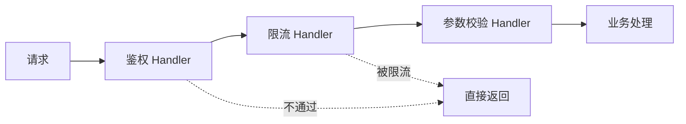

# Spring 中的设计模式、用策略模式替代 if-else

> 频率：★★☆ · 近两年出现在：美团（Spring 循环依赖、设计模式） · 参考：[JavaGuide](https://javaguide.cn/system-design/framework/spring/spring-design-patterns-summary.html)

## 一句话答案

Spring 里用到的设计模式：工厂（`BeanFactory`）、单例（单例 Bean）、代理（AOP）、模板方法（`JdbcTemplate`、`RestTemplate`）、观察者（事件机制）、适配器（`HandlerAdapter`）、责任链（拦截器、过滤器、AOP 的通知链）、策略（`Resource` 加载、`InstantiationStrategy`）。业务里最常用的是**策略模式 + Spring 注入**替代一长串 if-else。

## 展开（1–2 分钟能讲完）

**策略模式替代 if-else**：比如按支付方式走不同逻辑。

```java
public interface PayStrategy {
    String type();                       // "alipay"、"wechat"
    PayResult pay(Order order);
}

@Component
class AlipayStrategy implements PayStrategy { ... }

@Component
public class PayStrategyFactory {
    private final Map<String, PayStrategy> map;
    public PayStrategyFactory(List<PayStrategy> strategies) {   // Spring 注入所有实现
        map = strategies.stream().collect(Collectors.toMap(PayStrategy::type, s -> s));
    }
    public PayStrategy get(String type) {
        PayStrategy s = map.get(type);
        if (s == null) throw new BizException("不支持的支付方式 " + type);
        return s;
    }
}
```

新增一种支付方式只要新写一个类，不改已有代码（开闭原则）。也可以直接注入 `Map<String, PayStrategy>`，key 是 Bean 名。

**Spring 里各模式的位置**：

| 模式 | 在哪 |
|---|---|
| 工厂 | `BeanFactory`、`FactoryBean` |
| 单例 | 单例 Bean（容器级单例，不是类级的） |
| 代理 | AOP、`@Transactional`、`@Async` |
| 模板方法 | `JdbcTemplate`、`AbstractApplicationContext.refresh()` |
| 观察者 | `ApplicationEvent` + `@EventListener` |
| 适配器 | Spring MVC 的 `HandlerAdapter`：适配不同类型的 Controller |
| 责任链 | `HandlerInterceptor`、Servlet `Filter`、AOP 的 `MethodInterceptor` 链 |
| 装饰器 | `BeanWrapper`、`TransactionAwareDataSourceProxy` |

## 图解



## 追问链

- **DCL 单例？**

  ```java
  public class Singleton {
      private static volatile Singleton instance;      // volatile 不能少
      private Singleton() {}
      public static Singleton getInstance() {
          if (instance == null) {                      // 第一次检查：已创建就不加锁
              synchronized (Singleton.class) {
                  if (instance == null) {              // 第二次检查：防止两个线程都通过了第一次检查
                      instance = new Singleton();
                  }
              }
          }
          return instance;
      }
  }
  ```

  `volatile` 防止指令重排：`new` 分成分配内存、初始化、把引用赋给 instance 三步，重排成「分配 → 赋值 → 初始化」后，另一个线程在第一次检查时看到 instance 不为 null，拿到的是还没初始化完的对象。更简单的写法：**静态内部类**（`Holder.INSTANCE`，利用类初始化的线程安全和懒加载）或**枚举**（还能防反射和序列化破坏单例）。
- **责任链模式在项目里怎么用？** 典型场景：请求前置校验（鉴权 → 限流 → 黑名单 → 参数校验）、风控规则、审批流、Agent 的输入输出护栏。实现：定义 `Handler` 接口（`handle(ctx)` 返回是否继续），Spring 注入 `List<Handler>`，用 `@Order` 排序，依次执行。好处是每个规则独立、可以配置开关、新增规则不改原有代码。
- **模板方法和策略的区别？** 模板方法用**继承**：父类定好流程骨架，子类实现其中某几步；策略用**组合**：整个算法可以替换。
- **观察者模式在 Spring 里的用法？** 发布 `applicationEventPublisher.publishEvent(new OrderPaidEvent(...))`，监听方 `@EventListener` 处理。默认是**同步**的，和发布者在同一个线程、同一个事务里；要异步加 `@Async`；要在事务提交后再处理用 `@TransactionalEventListener(phase = AFTER_COMMIT)`。

## 我的项目里

TODO：项目里有没有用策略模式或责任链替代 if-else 的地方？新增一种类型要改几个文件？
