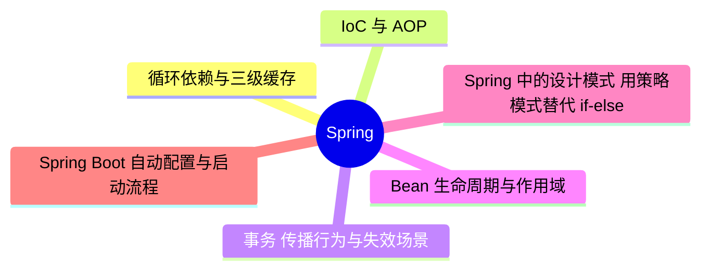

# Spring

> 进度：0 / 6 条已写完。本页由 `tools/gen_index.py` 生成，改条目后重新运行即可。

## 知识地图

## 条目（按频率排序）

频率按 2025–2026 年后端面经里出现的次数估计：★★★ 几乎每场都可能问，★★ 经常问，★ 偶尔问。

| 知识点 | 频率 | 状态 | 一句话答案 |
|---|---|---|---|
| [循环依赖与三级缓存](./circular-dependency) | ★★★ | · | 单例、属性注入的循环依赖靠三级缓存解决：一级放成品 Bean，二级放提前暴露的半成品，三级放生成早期引用的工厂（需要时提前创建 AOP 代理）。构造器注入的循环依赖解决不了。 |
| [IoC 与 AOP](./ioc-aop) | ★★★ | · | IoC 把对象的创建和依赖注入交给容器；AOP 在不改原代码的情况下织入横切逻辑（日志、事务、权限），实现方式是动态代理：有接口用 JDK 动态代理，没有接口用 CGLIB。 |
| [事务：传播行为与失效场景](./transaction) | ★★★ | · | @Transactional 靠 AOP 代理实现。常见失效：同类内部方法调用（绕过代理）、方法不是 public、异常被吞掉、抛出受检异常（默认只回滚运行时异常）、数据库引擎不支持事务。 |
| [Bean 生命周期与作用域](./bean-lifecycle) | ★★☆ | · | 实例化 → 属性填充 → Aware 回调 → BeanPostProcessor 前置 → 初始化（@PostConstruct、afterPropertiesSet、init-method）→ BeanPostProcessor 后置（AOP 代理在这里生成）→ 使用 → 销毁。 |
| [Spring 中的设计模式、用策略模式替代 if-else](./design-patterns) | ★★☆ | · | 工厂（BeanFactory）、单例（Bean）、代理（AOP）、模板方法（JdbcTemplate）、观察者（事件机制）、适配器（HandlerAdapter）。多个 if-else 分支可以用策略模式 + Spring 注入 Map<String, Strategy> 替代。 |
| [Spring Boot 自动配置与启动流程](./springboot) | ★★☆ | · | @SpringBootApplication 里的 @EnableAutoConfiguration 会加载 AutoConfiguration.imports 里列出的配置类，再用 @ConditionalOnClass 等条件决定是否生效。 |
