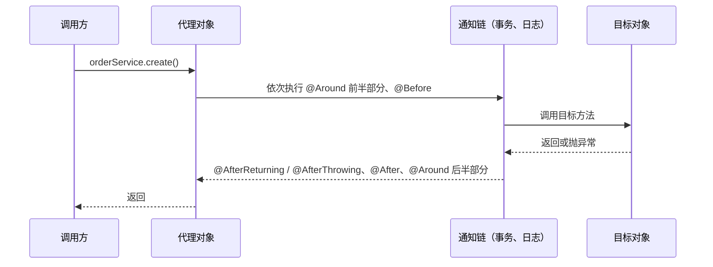

# IoC 与 AOP

> 频率：★★★ · 参考：[JavaGuide](https://javaguide.cn/system-design/framework/spring/ioc-and-aop.html)

## 一句话答案

**IoC（控制反转）**：对象的创建和依赖关系交给容器管理，而不是自己 `new`，实现方式是**依赖注入**（DI）。好处是解耦、方便替换实现和测试。**AOP（面向切面）**：把日志、事务、权限这类横切逻辑从业务代码里抽出来，在运行时通过**动态代理**织入。目标类实现了接口默认用 JDK 动态代理，否则用 CGLIB（Spring Boot 2.x 起默认都用 CGLIB）。

## 展开（1–2 分钟能讲完）

**IoC 容器启动的大致过程**（`AbstractApplicationContext.refresh()`）：扫描并解析配置，生成 BeanDefinition → 执行 `BeanFactoryPostProcessor` → 注册 `BeanPostProcessor` → 实例化所有非懒加载的单例 Bean（走[生命周期](./bean-lifecycle)）→ 发布容器刷新完成事件。

**注入方式**：构造器注入（推荐：依赖不可变、不会为 null、循环依赖会立刻暴露、方便单测）、setter 注入（可选依赖）、字段注入（`@Autowired` 写在字段上，最方便，但不好测试，IDEA 会警告）。

**AOP 的术语**：

- 切面（Aspect）：一个横切关注点的类，比如日志切面。
- 切点（Pointcut）：在哪些方法上生效，`@Pointcut("execution(* com.x.service..*(..))")` 或 `@annotation(com.x.Log)`。
- 通知（Advice）：什么时候执行：`@Before`、`@After`、`@AfterReturning`、`@AfterThrowing`、`@Around`。
- 织入：Spring AOP 是运行时通过代理织入；AspectJ 可以编译期或类加载期织入（直接改字节码）。

## 图解

## 追问链

- **JDK 代理和 CGLIB 的区别？** JDK 动态代理基于**接口**：运行时生成一个实现了相同接口的类，方法调用转给 `InvocationHandler`，只能代理接口里的方法。CGLIB 基于**继承**：用 ASM 生成目标类的子类，重写方法，所以不能代理 `final` 类和 `final`/`private`/`static` 方法。性能上现在差别不大。Spring Boot 2.0 起默认 `proxyTargetClass=true`，即都用 CGLIB，避免「注入实现类时报类型不匹配」的问题。
- **多个切面的执行顺序？** 用 `@Order` 或实现 `Ordered`，**值越小优先级越高**：越高的切面越在外层，`@Before` 越先执行、`@After` 越后执行（像洋葱）。同一个切面里：`@Around` 前半 → `@Before` → 方法 → `@AfterReturning`/`@AfterThrowing` → `@After` → `@Around` 后半（Spring 5.2.7 起的顺序）。
- **@Autowired 和 @Resource 的区别？** `@Autowired` 是 Spring 的，**先按类型**找，找到多个再按字段名匹配，可以配合 `@Qualifier` 指定名字，`required=false` 允许为空。`@Resource` 是 JSR-250（Jakarta）的，**先按名字**找，找不到再按类型。
- **同一个类里方法 A 调用方法 B，B 上的切面会生效吗？** 不会。A 里调用的是 `this.B()`，`this` 是目标对象而不是代理，绕过了代理。解决：把 B 移到另一个 Bean；或者注入自己（`@Lazy` 注入自身）；或者 `AopContext.currentProxy()`（要开启 `exposeProxy`）。这也是 `@Transactional` 失效的常见原因。
- **Spring AOP 和 AspectJ 的区别？** Spring AOP 只能拦截 Spring Bean 的方法调用，运行时代理，有性能开销；AspectJ 功能完整（字段访问、构造方法、静态方法都能拦截），编译期织入，没有运行时代理开销，但要特殊的编译器或 agent。Spring 只借用了 AspectJ 的注解和切点表达式语法。

## 我的项目里

TODO：项目里自己写过切面吗（接口日志、耗时统计、权限校验、限流）？切点是用表达式还是自定义注解？
