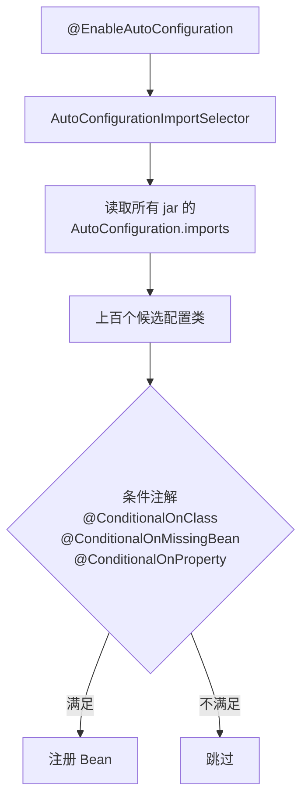

# Spring Boot 自动配置与启动流程

> 频率：★★☆ · 近两年出现在：阿里（Spring 自动配置、Bean 生命周期） · 参考：[JavaGuide](https://javaguide.cn/system-design/framework/spring/spring-boot-auto-assembly-principles.html)

## 一句话答案

**自动配置**：`@SpringBootApplication` 包含 `@EnableAutoConfiguration`，它通过 `AutoConfigurationImportSelector` 读取所有 jar 里的自动配置类清单（Boot 2.7 起是 `META-INF/spring/org.springframework.boot.autoconfigure.AutoConfiguration.imports`，之前是 `spring.factories`），再用 `@ConditionalOnClass`、`@ConditionalOnMissingBean`、`@ConditionalOnProperty` 等条件注解决定哪些生效。引入了依赖、又没有自己定义，就用默认配置。

## 展开（1–2 分钟能讲完）

**`@SpringBootApplication` = 三个注解**：

- `@SpringBootConfiguration`：就是 `@Configuration`。
- `@ComponentScan`：扫描启动类所在包及子包。
- `@EnableAutoConfiguration`：导入自动配置。

**条件注解的例子**：`DataSourceAutoConfiguration` 上有 `@ConditionalOnClass(DataSource.class)`（classpath 里有 JDBC 才生效），里面的 `DataSource` Bean 有 `@ConditionalOnMissingBean`（用户自己定义了就不用默认的）。属性通过 `@ConfigurationProperties(prefix = "spring.datasource")` 绑定。这就是「约定大于配置」：默认可用，又可以覆盖。

**启动流程**（`SpringApplication.run`）：

1. 推断应用类型（Servlet / Reactive / 普通），加载 `ApplicationContextInitializer` 和 `ApplicationListener`。
2. 准备 `Environment`：读取命令行参数、环境变量、配置文件。
3. 打印 Banner，创建 `ApplicationContext`。
4. `prepareContext`：注册启动类等。
5. **`refreshContext`**：就是 Spring 的 `refresh()`：解析配置类、处理自动配置、创建所有单例 Bean；Web 应用在这一步（`onRefresh`）创建并启动内嵌的 Tomcat。
6. 执行 `CommandLineRunner` / `ApplicationRunner`，发布 started、ready 事件。

## 图解

## 追问链

- **starter 是什么、怎么写一个？** starter 是一个只做依赖聚合的模块（比如 `spring-boot-starter-web` 把 Spring MVC、Tomcat、Jackson 拉进来），通常配一个 autoconfigure 模块。自己写：
  1. 写 `XxxProperties`（`@ConfigurationProperties(prefix = "xxx")`）；
  2. 写 `XxxAutoConfiguration`（`@AutoConfiguration` + 条件注解 + `@EnableConfigurationProperties`），里面定义 Bean，用 `@ConditionalOnMissingBean` 允许用户覆盖；
  3. 在 `META-INF/spring/org.springframework.boot.autoconfigure.AutoConfiguration.imports` 里写上配置类的全限定名；
  4. 命名习惯：第三方的叫 `xxx-spring-boot-starter`。
- **配置文件的加载顺序？** 优先级从高到低（高的覆盖低的）：命令行参数 > `SPRING_APPLICATION_JSON` > 系统属性 `-D` > 环境变量 > jar 包**外**的 `application-{profile}` > jar 包外的 `application` > jar 包**内**的 `application-{profile}` > jar 包内的 `application` > `@PropertySource` > 默认属性。同一位置 `.properties` 优先于 `.yml`。记住两条：外部覆盖内部，profile 专属覆盖通用。
- **内嵌 Tomcat 是怎么启动的？** `ServletWebServerApplicationContext.onRefresh()` 里通过 `ServletWebServerFactory`（自动配置的 `TomcatServletWebServerFactory`）创建 Tomcat，把 `DispatcherServlet` 注册进去。
- **怎么排查某个自动配置为什么没生效？** 启动加 `--debug` 或 `debug=true`，会打印 **Condition Evaluation Report**，列出每个配置类匹配或不匹配的原因。用 `@SpringBootApplication(exclude = ...)` 排除不要的自动配置。

## 我的项目里

TODO：项目用了哪些 starter？有没有自己封装过 starter 或者自动配置（比如统一的日志、鉴权、限流组件）？
