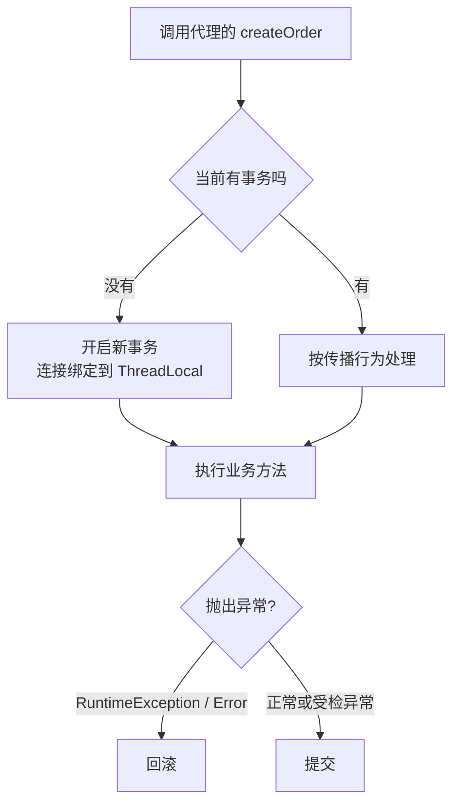

# 事务：传播行为与失效场景

> 频率：★★★ · 参考：[JavaGuide](https://javaguide.cn/system-design/framework/spring/spring-transaction.html)

## 一句话答案

`@Transactional` 基于 AOP：代理在方法前开启事务、方法结束后提交，抛出**运行时异常或 Error**时回滚。常见失效场景：方法不是 public；**同类内部调用**（不经过代理）；异常被 catch 吞掉；抛出的是受检异常而没配 `rollbackFor`；Bean 没被 Spring 管理；数据库引擎不支持事务（MyISAM）；在新线程里操作数据库。

## 展开（1–2 分钟能讲完）

**原理**：`TransactionInterceptor` 拦截方法 → 通过 `PlatformTransactionManager`（JDBC 下是 `DataSourceTransactionManager`）获取连接、`setAutoCommit(false)` → 把连接绑定到 **ThreadLocal**（`TransactionSynchronizationManager`），同一个线程里的 MyBatis/JdbcTemplate 都拿这个连接 → 正常结束 commit，异常时按规则 rollback。

**失效场景逐条**：

| 场景 | 原因 |
|---|---|
| 同类内部调用 `this.b()` | 没经过代理（见 [AOP](./ioc-aop)） |
| 非 public 方法 | 默认只代理 public 方法（Spring 6 起 CGLIB 下 protected 和包可见的也支持） |
| `final` / `static` 方法 | CGLIB 无法重写 |
| 异常被 catch 了不抛 | 代理看不到异常；要么重新抛出，要么 `TransactionAspectSupport.currentTransactionStatus().setRollbackOnly()` |
| 抛受检异常（如 IOException） | 默认只回滚 RuntimeException 和 Error，要写 `rollbackFor = Exception.class` |
| 新开线程里执行 SQL | 事务连接绑定在原线程的 ThreadLocal 里，新线程拿到的是另一个连接 |
| 传播行为设成 `NOT_SUPPORTED` / `NEVER` | 本来就不在事务里 |
| 类没被 Spring 管理 | 没有代理 |

## 图解

## 追问链

- **七种传播行为？** 重点是前三个：
  - `REQUIRED`（默认）：有事务就加入，没有就新建。内层抛异常，整个事务回滚（即使外层 catch 了，提交时也会报 `UnexpectedRollbackException`，因为事务已经被标记为只能回滚）。
  - `REQUIRES_NEW`：挂起外层事务，**新开一个独立的事务**（新连接）。内外各自提交或回滚，互不影响。适合记录操作日志、发消息记录这种「主流程失败也要保留」的操作。
  - `NESTED`：在外层事务里建一个**保存点**（savepoint）。内层回滚只回到保存点，外层可以继续；外层回滚则内层一起回滚。
  - 其他：`SUPPORTS`（有就加入，没有就非事务执行）、`MANDATORY`（必须有，没有抛异常）、`NOT_SUPPORTED`（挂起事务，非事务执行）、`NEVER`（有事务就抛异常）。
- **大事务的问题？** 长时间持有数据库连接，连接池被占满，其他请求拿不到连接；长时间持有行锁，并发更新阻塞甚至死锁；undo log 变大，回滚慢；主从延迟变大。优化：把查询、计算、远程调用移到事务外面，事务里只留写操作；用**编程式事务** `TransactionTemplate` 精确控制范围；拆成多个小事务 + 最终一致。
- **事务里调用远程接口的问题？** 远程调用慢会拉长事务；超时了不知道对方成功没有；本地事务回滚了，远程的操作回滚不了（不一致）。做法：远程调用放到事务外，或者事务提交后再调用（`@TransactionalEventListener(phase = AFTER_COMMIT)`、`TransactionSynchronization.afterCommit`），失败了用重试 + 幂等，或者用本地消息表做最终一致（见[分布式事务](../11-distributed/distributed-transaction)）。
- **isolation 和 readOnly 属性？** `isolation` 默认用数据库的隔离级别（MySQL 是可重复读）。`readOnly = true` 对 MySQL 会开启只读事务，可以做一些优化，读写分离的框架也会据此路由到从库。
- **事务提交后才发 MQ 怎么写？** 见上面的 `@TransactionalEventListener`；如果发 MQ 和提交必须同时成功，用本地消息表或 RocketMQ 事务消息。

## 我的项目里

TODO：项目里有没有遇到过事务没生效或者大事务的问题？哪些方法用了 `REQUIRES_NEW`？
