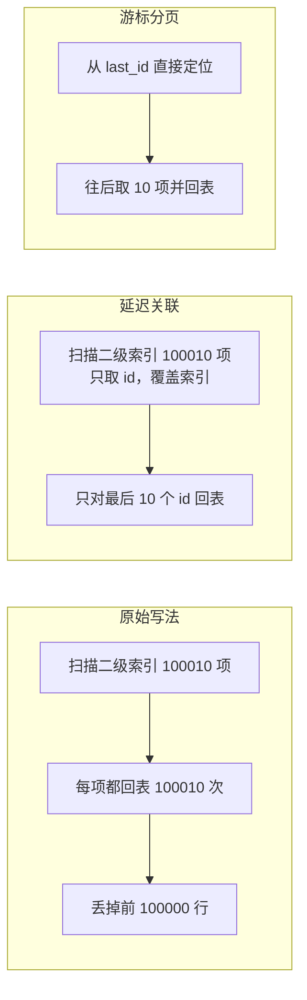

# 深分页优化

> 频率：★★ · 近两年出现在：字节（深分页多次，含现场改写 SQL）、腾讯（深分页慢查询）、小红书（深度分页 SQL 改法）、美团（跨片分页）等 · 参考：[JavaGuide](https://javaguide.cn/high-performance/deep-pagination-optimization.html)

## 一句话答案

`limit 100000, 10` 要扫描并丢弃前 10 万行。优化：记住上一页最后的 id，用 `where id > last_id limit 10`（游标分页）；或者先用覆盖索引查出 id，再 join 回表取整行。

## 展开（1–2 分钟能讲完）

`select * from orders where user_id = ? order by create_time limit 100000, 10` 慢在两处：

1. MySQL 要按顺序找到前 100010 行，再丢掉前 100000 行。
2. 如果是二级索引，这 100010 行**每一行都要回表**，大量随机 IO。

**三种优化方式：**

| 方案 | SQL | 优缺点 |
|---|---|---|
| **游标分页**（推荐） | `where id > #{lastId} order by id limit 10` | 直接从索引定位起点，和页数无关。缺点：不能跳到任意页，适合「下一页」「无限滚动」 |
| **延迟关联** | 先在子查询里用覆盖索引只查 id，再 join 回表 | 只有最终的 10 行回表。仍然要扫描前面的索引项，但快很多 |
| **子查询定位起点** | `where id >= (select id from t order by id limit 100000, 1) limit 10` | 要求 id 和排序顺序一致 |

```sql
-- 延迟关联
select o.* from orders o
join (
    select id from orders
    where user_id = 42
    order by create_time
    limit 100000, 10
) t on o.id = t.id;
```

延迟关联要配合索引 `(user_id, create_time)`：子查询只用这个索引就能拿到 id（二级索引叶子里有主键），不用回表。

## 图解



## 追问链

- **游标分页时排序字段有重复值怎么办？** 用 (排序字段, id) 组合做游标：`where (create_time, id) > (?, ?) order by create_time, id limit 10`，保证顺序唯一，不漏不重。
- **产品一定要能跳页怎么办？** 限制最大页数（很多搜索引擎只给前几十页）；或者预先算好每隔 N 页的起始 id 存起来。
- **分库分表后跨分片怎么分页？**
  - 全局视野法：每个分片都查前 offset + n 条，合并排序后取，页越深越慢。
  - 禁止跳页：用游标，每个分片取 `> last` 的 n 条再合并。
  - 把需要分页查询的数据同步到 ES 或单独的汇总表。
- **ES 的深分页？** `from + size` 默认限制在 1 万条以内；深分页用 `search_after`（类似游标），导出全部数据用 scroll 或 PIT。
- **小红书问过「深分页的 SQL 怎么改」**：现场写出延迟关联和游标分页两种写法，并说明各自的索引要求。

## 我的项目里

TODO：项目里的列表接口是怎么分页的？数据量多大？
