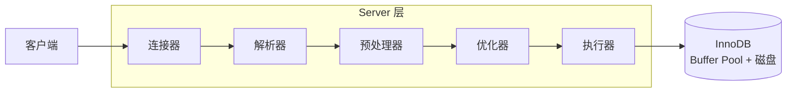

# InnoDB 与 MyISAM、一条 SQL 的执行过程

> 频率：★ · 近两年出现在：恒生（InnoDB 与 MyISAM）、招银网络（存储引擎与 B+ 树）、字节（InnoDB）等 · 参考：[小林coding](https://xiaolincoding.com/mysql/base/how_select.html)

## 一句话答案

InnoDB 支持事务、行锁、外键、崩溃恢复，是默认引擎；MyISAM 只有表锁、不支持事务。SQL 的执行过程：连接器 → 解析器 → 优化器 → 执行器 → 存储引擎。

## 展开（1–2 分钟能讲完）

**InnoDB 和 MyISAM：**

| | InnoDB | MyISAM |
|---|---|---|
| 事务 | 支持 | 不支持 |
| 锁 | 行锁 | 表锁 |
| 崩溃恢复 | 有 redo log | 没有，可能损坏 |
| 索引 | 聚簇索引，数据和主键索引在一起 | 非聚簇，索引存数据文件里的地址 |
| `count(*)` | 要扫描 | 直接返回存好的行数（没有 where 时） |
| 外键 | 支持 | 不支持 |

现在几乎没有理由用 MyISAM。

**一条 select 的执行过程：**

1. **连接器**：建立连接，校验用户名密码，获取权限。
2. **查询缓存**：8.0 已经删除（表一更新缓存就全部失效，命中率很低）。
3. **解析器**：词法分析、语法分析，生成语法树。
4. **预处理器**：检查表和列是否存在，把 `*` 展开。
5. **优化器**：选索引、决定 join 顺序，生成执行计划。
6. **执行器**：检查权限，调用存储引擎的接口一行行取数据。

## 图解

**Buffer Pool**：InnoDB 在内存里缓存数据页和索引页，默认 128 MB，生产环境一般设成机器内存的 50%–70%。淘汰用改进的 LRU：新读入的页先放在链表的 old 区（后 3/8），一段时间后再被访问才移到 young 区。这样全表扫描读进来的大量页不会把真正的热点页挤出去。

## 追问链

- **change buffer 是什么？** 修改非唯一二级索引时，如果页不在内存里，先把修改记在 change buffer，等页被读入时再合并，减少随机读。唯一索引用不了，因为要先读页判断是否重复。
- **update 的执行过程？** 在 select 的基础上，加上 undo log、redo log、binlog 和两阶段提交，见[三大日志](./logs)。
- **为什么说 Buffer Pool 命中率重要？** 命中率低意味着大量查询要读磁盘。可以从 `show engine innodb status` 里看命中率。
- **自适应哈希索引？** InnoDB 发现某些索引页被频繁等值访问时，自动在内存里建一个哈希索引来加速，不用手动管理。

## 我的项目里

TODO：项目里 MySQL 的版本和 Buffer Pool 大小是多少？
