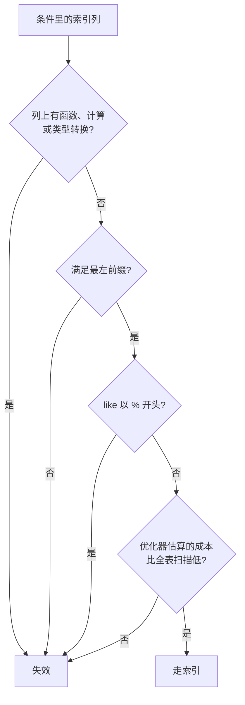

# 索引失效场景

> 频率：★★★ · 近两年出现在：字节（索引失效与慢 SQL 多次）、腾讯、美团（索引失效多次）、深信服、浩鲸、美图等 · 参考：[小林coding](https://xiaolincoding.com/mysql/index/index_lose.html)

## 一句话答案

常见原因：不满足最左前缀、对索引列做函数或计算、隐式类型转换、`like` 以 `%` 开头、`or` 两边有一边没有索引、优化器估算全表扫描更快。

## 展开（1–2 分钟能讲完）

根本原因只有一个：**B+ 树是按索引列的原始值排序的，只要查询条件没法利用这个顺序，就用不上索引。**

| 场景 | 例子 | 为什么失效 | 改法 |
|---|---|---|---|
| 不满足最左前缀 | 索引 (a, b)，`where b = 1` | b 只在 a 相同时有序 | 调整索引或查询 |
| 对索引列用函数 | `where date(create_time) = '2026-11-01'` | 函数结果的顺序和原值不同 | 改成范围：`create_time >= '2026-11-01' and create_time < '2026-11-02'`；8.0 可建函数索引 |
| 对索引列做计算 | `where id + 1 = 10` | 同上 | `where id = 9` |
| 隐式类型转换 | `phone` 是 varchar，`where phone = 13800000000` | MySQL 把字符串列转成数字比较，相当于对列用了函数 | 加引号：`'13800000000'` |
| like 左模糊 | `where name like '%三'` | 不知道从哪里开始找 | 用 `like '张%'`；全文搜索用 ES |
| or 有一边没索引 | `where a = 1 or c = 2`（c 没索引） | c 那边总要全表扫描 | 给 c 加索引，或改成 `union` |
| 优化器认为全表更快 | 区分度很低，或要回表的行太多 | 回表的随机 IO 比全表顺序扫描还贵 | 用覆盖索引；检查统计信息 |

**注意反过来的情况**：列是 int、传入字符串 `where id = '5'` **不会**失效，因为转换的是常量，不是列。

## 图解

## 追问链

- **优化器为什么会选错索引？** 它靠统计信息（索引的基数）估算扫描行数，统计信息是采样得到的，可能不准。可以 `analyze table` 重新统计，或用 `force index` 强制指定。携程面试问过「优化器选错索引怎么办」。
- **`!=`、`not in`、`is null` 一定失效吗？** 不一定，取决于优化器估算。`is null` 可以走索引；`!=` 和 `not in` 如果符合条件的行很少，也可能走索引范围扫描。不要背成「一定失效」。
- **order by 什么时候用不上索引？** 排序的列不满足最左前缀、升降序和索引不一致（8.0 支持降序索引）、排序前的过滤条件是范围查询。这时 explain 会出现 `Using filesort`。
- **怎么确认索引失效了？** 看 explain 的 `type` 是不是 `ALL`、`key` 是不是 NULL，见[慢查询排查](./slow-sql)。

## 我的项目里

TODO：项目里有没有遇到过索引失效？是哪种情况？
