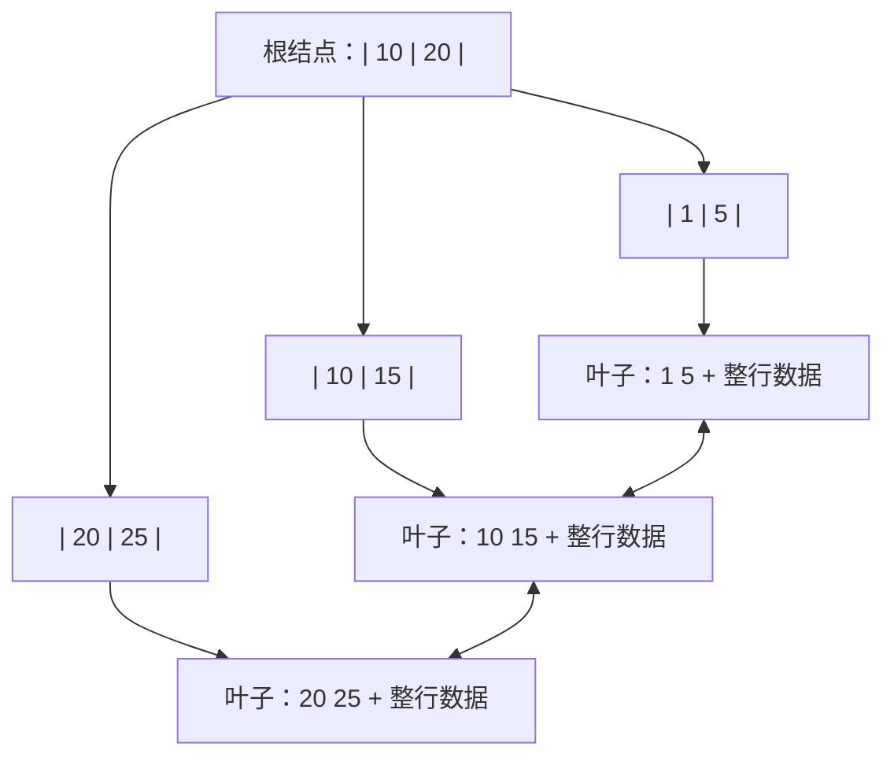

# 索引结构：为什么用 B+ 树

> 频率：★★★ · 近两年出现在：字节（B+ 树与 B 树多次）、腾讯（B+ 树与 B 树）、阿里、顺丰、京东、招银、小红书（B+ 树容量）等 · 参考：[小林coding](https://xiaolincoding.com/mysql/index/why_index_chose_bpuls_tree.html)

## 一句话答案

B+ 树非叶子结点只存键，一页能放更多键，树更矮（三层能存约两千万行），IO 次数少；数据都在叶子结点且用链表连接，范围查询快。B 树非叶子结点也存数据，哈希索引不支持范围查询。

## 展开（1–2 分钟能讲完）

数据库的数据在磁盘上，**索引结构要解决的核心问题是减少磁盘 IO**。InnoDB 以「页」为单位读写，一页默认 16 KB，B+ 树的一个结点就是一页。

B+ 树的特点：

1. **非叶子结点只存索引键和子结点指针**，不存整行数据，所以一页能放很多键（扇出大），树很矮。
2. **所有数据都在叶子结点**，每次查询都走到叶子，查询时间稳定。
3. **叶子结点之间用双向链表连接**，范围查询找到起点后顺着链表扫就行。

**和其他结构的对比**：

| 结构 | 不选它的原因 |
|---|---|
| 哈希表 | 等值查询 O(1)，但不支持范围查询和排序（InnoDB 有自适应哈希索引作为补充） |
| 二叉搜索树 / 红黑树 | 每个结点只有两个分支，千万级数据要二十多层，每层一次 IO |
| B 树 | 非叶子结点也存数据，扇出变小、树更高；范围查询要在各层之间来回跳 |
| 跳表 | 层数比 B+ 树高很多，IO 多（Redis 在内存里所以用跳表没问题） |

## 图解

**三层 B+ 树能存多少行？**

- 非叶子结点：主键 bigint 8 字节 + 指针 6 字节 = 14 字节，一页约 16 KB ÷ 14 ≈ **1170** 个指针。
- 叶子结点：假设一行 1 KB，一页存 **16** 行。
- 三层：1170 × 1170 × 16 ≈ **2190 万行**。查任意一行只要 3 次 IO，而根结点和第二层通常常驻内存，实际只要 1 次磁盘 IO。

## 追问链

- **为什么主键推荐用自增 id？** 新数据总是追加在最后一页，不会造成页分裂；UUID 这种随机主键会插到中间，频繁页分裂、产生碎片，而且占空间更大（二级索引叶子都要存主键）。
- **数据超过两千万就必须分表吗？** 不是硬性规定。行更小的话一页能存更多行；而且只要上层在内存里，四层的代价也不大。是否分表要看实际的查询性能和写入压力，见[分库分表](./sharding)。
- **B+ 树插入时怎么保持平衡？** 页满了就分裂成两页，把中间的键提升到父结点；删除时页太空会合并。
- **索引越多越好吗？** 不是。每个索引都是一棵 B+ 树，写入时都要维护，还占空间。区分度低的列（如性别）建索引意义不大。

## 我的项目里

TODO：项目里的主键用的是自增还是雪花 id？为什么？
