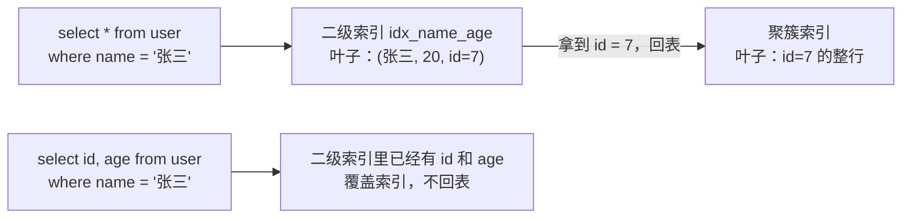

# 聚簇索引、回表、覆盖索引、最左前缀、索引下推

> 频率：★★★ · 近两年出现在：字节（联合索引、覆盖索引、回表多次）、腾讯云智（索引下推）、美团（聚簇索引）、顺丰（最左匹配）、阿里、小红书等 · 参考：[小林coding](https://xiaolincoding.com/mysql/index/index_interview.html)

## 一句话答案

InnoDB 主键索引的叶子存整行（聚簇），二级索引的叶子存主键值，查其他列要回表。查询的列都在索引里叫覆盖索引，不用回表。联合索引按最左前缀匹配；索引下推（ICP）在存储引擎层先用索引列过滤，减少回表次数。

## 展开（1–2 分钟能讲完）

以这张表为例：`user(id 主键, name, age, city)`，联合索引 `idx_name_age(name, age)`。

| 概念 | 说明 | 例子 |
|---|---|---|
| **聚簇索引** | 主键索引，叶子结点存整行数据。一张表只有一个 | `where id = 5` 一次查完 |
| **二级索引** | 叶子结点存「索引列 + 主键值」 | `idx_name_age` 的叶子存 (name, age, id) |
| **回表** | 通过二级索引拿到主键，再到聚簇索引查整行 | `select * from user where name = '张三'` |
| **覆盖索引** | 要查的列都在二级索引里，不用回表。explain 显示 `Using index` | `select id, age from user where name = '张三'` |
| **最左前缀** | 联合索引按 (name, age) 排序：先按 name，name 相同再按 age。所以只有从最左列开始才能用上 | `where name = ? and age = ?` ✅；`where age = ?` ❌ |
| **索引下推** | 5.6 起，联合索引里能用来过滤的列，在存储引擎层先过滤，再回表。explain 显示 `Using index condition` | `where name like '张%' and age = 20`：先用 age 过滤掉不符合的，再回表 |

## 图解

**联合索引 (a, b, c) 的各种查询：**

| 条件 | 能用到的列 | 说明 |
|---|---|---|
| `a = 1` | a | |
| `a = 1 and b = 2 and c = 3` | a, b, c | 顺序写反也行，优化器会调整 |
| `b = 2 and c = 3` | 无 | 没有最左列（8.0.13 起特定情况下可能用跳跃扫描） |
| `a = 1 and c = 3` | a | c 不能用来定位，但可以靠索引下推过滤 |
| `a = 1 and b > 2 and c = 3` | a, b | b 是范围查询，b 之后的 c 不再有序 |
| `a = 1 order by b` | a，且排序不用 filesort | a 固定时 b 本身有序 |

## 追问链

- **联合索引的列顺序怎么设计？** 等值查询的列放前面，范围查询的列放后面；区分度高的列优先；兼顾排序和分组的需求；尽量让常用查询走覆盖索引。
- **为什么范围查询之后的列用不上？** 在 b > 2 的范围里，c 不是整体有序的，没法二分定位。（注：`>=`、`between`、`like '前缀%'` 在边界值上 c 仍可能部分有序，具体看 explain 的 key_len。）
- **二级索引为什么存主键而不存行的地址？** 行会因为页分裂移动位置，存主键就不用在移动时更新所有二级索引。
- **没有主键的表怎么办？** InnoDB 会选第一个非空的唯一索引做聚簇索引；都没有就生成一个隐藏的 6 字节 `row_id`。
- **select * 为什么不推荐？** 用不上覆盖索引、多传数据、表结构变化时容易出错。
- **怎么判断用没用上索引、用了几列？** 看 explain 的 `key` 和 `key_len`，见[慢查询排查](./slow-sql)。

## 我的项目里

TODO：项目里建了哪些联合索引？列的顺序是怎么定的？
