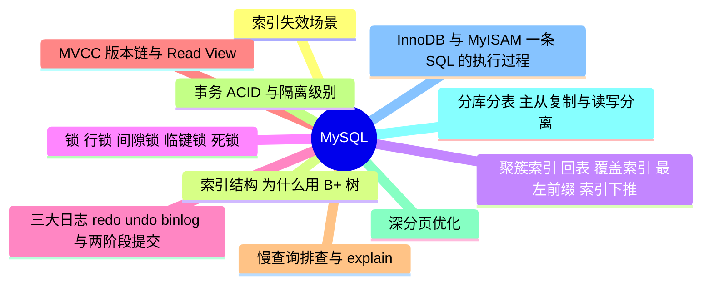

# MySQL

> 进度：11 / 11 条已写完。本页由 `tools/gen_index.py` 生成，改条目后重新运行即可。

## 知识地图

## 条目（按频率排序）

频率按 2025–2026 年后端面经里出现的次数估计：★★★ 几乎每场都可能问，★★ 经常问，★ 偶尔问。

| 知识点 | 频率 | 状态 | 一句话答案 |
|---|---|---|---|
| [索引失效场景](./index-failure) | ★★★ | ✅ | 常见原因：不满足最左前缀、对索引列做函数或计算、隐式类型转换、like 以 % 开头、or 两边有一边没有索引、优化器估算全表扫描更快。 |
| [索引结构：为什么用 B+ 树](./index-structure) | ★★★ | ✅ | B+ 树非叶子结点只存键，一页能放更多键，树更矮（三层能存约两千万行），IO 次数少；数据都在叶子结点且用链表连接，范围查询快。B 树非叶子结点也存数据，哈希索引不支持范围查询。 |
| [聚簇索引、回表、覆盖索引、最左前缀、索引下推](./index-types) | ★★★ | ✅ | InnoDB 主键索引的叶子存整行（聚簇），二级索引的叶子存主键值，查其他列要回表。查询的列都在索引里叫覆盖索引，不用回表。联合索引按最左前缀匹配；索引下推（ICP）在存储引擎层先用索引列过滤，减少回表次数。 |
| [锁：行锁、间隙锁、临键锁、死锁](./locks) | ★★★ | ✅ | InnoDB 的行锁加在索引上；记录锁锁一行，间隙锁锁区间防止插入，临键锁 = 记录锁 + 间隙锁，是可重复读下的默认加锁单位。没走索引的更新会锁住全表。 |
| [三大日志：redo、undo、binlog 与两阶段提交](./logs) | ★★★ | ✅ | redo log 是 InnoDB 的物理日志，保证崩溃恢复（WAL）；undo log 记录旧版本，用于回滚和 MVCC；binlog 是 Server 层的逻辑日志，用于主从复制和数据恢复。两阶段提交（redo prepare → 写 binlog → redo commit）保证两份日志一致。 |
| [MVCC：版本链与 Read View](./mvcc) | ★★★ | ✅ | 每行有隐藏列 trx_id 和 roll_pointer，旧版本通过 undo log 串成版本链。快照读时用 Read View（活跃事务列表、最小和最大事务 id）判断哪个版本可见。读已提交每次查询都生成 Read View，可重复读只在第一次查询时生成。 |
| [慢查询排查与 explain](./slow-sql) | ★★★ | ✅ | 开慢查询日志找出慢 SQL，用 explain 看 type（至少到 range）、key、rows、Extra（出现 Using filesort、Using temporary 要警惕）；优化手段：加合适的索引、用覆盖索引、避免 select *、拆分大查询。 |
| [事务 ACID 与隔离级别](./transaction-isolation) | ★★★ | ✅ | 四个隔离级别：读未提交、读已提交、可重复读（InnoDB 默认）、串行化，分别解决脏读、不可重复读、幻读。原子性靠 undo log，持久性靠 redo log，隔离性靠锁和 MVCC。 |
| [深分页优化](./deep-pagination) | ★★☆ | ✅ | limit 100000, 10 要扫描并丢弃前 10 万行。优化：记住上一页最后的 id，用 where id > last_id limit 10（游标分页）；或者先用覆盖索引查出 id，再 join 回表取整行。 |
| [分库分表、主从复制与读写分离](./sharding) | ★★☆ | ✅ | 单表数据量太大或单库扛不住写入时考虑分库分表。分片键选查询最频繁的字段（如用户 id），带来的问题：跨分片查询、分布式事务、全局 id。主从复制靠 binlog，读写分离要处理主从延迟。 |
| [InnoDB 与 MyISAM、一条 SQL 的执行过程](./engine) | ★☆☆ | ✅ | InnoDB 支持事务、行锁、外键、崩溃恢复，是默认引擎；MyISAM 只有表锁、不支持事务。SQL 的执行过程：连接器 → 解析器 → 优化器 → 执行器 → 存储引擎。 |
