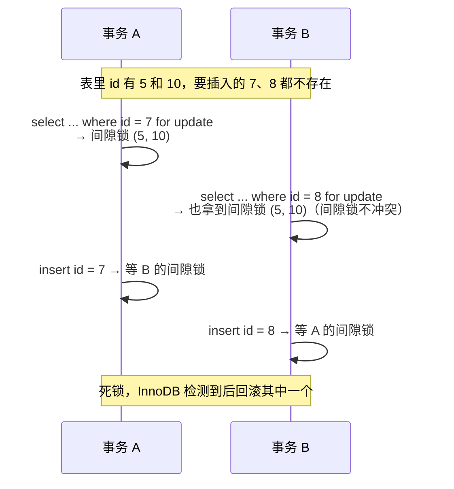

# 锁：行锁、间隙锁、临键锁、死锁

> 频率：★★★ · 近两年出现在：字节（间隙锁、幻读多次）、腾讯（InnoDB 加锁）、美团、腾讯音乐（库存扣减）、SHEIN（数据库死锁）、xTransfer 等 · 参考：[小林coding](https://xiaolincoding.com/mysql/lock/how_to_lock.html)

## 一句话答案

InnoDB 的行锁加在索引上；记录锁锁一行，间隙锁锁区间防止插入，临键锁 = 记录锁 + 间隙锁，是可重复读下的默认加锁单位。没走索引的更新会锁住全表。

## 展开（1–2 分钟能讲完）

**按粒度分：**

| 级别 | 锁 | 说明 |
|---|---|---|
| 全局 | 全局读锁 `FLUSH TABLES WITH READ LOCK` | 全库备份时用 |
| 表级 | 表锁、元数据锁（MDL）、意向锁、AUTO-INC 锁 | MDL：改表结构时加写锁，会被长事务阻塞；意向锁：加行锁前先在表上加意向锁，让加表锁时不用逐行检查 |
| 行级 | 记录锁、间隙锁、临键锁、插入意向锁 | 加在**索引**上 |

**行锁的三种形态**（假设索引上有 5、10、15 三个值）：

- **记录锁**：锁住 10 这一条。
- **间隙锁**：锁住 (5, 10) 这个开区间，**不让别人往里插入**。间隙锁之间不冲突，两个事务可以同时持有同一个间隙的锁。
- **临键锁**：(5, 10]，左开右闭，记录锁 + 前面的间隙。

**可重复读下的加锁规则**（简化版）：

| 查询 | 加什么锁 |
|---|---|
| 唯一索引等值查询，记录存在 | 只锁这一行（退化成记录锁） |
| 唯一索引等值查询，记录不存在 | 锁所在的间隙（退化成间隙锁） |
| 非唯一索引等值查询 | 符合的记录加临键锁，再加上后面一个间隙锁 |
| 范围查询 | 扫描到的范围都加临键锁 |
| **没走索引** | **扫描到的每一行都加临键锁，相当于锁全表** |

读已提交级别下基本只有记录锁，没有间隙锁。

## 图解

**经典死锁：两个事务先各自拿到间隙锁，再互相等对方插入**

这正是「先查不存在再插入」这种防重复写法的常见坑。改用唯一索引 + 直接 insert，捕获重复键异常更好。

## 追问链

- **update 没走索引会怎样？** 全表每一行都加临键锁，等于锁表，其他事务的写全部被阻塞。可以开 `sql_safe_updates`，让不带索引条件的 update 直接报错。
- **数据库死锁怎么排查？** `show engine innodb status` 看 `LATEST DETECTED DEADLOCK`，能看到两个事务各自持有和等待的锁、执行的 SQL。InnoDB 默认开启死锁检测，会回滚代价小的事务；没检测到的靠 `innodb_lock_wait_timeout`（默认 50 秒）超时。
- **怎么避免死锁？** 所有事务按相同顺序访问数据；事务尽量短；加锁的查询要走索引；考虑改成读已提交级别减少间隙锁。
- **库存扣减怎么防超卖？**
  - 悲观：`select stock ... for update` 锁住再扣。
  - 乐观：`update t set stock = stock - 1 where id = ? and stock > 0`，看影响行数，这一条语句本身就是原子的。
  - 带版本号：`where version = ?`，失败重试。
  - 高并发下先在 Redis 扣，见[秒杀](../11-distributed/seckill)。
- **加了 MDL 锁会出什么事？** 一个长事务查着某张表时去改表结构，`alter` 要等 MDL 写锁；之后这张表所有的查询都排在它后面，整张表不可用。改表前先查有没有长事务。
- **乐观锁和悲观锁怎么选？** 冲突少用乐观锁（失败重试的代价小）；冲突多用悲观锁（避免大量重试）。

## 我的项目里

TODO：项目里有没有 `for update` 或乐观锁？防重复插入是怎么做的？
