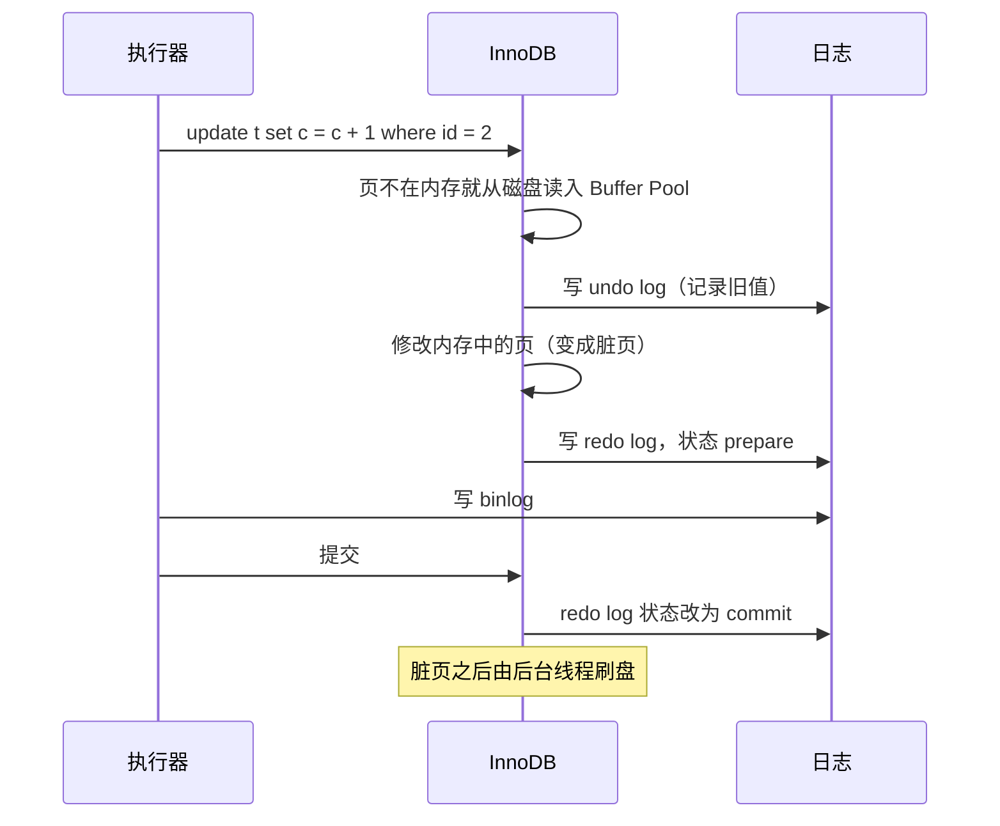

# 三大日志：redo、undo、binlog 与两阶段提交

> 频率：★★★ · 近两年出现在：字节（binlog 与 redo 两阶段提交、MySQL 日志）、美团（日志顺序、binlog 模式）、浩鲸（三种日志）等 · 参考：[小林coding](https://xiaolincoding.com/mysql/log/how_update.html)

## 一句话答案

redo log 是 InnoDB 的物理日志，保证崩溃恢复（WAL）；undo log 记录旧版本，用于回滚和 MVCC；binlog 是 Server 层的逻辑日志，用于主从复制和数据恢复。两阶段提交（redo prepare → 写 binlog → redo commit）保证两份日志一致。

## 展开（1–2 分钟能讲完）

| | redo log | undo log | binlog |
|---|---|---|---|
| 属于 | InnoDB | InnoDB | Server 层，所有引擎都有 |
| 内容 | 物理日志：某页某处改成了什么 | 逻辑上的反向操作 / 旧版本 | 逻辑日志：SQL 语句或行的变化 |
| 用途 | 崩溃恢复 | 回滚、MVCC | 主从复制、按时间点恢复 |
| 写法 | 固定大小，循环写 | 随事务产生，由 purge 清理 | 追加写，写满一个文件换下一个 |

**为什么要 redo log（WAL，先写日志）？** 修改数据时先改内存里的页（Buffer Pool），再把改动顺序写进 redo log 就算提交成功，脏页之后再慢慢刷到磁盘。把随机写变成了顺序写；宕机后用 redo log 把没刷盘的修改重做一遍。

**刷盘参数（俗称「双 1」）：**

- `innodb_flush_log_at_trx_commit`：1 = 每次提交都刷盘（默认，最安全）；2 = 写到操作系统缓存，每秒刷盘；0 = 每秒写一次。
- `sync_binlog`：1 = 每次提交都刷盘；N = 每 N 次提交刷一次。

两个都设成 1 最安全，但最慢。

## 图解

**一条 update 的完整过程和两阶段提交：**

**为什么需要两阶段提交？** 如果分开写，任何一个写完另一个没写时宕机，就会不一致：

- 先写 redo、再写 binlog，中间宕机：主库恢复后有这条修改，但 binlog 没有，**从库少了这条**。
- 先写 binlog、再写 redo，中间宕机：主库恢复后没有这条修改，但**从库多了这条**。

**崩溃恢复时怎么判断：** 找到 prepare 状态的 redo，用里面的事务 id（XID）去 binlog 里找。binlog 里有完整的这个事务就提交，没有就回滚。

## 追问链

- **binlog 的三种格式？**
  - STATEMENT：记 SQL 原文。日志小，但 `now()`、`uuid()` 这类函数会导致主从不一致。
  - ROW：记录每一行改前改后的值。最安全，8.0 默认，但批量更新时日志很大。
  - MIXED：一般用 STATEMENT，可能不安全时自动切 ROW。
- **有了 binlog 为什么还要 redo log？** binlog 没有记录「哪些修改已经刷到磁盘」，不能用来做崩溃恢复；而且 redo log 是物理日志，恢复更快。
- **有了 redo log 为什么还要 binlog？** redo log 循环写，旧的会被覆盖，不能用来恢复任意时间点的数据；它也只属于 InnoDB，不能直接用于主从复制。
- **redo log 写满了怎么办？** 有 write pos（写到哪）和 checkpoint（刷盘到哪）两个位置。写满时必须先推进 checkpoint，把对应的脏页刷盘，这期间更新会被阻塞。
- **组提交是什么？** 多个事务的 redo 和 binlog 合并成一次刷盘，减少 IO，「双 1」配置下也能有不错的性能。
- **Canal 同步缓存靠的就是 binlog**，见[缓存一致性](../07-redis/cache-consistency)。

## 我的项目里

TODO：项目有没有用 binlog 做数据同步？数据误删能恢复到哪个时间点？
