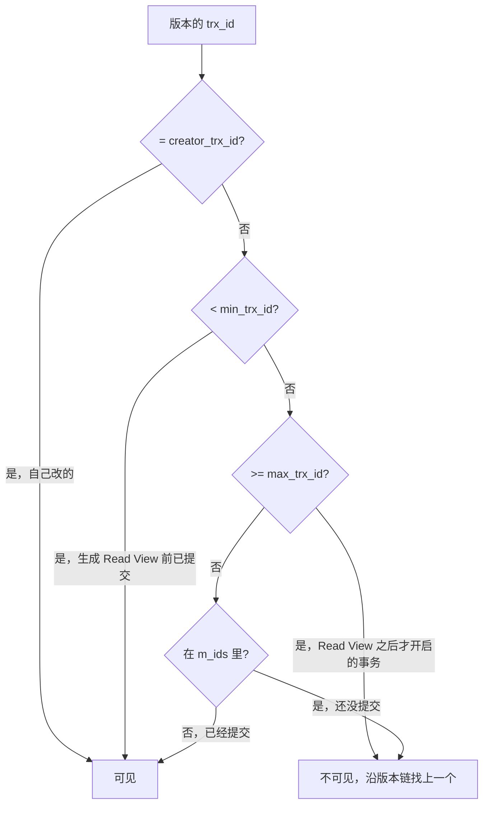
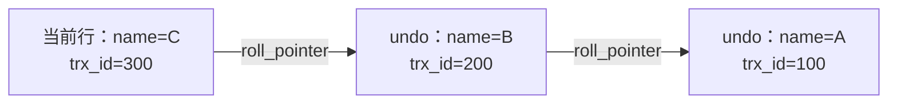

# MVCC：版本链与 Read View

> 频率：★★★ · 近两年出现在：字节（MVCC 多次）、美团（MVCC 多次）、拼多多、顺丰、超聚变、小红书等 · 参考：[小林coding](https://xiaolincoding.com/mysql/transaction/mvcc.html)

## 一句话答案

每行有隐藏列 `trx_id` 和 `roll_pointer`，旧版本通过 undo log 串成版本链。快照读时用 Read View（活跃事务列表、最小和最大事务 id）判断哪个版本可见。读已提交每次查询都生成 Read View，可重复读只在第一次查询时生成。

## 展开（1–2 分钟能讲完）

MVCC（多版本并发控制）让**读不加锁、读写不冲突**：写操作生成新版本，读操作去找一个自己「应该看到」的旧版本。

**三个组成部分：**

1. **隐藏列**：每行有 `trx_id`（最后修改它的事务 id）和 `roll_pointer`（指向 undo log 里的上一个版本）。
2. **版本链**：每次修改，旧版本写进 undo log，新版本的 `roll_pointer` 指向它，串成一条链。
3. **Read View**：快照读时生成，包含四个字段：
   - `m_ids`：生成时还活跃（未提交）的事务 id 列表
   - `min_trx_id`：`m_ids` 里最小的
   - `max_trx_id`：生成时**下一个将要分配**的事务 id
   - `creator_trx_id`：自己的事务 id

**可见性判断**：从版本链最新的版本开始，按下面的规则逐个检查，第一个可见的就是结果。

## 图解

**版本链示例**：

假设事务 200 已经提交、事务 300 还没提交（它正持有这一行的锁），这时一个只读事务生成的 Read View 是 `m_ids=[300]`，`min=300`，`max=301`：版本 300 在活跃列表里，不可见；沿版本链找到版本 200，它小于 min，说明生成 Read View 前已经提交，可见。所以读到 `name=B`。

**RC 和 RR 的区别只在生成时机**：

- **读已提交**：每次 select 都生成新的 Read View，所以能看到别人刚提交的数据（不可重复读）。
- **可重复读**：事务里第一次 select 时生成，之后一直复用，所以多次读结果一样。

## 追问链

- **快照读和当前读？** 普通 select 是快照读，走 MVCC；`select ... for update`、`select ... lock in share mode`、`update`、`delete`、`insert` 是当前读，读最新版本并加锁。
- **MVCC 能完全解决幻读吗？** 只能解决快照读的幻读；当前读要靠临键锁；混用时仍可能出现，见[隔离级别](./transaction-isolation)。
- **undo log 什么时候删除？** 当没有任何活跃的 Read View 还需要某个版本时，后台 purge 线程会清理。所以**长事务会让 undo log 一直堆积**。
- **事务 id 什么时候分配？** 开启事务时不分配，第一次执行修改语句时才分配；只读事务不分配真实的事务 id。
- **读未提交和串行化用 MVCC 吗？** 不用。读未提交直接读最新版本；串行化对读也加锁。

## 我的项目里

TODO：能不能结合项目说一个「两个请求同时读写同一行」的场景，当时是怎么保证正确的？
