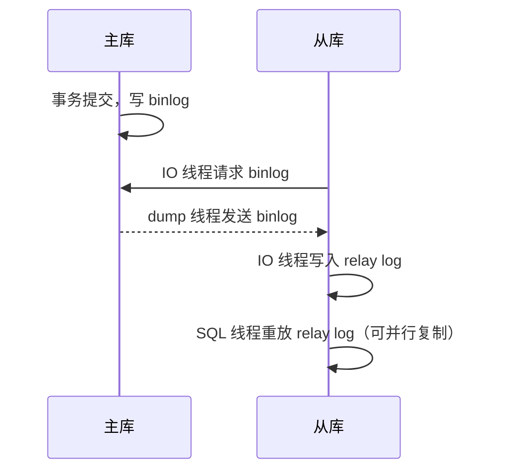

# 分库分表、主从复制与读写分离

> 频率：★★ · 近两年出现在：美团（分库分表、跨片查询、分片键多次）、阿里（订单表分片、百万 QPS）、字节（分库分表）、美团（MySQL 主从同步）等 · 参考：[JavaGuide](https://javaguide.cn/high-performance/read-and-write-separation-and-library-subtable.html)

## 一句话答案

单表数据量太大或单库扛不住写入时考虑分库分表。分片键选查询最频繁的字段（如用户 id），带来的问题：跨分片查询、分布式事务、全局 id。主从复制靠 binlog，读写分离要处理主从延迟。

## 展开（1–2 分钟能讲完）

**先说顺序**：能不分就不分。优化 SQL 和索引 → 加缓存 → 读写分离 → 归档历史数据 → 最后才分库分表。

**怎么分：**

| 方式 | 做法 | 解决什么 |
|---|---|---|
| 垂直分库 | 按业务拆：用户库、订单库、商品库 | 单库连接数和写入压力 |
| 垂直分表 | 大表按列拆：常用字段和大字段（详情、备注）分开 | 单行太大 |
| 水平分表 | 同一张表按分片键拆成多张结构相同的表 | 单表行数太多 |
| 水平分库 | 拆出来的表放到不同的库、不同的机器 | 单机的写入和存储上限 |

**分片键和路由：**

- 分片键选**查询条件里最常出现**的字段。订单表通常按 `user_id`，这样「查我的订单」只落在一个分片。
- 路由算法：取模（简单、均匀，但扩容要迁移大量数据）、范围（按时间或 id 段，扩容方便，但新数据集中在最后一个分片）、一致性哈希。
- 常用中间件：ShardingSphere（客户端 JDBC 或代理模式）。

**带来的问题和解法：**

| 问题 | 解法 |
|---|---|
| 不带分片键的查询（商家查订单） | 按商家 id 再存一份（异构索引表），或同步到 ES |
| 跨分片分页、排序、聚合 | 见[深分页](./deep-pagination)；汇总数据走离线或 ES |
| 跨库 join | 应用层分两次查；冗余字段；广播表（小的字典表每个库都放一份） |
| 分布式事务 | 尽量让一个事务落在同一分片；否则用[最终一致方案](../11-distributed/distributed-transaction) |
| 全局唯一 id | 雪花算法、号段模式，见[分布式 id](../11-distributed/id-generator) |
| 扩容 | 一开始就分足够多的逻辑表（如 1024 张）映射到少量物理库；翻倍扩容只迁移一半数据 |

## 图解

**主从复制：**

复制模式：**异步**（默认，主库不等从库，宕机可能丢数据）、**半同步**（至少一个从库收到 binlog 才返回）、组复制（MGR）。

## 追问链

- **主从延迟的原因？** 从库机器差；主库大事务；从库上有慢查询抢资源；从库单线程重放（5.7 起支持按组提交并行复制）。
- **主从延迟怎么解决读不到刚写的数据？**
  - 写后立即读的请求强制走主库。
  - 写完在缓存里标记这个 key，一段时间内读主库。
  - 半同步复制。
  - 业务上接受短暂延迟，比如提示「处理中」。
- **分片键怎么选？** 区分度高、分布均匀、是最主要的查询条件、基本不会修改。订单可以把 user_id 的后几位嵌进订单号，这样按订单号也能算出分片。
- **单表多少行需要分？** 常见说法是两千万左右，来自[三层 B+ 树的估算](./index-structure)，但不是硬性标准，以实际性能为准。
- **数据迁移怎么不停机？** 双写（新旧库同时写）→ 历史数据迁移 → 校验一致 → 读流量逐步切到新库 → 停止旧库写入。

## 我的项目里

TODO：项目数据量多大？如果要分库分表，分片键选什么？
