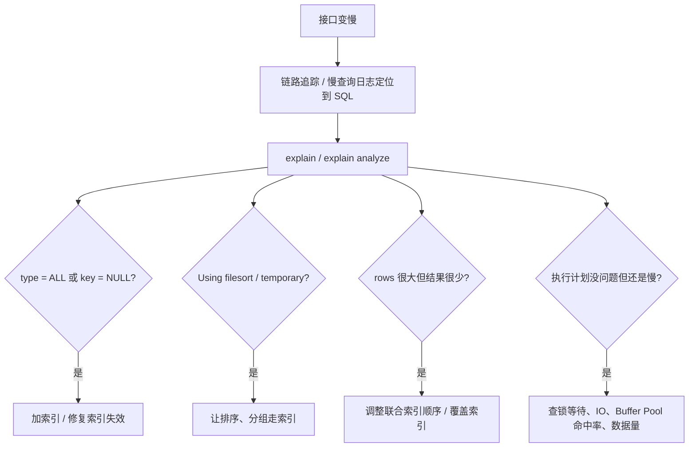

# 慢查询排查与 explain

> 频率：★★★ · 近两年出现在：字节（慢查询多次）、美团（慢 SQL 排查）、京东、上海星丰雨（800 ms 优化到 100 ms）、招银（卡号加日期查询变慢）、用友等 · 参考：[JavaGuide](https://javaguide.cn/database/mysql/mysql-query-execution-plan.html)

## 一句话答案

开慢查询日志找出慢 SQL，用 explain 看 `type`（至少到 `range`）、`key`、`rows`、`Extra`（出现 `Using filesort`、`Using temporary` 要警惕）；优化手段：加合适的索引、用覆盖索引、避免 `select *`、拆分大查询。

## 展开（1–2 分钟能讲完）

**排查步骤：**

1. **找到慢 SQL**：开启 `slow_query_log`，设置 `long_query_time`（比如 1 秒），用 `mysqldumpslow` 或 `pt-query-digest` 汇总；线上也可以从 APM、链路追踪里找。
2. **看执行计划**：`explain`，8.0.18 起可以用 `explain analyze` 看实际执行的耗时和行数。
3. **判断原因**：没走索引、走错索引、回表太多、排序或分组用了临时表、扫描行数太多、锁等待。
4. **优化并验证**：改完再 explain，对比耗时。

**explain 重点看的列：**

| 列 | 含义 | 关注什么 |
|---|---|---|
| `type` | 访问方式，从好到差：`const` > `eq_ref` > `ref` > `range` > `index` > `ALL` | 至少到 `range`；`ALL` 是全表扫描，`index` 是全索引扫描 |
| `key` | 实际用的索引 | NULL 表示没用索引 |
| `key_len` | 用到的索引长度 | 判断联合索引用了几列 |
| `rows` | 估计扫描的行数 | 越少越好 |
| `filtered` | 按条件过滤后剩下的比例 | 很低说明扫了很多无用行 |
| `Extra` | 额外信息 | `Using index` 好（覆盖索引）；`Using index condition` 是索引下推；`Using filesort`、`Using temporary` 要优化 |

**常见优化手段：**

- 建合适的联合索引，让查询走[覆盖索引](./index-types)。
- 避免[索引失效](./index-failure)。
- `order by`、`group by` 的列利用索引的有序性。
- [深分页](./deep-pagination)改成游标分页。
- 大查询拆小，大 `in` 列表分批。
- join 的关联列要有索引，小表驱动大表。
- 实在优化不了：加缓存、读写分离、冗余字段、[分库分表](./sharding)。

## 图解

## 追问链

- **准备一个自己的优化故事**：面试官很爱问「你优化过的最慢的 SQL」。按这个结构讲：现象（接口 800 ms）→ 定位（链路追踪发现慢在哪条 SQL）→ 原因（explain 显示全表扫描 / filesort）→ 方案（建了什么索引、为什么这个顺序）→ 结果（降到多少）。
- **`count(*)`、`count(1)`、`count(列)` 有什么区别？** 前两个一样，统计所有行，InnoDB 会挑最小的索引来扫；`count(列)` 只统计这一列不为 NULL 的行。InnoDB 没有像 MyISAM 那样存总行数，大表要计数可以用 Redis 或单独的计数表。
- **join 怎么优化？** 被驱动表的关联列要有索引（这样走 Index Nested-Loop Join）；8.0.18 起没有索引时用 Hash Join；让结果集小的表做驱动表。
- **数据库 CPU 或内存很高怎么查？** `show processlist` 看正在执行的 SQL 和状态；`information_schema.innodb_trx` 查长事务；看 Buffer Pool 命中率。
- **银行卡号 + 日期的查询变慢了（招银问过）？** 先 explain 看有没有用上 (卡号, 日期) 的联合索引；检查卡号字段类型是否导致隐式转换；看日期条件有没有对列用函数；数据量增长后考虑按时间分区或归档。

## 我的项目里

TODO：写出自己的一个 SQL 优化案例：现象 → 定位 → 原因 → 方案 → 结果。
