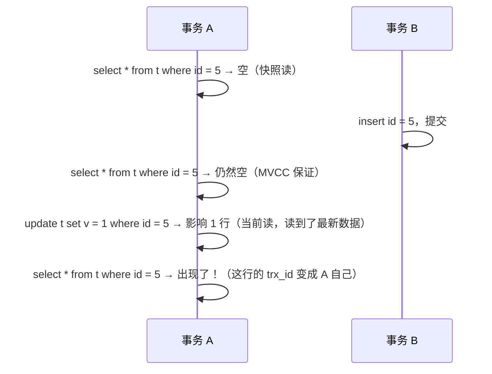

# 事务 ACID 与隔离级别

> 频率：★★★ · 近两年出现在：字节（隔离级别多次）、美团（隔离级别与幻读多次）、阿里、恒生、小红书（幻读）、招银等 · 参考：[小林coding](https://xiaolincoding.com/mysql/transaction/mvcc.html)

## 一句话答案

四个隔离级别：读未提交、读已提交、可重复读（InnoDB 默认）、串行化，分别解决脏读、不可重复读、幻读。原子性靠 undo log，持久性靠 redo log，隔离性靠锁和 MVCC。

## 展开（1–2 分钟能讲完）

**ACID 和各自的实现：**

| 特性 | 含义 | InnoDB 怎么实现 |
|---|---|---|
| 原子性 A | 要么全做，要么全不做 | undo log 记录修改前的值，失败时回滚 |
| 一致性 C | 数据从一个合法状态到另一个合法状态 | 由另外三个特性加上应用逻辑共同保证 |
| 隔离性 I | 并发事务互不干扰 | 锁 + MVCC |
| 持久性 D | 提交后不会丢 | redo log（崩溃后重做） |

**三种并发问题：**

- **脏读**：读到别的事务**还没提交**的数据。
- **不可重复读**：同一事务里两次读**同一行**，结果不同（被别人改了并提交）。
- **幻读**：同一事务里两次**按条件查询**，行数不同（被别人插入了并提交）。

**四个隔离级别：**

| 隔离级别 | 脏读 | 不可重复读 | 幻读 |
|---|---|---|---|
| 读未提交 | 有 | 有 | 有 |
| 读已提交（RC） | ✅ 解决 | 有 | 有 |
| 可重复读（RR，InnoDB 默认） | ✅ | ✅ | 大部分解决 |
| 串行化 | ✅ | ✅ | ✅ |

很多互联网公司把隔离级别改成 RC：并发更高、间隙锁少、死锁少，binlog 用 row 格式就不会有主从不一致的问题。

## 图解

**RR 能解决幻读吗？大部分能，但有例外：**

- **快照读**（普通 select）靠 [MVCC](./mvcc) 读同一个版本，不会幻读。
- **当前读**（`select ... for update`、`update`、`delete`）靠[临键锁](./locks)锁住范围，别人插不进来，也不会幻读。
- 但像上图这样**先快照读、再当前读**，就会出现幻读。要完全避免，在事务一开始就用 `select ... for update`。

## 追问链

- **每种并发问题举个例子？** 脏读：A 给账户加了 100 没提交，B 读到加后的余额，A 回滚。不可重复读：A 两次读同一个订单状态，中间 B 把它改成已支付。幻读：A 统计未支付订单数，中间 B 插入一条新订单。
- **RC 和 RR 在实现上的区别？** 都用 MVCC，区别是 Read View 的生成时机：RC 每次 select 都生成新的，RR 只在第一次 select 时生成。另外 RC 基本不加间隙锁。
- **怎么查看和修改隔离级别？** `select @@transaction_isolation;`，`set session transaction isolation level read committed;`。
- **长事务有什么问题？** 占着锁不放，阻塞别人；undo log 不能清理，越积越多；主从延迟。见 Spring 的[大事务问题](../05-spring/transaction)。

## 我的项目里

TODO：项目里的隔离级别是什么？有没有需要 `for update` 的地方？
