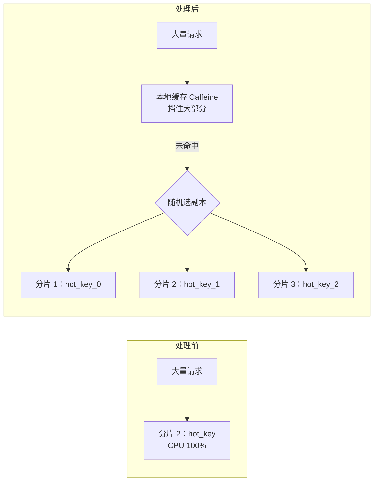

# 大 key 与热 key

> 频率：★★★ · 近两年出现在：字节（big key、hot key 多次）、美团（点赞热 key、Redis 热点）、腾讯（冷热 key 预热）、字节抖音平台等 · 参考：[小林coding](https://xiaolincoding.com/redis/base/redis_interview.html)

## 一句话答案

大 key（单个 value 过大或集合元素过多）会导致阻塞、网络拥塞、迁移慢，用 `--bigkeys` 或 `MEMORY USAGE` 发现，拆分后用 `UNLINK` 异步删除。热 key 的访问集中在一个分片，用本地缓存、key 加随机后缀分散、读写分离。

## 展开（1–2 分钟能讲完）

### 大 key

**多大算大**：没有统一标准，常见的参考是 String 超过 10 KB，集合类元素超过 5000 个（阿里云的开发规范）。

**危害**：

- 操作耗时长，单线程的 Redis 整体被阻塞（`HGETALL`、`DEL` 一个百万元素的 Hash）。
- 网卡流量被打满：一个 1 MB 的 key 每秒访问 1000 次就是 1 GB/s。
- Cluster 里内存分布不均，迁移槽时卡住。
- 过期或淘汰时同步删除会卡顿。

**发现**：`redis-cli --bigkeys`（每种类型找最大的一个）、`--memkeys`、`MEMORY USAGE key`、离线分析 RDB 文件（不影响线上）。

**处理**：

- **拆分**：一个大 Hash 按字段哈希拆成多个小 Hash；大 String 拆成多段，或者只存必要字段。
- **删除**：用 `UNLINK` 异步删除；开启 `lazyfree-lazy-expire`、`lazyfree-lazy-eviction`，让过期和淘汰也异步删除；老版本用 `HSCAN` 分批删。
- **从源头避免**：不要把整个列表塞进一个 key，压缩 value。

### 热 key

**危害**：Cluster 中一个 key 只在一个分片上，这个分片的 CPU 和网卡被打满，其他分片很空闲。热点过期时还会[击穿](./cache-problems)。

**发现**：`redis-cli --hotkeys`（要求淘汰策略是 LFU）、`MONITOR` 抽样（影响性能，慎用）、客户端或代理层统计访问次数、业务预判（大促商品、明星微博）。

**处理**：

- **本地缓存**：应用内用 Caffeine 缓存热 key，几秒过期，请求根本不到 Redis。
- **打散**：把一个热 key 复制成 `key_0` 到 `key_N`，分布到不同分片，读时随机选一个；更新时要更新全部副本。
- **读写分离**：读请求分到多个从节点。
- **提前预热**：已知的活动热点提前加载。

## 图解

## 追问链

- **点赞系统怎么设计才不会有热 key？** 计数打散成多个 key 分别累加，读时求和，或者先在本地聚合，定期批量写入 Redis；明细用 Set 记录谁点过。直播间这种场景还可以合并写：客户端攒一批再上报。
- **本地缓存和 Redis 怎么保持一致？** 本地缓存设很短的过期时间，更新时通过发布订阅广播让各台机器删除，见[缓存一致性](./cache-consistency)。
- **为什么 `--hotkeys` 要求 LFU？** 它靠 LFU 的访问计数来判断热度，LRU 只记录了最后访问时间。
- **大 key 会影响主从复制吗？** 会，全量同步时 RDB 更大；对大 key 的修改如果以整个 key 传播，也会占用复制带宽。

## 我的项目里

TODO：项目里有没有大集合？热点数据是什么、怎么处理的？
