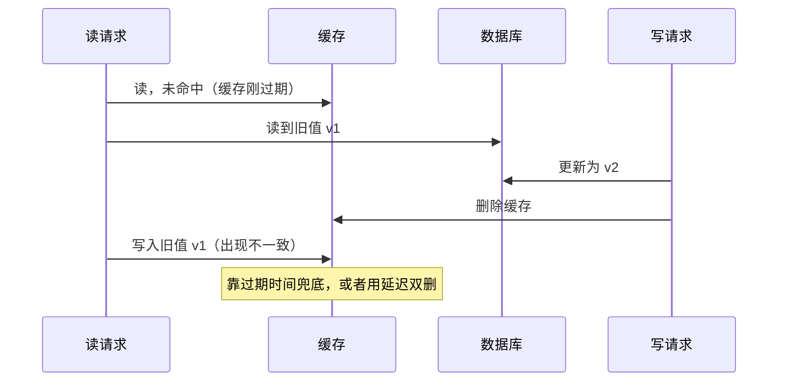
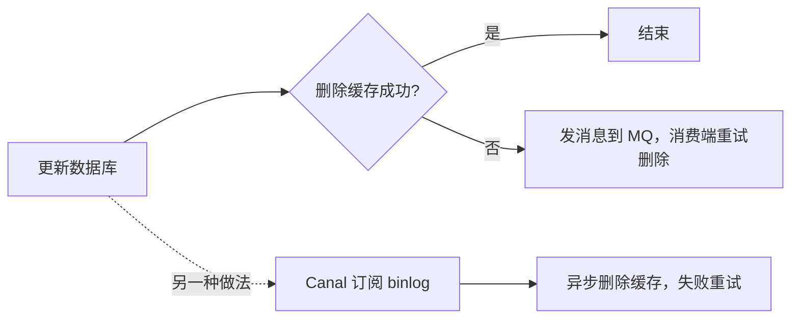

# 缓存与数据库一致性

> 频率：★★★ · 近两年出现在：字节、美团、腾讯、阿里、小红书、SHEIN、深信服、用友等，几乎每家都问 · 参考：[小林coding](https://xiaolincoding.com/redis/architecture/mysql_redis_consistency.html)

## 一句话答案

常用方案是 **Cache Aside**：读时先读缓存，没有再读库并写回缓存；写时**先更新数据库，再删除缓存**。删除失败用消息队列重试，或者订阅 binlog（Canal）异步删除；要求更强时用延迟双删。

## 展开（1–2 分钟能讲完）

缓存和数据库是两个系统，没有办法用一个事务同时更新，所以只能追求**最终一致**，并把不一致的时间窗口压到最小。

**读路径**：查缓存 → 命中就返回 → 没命中就查数据库，再把结果写进缓存（带过期时间）。

**写路径**有四种组合，只有一种合适：

| 方案 | 问题 |
|---|---|
| 先更新缓存，再更新数据库 | 数据库更新失败，缓存里就是脏数据 |
| 先更新数据库，再更新缓存 | 两个并发写的顺序可能交错，缓存最后留下旧值；而且写多读少时，频繁更新缓存是浪费 |
| 先删缓存，再更新数据库 | 删完缓存、还没更新数据库时，一个读请求把**旧值**读出来又写回缓存，之后缓存一直是旧的 |
| **先更新数据库，再删缓存** ✅ | 只有一种极端情况会出问题（见下图），而且概率很低 |

**为什么是「删除」而不是「更新」缓存？** 删除是幂等的，不怕并发写的顺序问题；而且懒加载，下次读到时才重新计算，避免缓存了没人读的数据。

## 图解

先更新数据库再删缓存，唯一的不一致场景：缓存刚好过期，读请求读到旧值后，**在写请求删除缓存之后**才把旧值写回去。这要求「读库 + 写缓存」比「写库 + 删缓存」还慢，实际很少发生。

**删除缓存失败怎么办？**

订阅 binlog 的好处是业务代码不用管删缓存，所有写库的地方都自动覆盖到。

## 追问链

- **为什么先更新库再删缓存，反过来有什么问题？** 见上表第三行：先删缓存会让并发的读请求把旧值写回去，而且这个窗口比较大（整个更新数据库的时间）。
- **延迟双删是什么？延迟时间怎么定？** 先删缓存 → 更新数据库 → 等一会儿再删一次。延迟时间要大于「一次读库 + 写缓存」的耗时，一般是几百毫秒，靠压测估计。缺点是延迟不好定，而且写请求变慢（通常放到异步线程或延迟消息里做）。
- **要求强一致怎么办？** 读写都加分布式锁（或者把同一个 key 的读写串行化），代价是性能大幅下降。真正要求强一致的数据（比如余额）一般不放缓存，直接读数据库。
- **多级缓存（Caffeine + Redis）怎么保证一致？** 更新时通过 MQ 或 Redis 的发布订阅广播，让每台机器删除自己的本地缓存；本地缓存的过期时间设得更短。
- **主从架构下读到旧数据？** 删除缓存后，读请求可能从还没同步的从库读到旧值写回缓存。可以让写后的短时间内强制读主库，或者在延迟双删的第二次删除里覆盖这个时间。

## 我的项目里

TODO：项目里哪些数据放了缓存？用的是哪种更新策略？有没有遇到过不一致？
